 
 

    

 
 

# 4.4. Mobile Applications UX/UI Design

Esta sección presenta la propuesta visual y de interacción de la aplicación nativa de SafeStep para Android (Kotlin y Jetpack Compose, `com.safestep.mobile`, versión 1.0.0). La aplicación está dirigida al mismo jugador que la aplicación web (ver 4.1 y 4.2) y reutiliza su API REST, de modo que cubre los mismos flujos de práctica y recompensa: registro e ingreso, recuperación de contraseña, simulaciones, progreso, tienda, cupones, carrito y pago. La administración del catálogo queda solo en la aplicación web porque es una tarea de escritorio que no necesita estar en el teléfono.

**Decisiones de diseño que se mantienen en todas las pantallas** (derivan de la guía de estilo de 4.1 y de la arquitectura de información de 4.2):

| Decisión | Aplicación en la aplicación móvil |
| --- | --- |
| Sistema de diseño | Material Design 3 con la paleta de la web: azul `#0369a1` como color primario, verde para el estado activo y para el acierto, rojo solo para errores. Hay tema claro y oscuro. |
| Navegación | Barra inferior con cinco destinos fijos (Inicio, Simulaciones, Progreso, Tienda, Perfil), al alcance del pulgar. Las pantallas de detalle (simulación, producto, carrito) muestran flecha de retorno y mantienen la barra para no perder el contexto. |
| Una tarea por pantalla | Cada paso de la simulación ocupa toda la pantalla: una pregunta y sus opciones, sin otros elementos que distraigan durante una emergencia simulada. |
| Retroalimentación inmediata | Al responder, la opción correcta se marca con un ícono de verificación, la elegida incorrectamente con un borde distinto y debajo aparece la explicación; el resultado final muestra la recompensa que acreditó el servidor. |
| Diseño inclusivo | Ningún estado depende solo del color (ícono, borde y texto acompañan al color); las áreas de toque respetan el mínimo de 48 dp que impone Material 3; los errores de formulario se muestran como texto junto al campo; la interfaz está en español e inglés; los textos usan escala tipográfica del sistema, que respeta el tamaño de letra que el usuario eligió. |
| Estados de espera y error | Los botones muestran un indicador de progreso y se desactivan mientras esperan al servidor, para evitar envíos dobles; cada pantalla de datos indica si está cargando, vacía o con error, y el error ofrece «Reintentar». |

## 4.4.1. Mobile Applications Wireframes

Los wireframes de la aplicación móvil definen la estructura de cada pantalla antes del tratamiento visual. Se dibujaron en escala de grises, con una trama de líneas en lugar de texto largo y de imágenes, y sobre un marco de 360 × 720 dp (el ancho de referencia de un teléfono Android). Los círculos rojos numerados señalan los elementos clave que se describen debajo de cada lámina. El nombre de cada wireframe (W-01 a W-16) se usa en los wireflows y en los mock-ups para poder seguir una pantalla a lo largo de las tres etapas.

Los textos de los wireframes están en inglés porque la captura final se tomó con el emulador en ese idioma; la aplicación incluye ambos idiomas.

### 4.4.1.1. Acceso y recuperación de contraseña (W-01 a W-03)

  

    <b>Gráfico 4.4.1</b>: Wireframes de ingreso, registro y recuperación de contraseña
  

  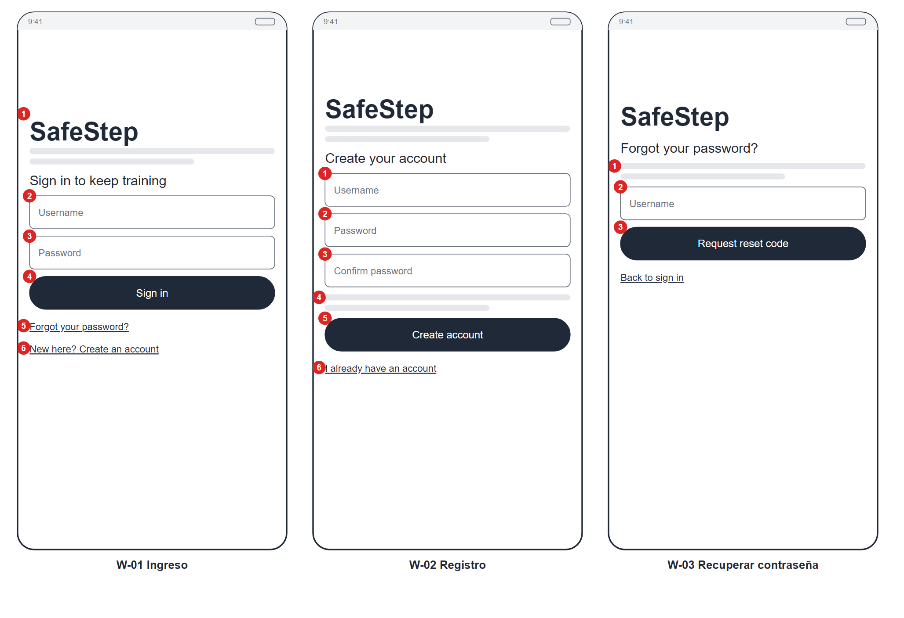
  

    <i><b>Fuente</b>: Elaboración propia.</i>
  

**Elementos clave**

- **W-01 Ingreso**: (1) marca y aviso del piloto; (2) usuario; (3) contraseña oculta; (4) botón principal «Iniciar sesión»; (5) enlace a recuperar contraseña; (6) enlace a crear una cuenta.
- **W-02 Registro**: (1) usuario; (2) contraseña; (3) confirmación de contraseña; (4) aviso de términos; (5) botón «Crear cuenta»; (6) enlace para volver a ingresar.
- **W-03 Recuperar contraseña** (dos etapas en la misma pantalla): (1) texto que explica qué se pide en esa etapa; (2) usuario, luego código; (3) nueva contraseña; (4) botón de confirmación.

### 4.4.1.2. Inicio y catálogo de simulaciones (W-04 a W-06)

  

    <b>Gráfico 4.4.2</b>: Wireframes de inicio, lista de simulaciones y detalle
  

  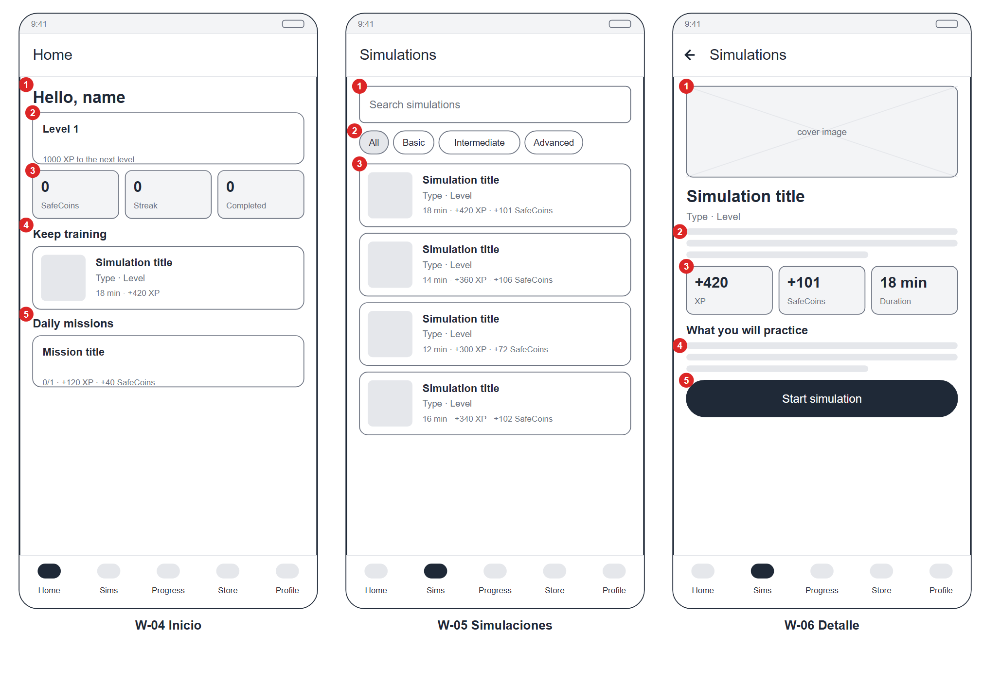
  

    <i><b>Fuente</b>: Elaboración propia.</i>
  

**Elementos clave**

- **W-04 Inicio**: (1) saludo; (2) nivel y experiencia que falta para el siguiente; (3) tres indicadores (SafeCoins, racha y simulaciones completadas); (4) «Sigue practicando», con la simulación sugerida; (5) misiones del día con su recompensa.
- **W-05 Simulaciones**: (1) búsqueda; (2) filtros por nivel y por tema que se desplazan en horizontal; (3) tarjetas con imagen, título, tema, nivel, duración y recompensa.
- **W-06 Detalle de simulación**: (1) imagen de portada; (2) descripción; (3) recompensa y duración; (4) lo que se practica; (5) botón «Iniciar simulación».

### 4.4.1.3. Simulación, retroalimentación y resultado (W-07 a W-09)

  

    <b>Gráfico 4.4.3</b>: Wireframes de un paso, de la respuesta y del resultado
  

  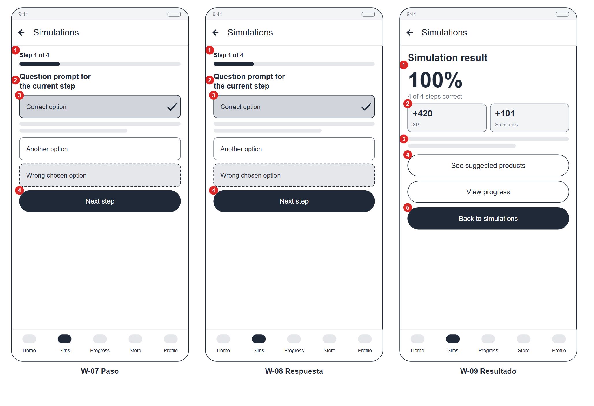
  

    <i><b>Fuente</b>: Elaboración propia.</i>
  

**Elementos clave**

- **W-07 Paso**: (1) número de paso y barra de avance; (2) enunciado de la situación; (3) opciones de respuesta, cada una de ancho completo.
- **W-08 Respuesta**: (1) avance actualizado; (2) mismo enunciado; (3) opción correcta marcada con verificación y la elegida por error con borde discontinuo, más la explicación; (4) botón «Siguiente paso» (en el último paso, «Finalizar simulación»).
- **W-09 Resultado**: (1) porcentaje de aciertos; (2) experiencia y SafeCoins que acreditó el servidor; (3) mensaje que explica la recompensa (por ejemplo, que se necesita 70 % para ganar monedas o que una repetición paga la mitad); (4) accesos a productos sugeridos y al progreso; (5) regreso a la lista.

### 4.4.1.4. Progreso y tienda (W-10 a W-12)

  

    <b>Gráfico 4.4.4</b>: Wireframes de progreso, tienda y cupones
  

  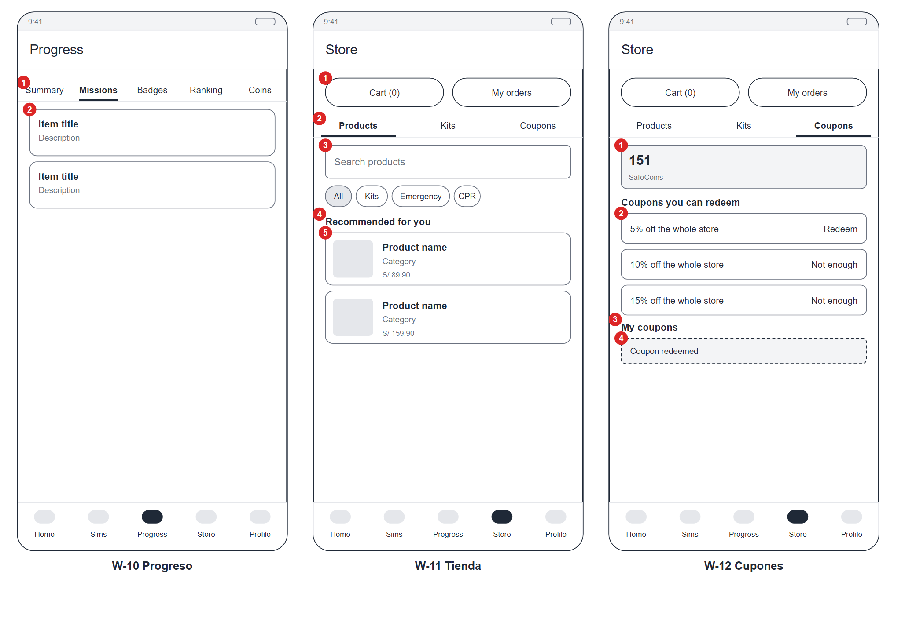
  

    <i><b>Fuente</b>: Elaboración propia.</i>
  

**Elementos clave**

- **W-10 Progreso**: (1) cinco pestañas (Resumen, Misiones, Insignias, Ranking y Monedas); (2) nivel, experiencia y SafeCoins; (3) actividad semanal en barras; (4) certificados obtenidos. Las demás pestañas repiten la estructura de lista de tarjetas.
- **W-11 Tienda**: (1) accesos al carrito y a los pedidos; (2) pestañas Productos, Kits y Cupones; (3) búsqueda; (4) productos recomendados según las simulaciones jugadas; (5) tarjeta de producto con imagen, nombre, categoría y precio.
- **W-12 Cupones**: (1) saldo de SafeCoins; (2) cupones que se pueden canjear, con el botón de canje activo solo si alcanza el saldo; (3) «Mis cupones»; (4) confirmación del canje.

### 4.4.1.5. Compra y perfil (W-13, W-14 y W-16)

  

    <b>Gráfico 4.4.5</b>: Wireframes de producto, carrito y perfil
  

  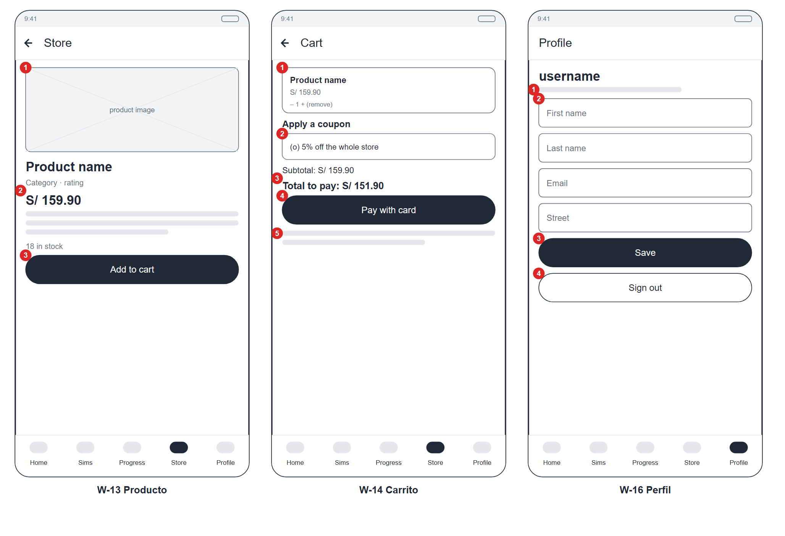
  

    <i><b>Fuente</b>: Elaboración propia.</i>
  

**Elementos clave**

- **W-13 Producto**: (1) imagen; (2) precio; (3) botón «Agregar al carrito».
- **W-14 Carrito**: (1) líneas con cantidad y botón para quitar; (2) selector de cupón (solo uno a la vez); (3) total ya con el descuento; (4) botón «Pagar con tarjeta»; (5) aviso de que el pago se hace en una página segura del procesador de pagos.
- **W-16 Perfil**: (1) usuario; (2) datos personales y dirección; (3) botón «Guardar»; (4) botón «Cerrar sesión».
- **W-15 Pago pendiente** (se muestra en 4.4.2 y 4.4.4): es la pantalla de espera mientras el pago se completa en el navegador.

## 4.4.2. Mobile Applications Wireflow Diagrams

Los wireflows combinan los wireframes de 4.4.1 con flechas que indican la interacción que lleva de una pantalla a la siguiente. Se elaboró uno por cada meta del jugador (la misma lista de metas que usa 4.6.2 para la aplicación web), con el camino principal. Los caminos alternos se detallan en los user flows de 4.4.4.

### 4.4.2.1. Meta 1: crear una cuenta y entrar

  

    <b>Gráfico 4.4.6</b>: Wireflow para crear una cuenta
  

  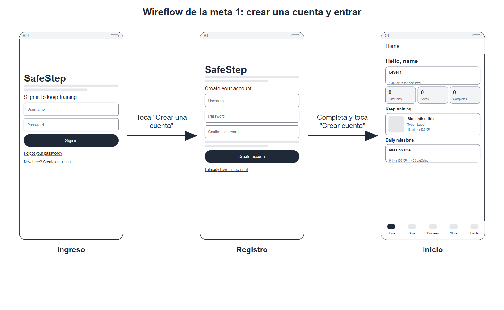
  

    <i><b>Fuente</b>: Elaboración propia.</i>
  

Desde Ingreso (W-01), el enlace «Crear una cuenta» lleva a Registro (W-02). Al completar el formulario con datos válidos, la aplicación guarda la sesión y abre Inicio (W-04) sin pedir que se ingrese de nuevo.

### 4.4.2.2. Meta 2: recuperar la contraseña

  

    <b>Gráfico 4.4.7</b>: Wireflow para recuperar la contraseña
  

  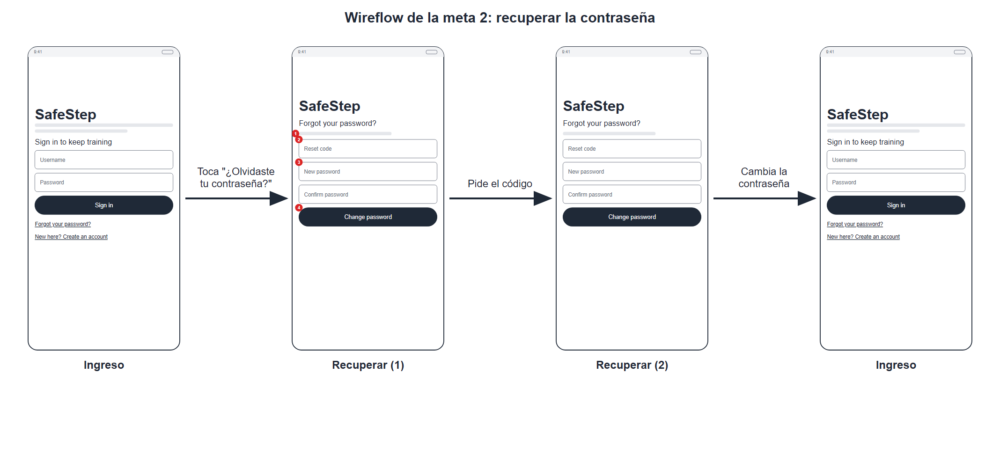
  

    <i><b>Fuente</b>: Elaboración propia.</i>
  

El enlace «¿Olvidaste tu contraseña?» abre W-03. En la primera etapa se escribe el usuario y se solicita el código; en la segunda se escribe el código con la nueva contraseña y su confirmación. Al terminar, el botón vuelve a Ingreso.

### 4.4.2.3. Meta 3: completar una simulación y recibir la recompensa

  

    <b>Gráfico 4.4.8</b>: Wireflow de una simulación
  

  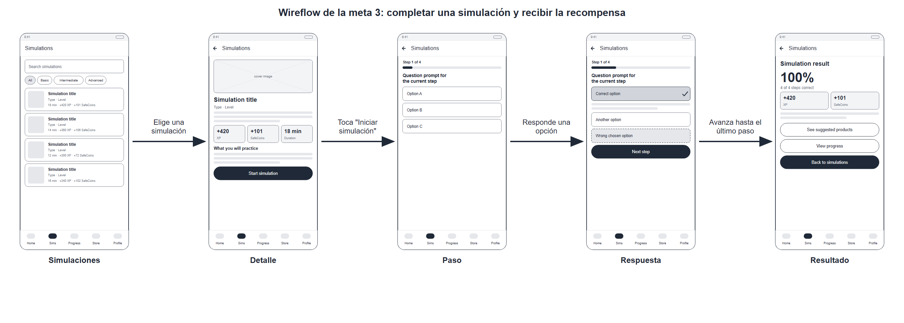
  

    <i><b>Fuente</b>: Elaboración propia.</i>
  

La lista (W-05) lleva al detalle (W-06) y este al primer paso (W-07). Cada respuesta muestra su retroalimentación (W-08) y el botón avanza hasta el último paso, tras el cual aparece el resultado (W-09) con la recompensa. Este es el flujo central del producto y el que alimenta el ciclo SafeCoins → cupones que se evalúa en el capítulo 8.

### 4.4.2.4. Meta 4: revisar el avance, las misiones y las monedas

  

    <b>Gráfico 4.4.9</b>: Wireflow del progreso
  

  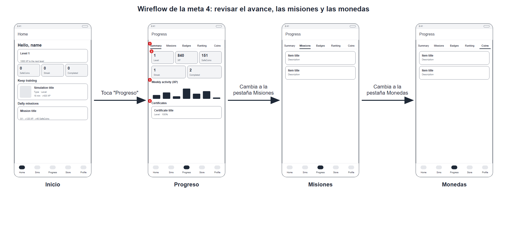
  

    <i><b>Fuente</b>: Elaboración propia.</i>
  

Desde cualquier pantalla, el destino «Progreso» de la barra inferior abre W-10; las pestañas superiores cambian entre resumen, misiones, insignias, ranking y movimientos de monedas sin salir de la pantalla.

### 4.4.2.5. Meta 5: canjear un cupón y pagar la compra

  

    <b>Gráfico 4.4.10</b>: Wireflow de canje y pago
  

  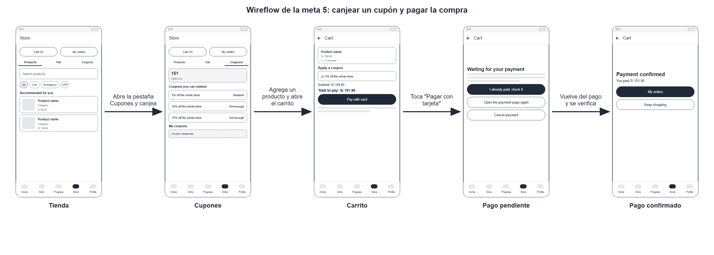
  

    <i><b>Fuente</b>: Elaboración propia.</i>
  

En Tienda (W-11) la pestaña Cupones (W-12) permite canjear SafeCoins por un cupón. Al agregar un producto y abrir el carrito (W-14), el cupón se elige y el total se recalcula. «Pagar con tarjeta» abre la página de pago del procesador en una pestaña del navegador (la aplicación nunca recibe datos de tarjeta) y deja la pantalla de espera (W-15). Al volver, la aplicación pregunta al servidor si el pago se confirmó y muestra la confirmación.

## 4.4.3. Mobile Applications Mock-ups

### 4.4.3.1. Introducción a los mock-ups

Los mock-ups son capturas de la aplicación implementada, tomadas en un emulador Android (API 37, 1080 × 2400 px) contra el backend real con datos de ejemplo, de modo que las cifras que se ven (recompensas, saldos, descuentos) son las que calculó el servidor y no valores de relleno. La captura se automatizó con una prueba instrumentada (`EvidenceTourTest`) que recorre las 21 pantallas, de manera que puede repetirse después de cada cambio visual.

Cada mock-up conserva la estructura del wireframe que lo origina. Una particularidad se debe a que la captura se tomó con datos de ejemplo: los textos del servidor (simulaciones, misiones, insignias) están en español aunque la interfaz esté en inglés. Las imágenes se descargan de forma asíncrona, por lo que la prueba espera unos segundos antes de cada captura.

### 4.4.3.2. Acceso (de W-01 a W-03)

  

    <b>Gráfico 4.4.11</b>: Mock-ups de ingreso, registro y recuperación de contraseña
  

  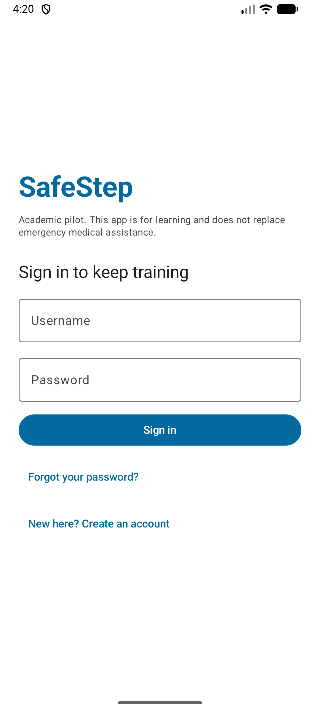
  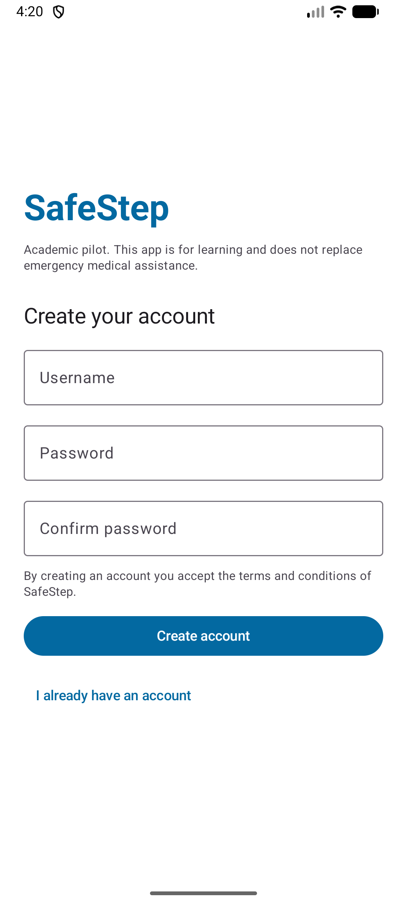
  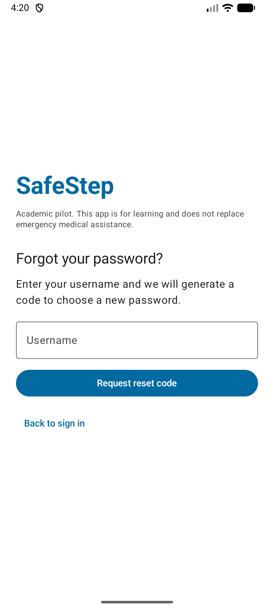
  

    <i><b>Fuente</b>: Captura de la aplicación SafeStep Android 1.0.0.</i>
  

El título «SafeStep» en azul primario y un solo botón de acción por pantalla mantienen el foco en completar el formulario. Los campos usan la apariencia contorneada de Material 3, que deja el borde visible aun con el campo vacío, y los mensajes de validación aparecen debajo del campo.

### 4.4.3.3. Inicio y simulaciones (de W-04 a W-06)

  

    <b>Gráfico 4.4.12</b>: Mock-ups de inicio, lista de simulaciones y detalle
  

  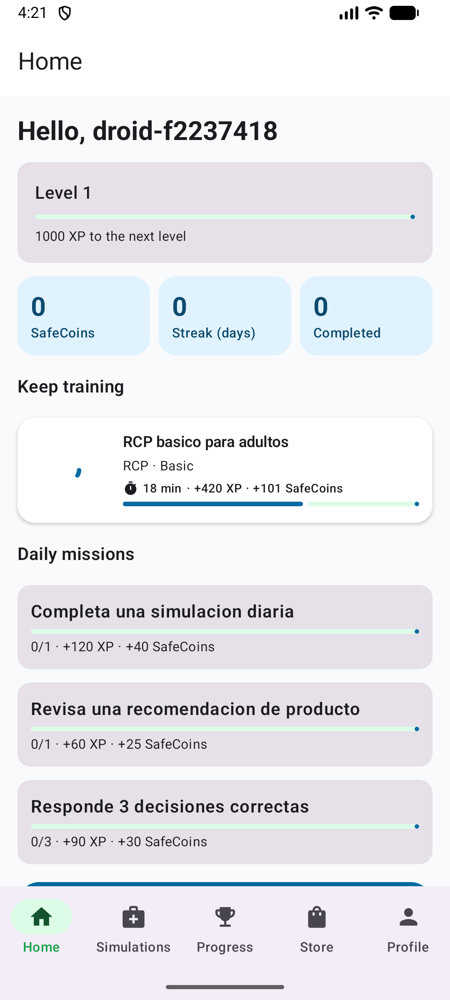
  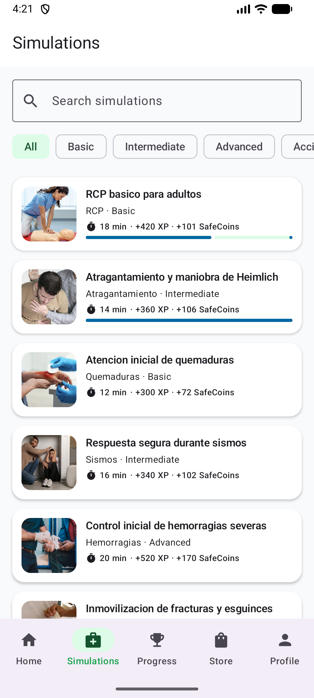
  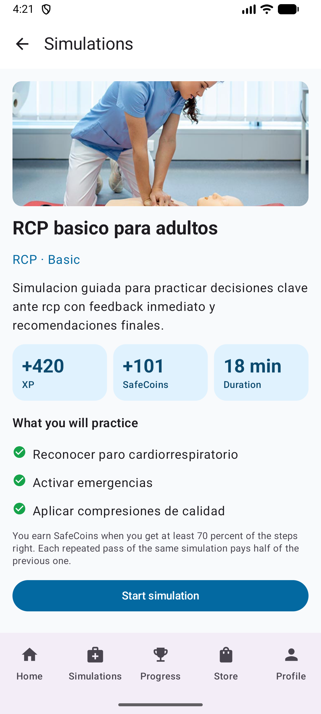
  

    <i><b>Fuente</b>: Captura de la aplicación SafeStep Android 1.0.0.</i>
  

Las tarjetas de simulación resumen en una línea lo que el jugador necesita para decidir (duración, experiencia y SafeCoins). La barra de la tarjeta aparece cuando el jugador ya avanzó en esa simulación e indica su porcentaje completado. El destino activo de la barra inferior se resalta con una cápsula verde y su etiqueta en el mismo color.

### 4.4.3.4. Simulación (de W-07 a W-09)

  

    <b>Gráfico 4.4.13</b>: Mock-ups de un paso, de la respuesta y del resultado
  

  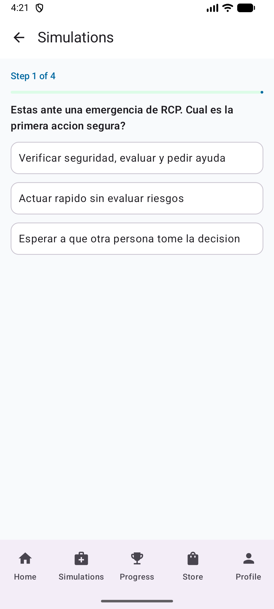
  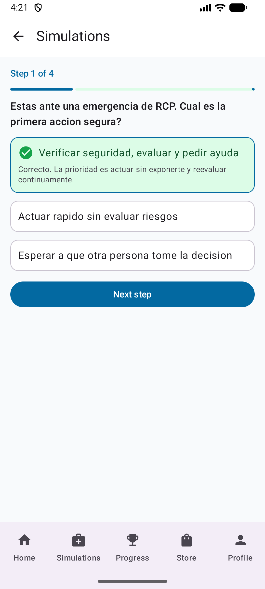
  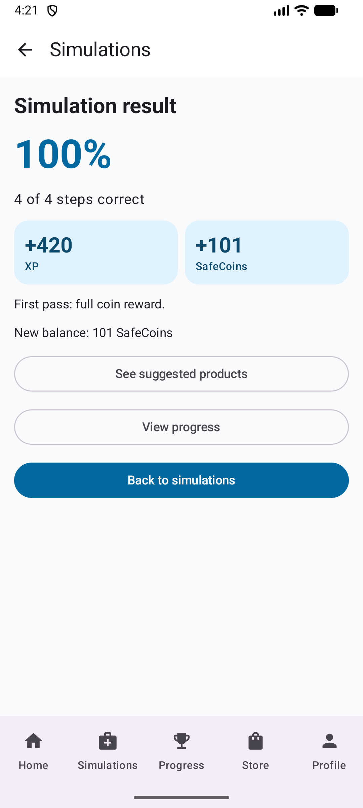
  

    <i><b>Fuente</b>: Captura de la aplicación SafeStep Android 1.0.0.</i>
  

La pregunta usa el tamaño de título; las opciones, ancho completo y área de toque amplia. En la respuesta, la opción correcta se distingue por el ícono de verificación y no solo por el color. El resultado muestra el porcentaje de aciertos en grande y, debajo, la experiencia y las monedas que el servidor registró.

### 4.4.3.5. Progreso (W-10)

  

    <b>Gráfico 4.4.14</b>: Mock-ups de las cinco pestañas de Progreso
  

  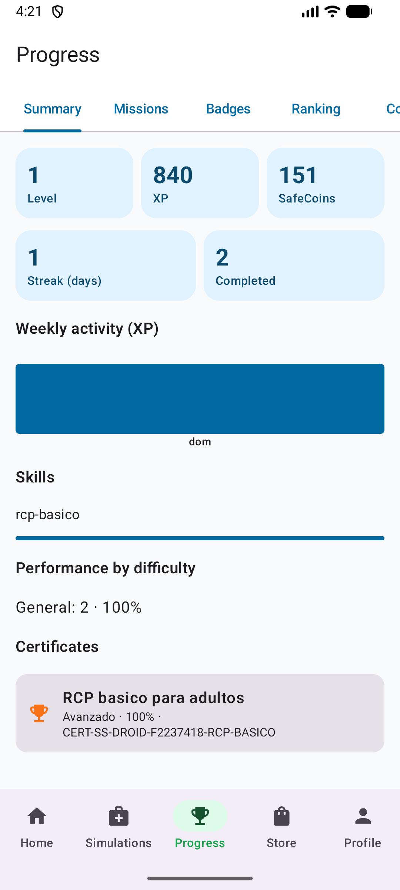
  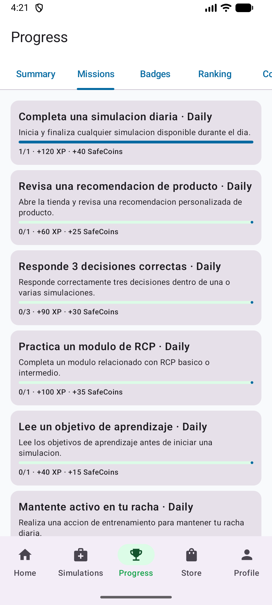
  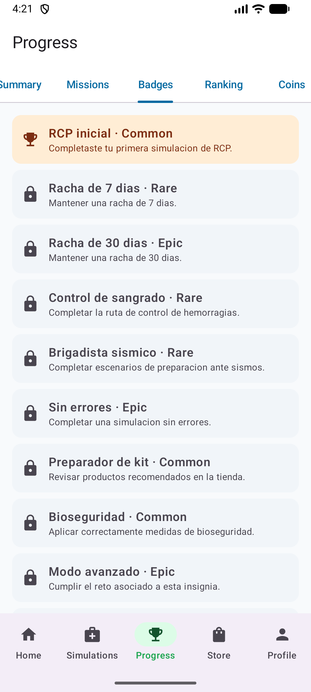
  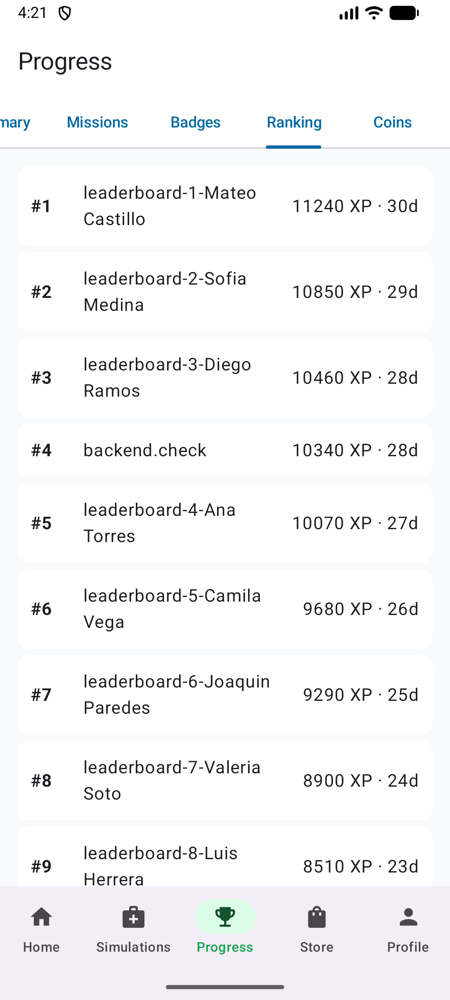
  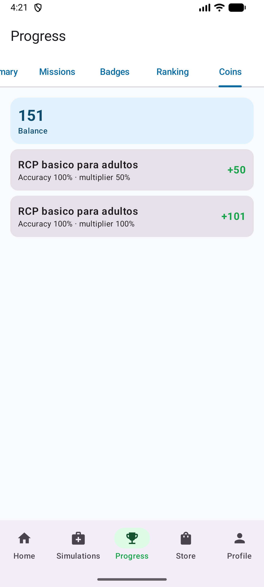
  

    <i><b>Fuente</b>: Captura de la aplicación SafeStep Android 1.0.0.</i>
  

Las cinco pestañas se desplazan en horizontal para que ninguna se corte en pantallas estrechas. La pestaña Monedas muestra cada movimiento con su simulación y su exactitud, de modo que el jugador entiende por qué ganó o no monedas.

### 4.4.3.6. Tienda, producto y carrito (de W-11 a W-14)

  

    <b>Gráfico 4.4.15</b>: Mock-ups de productos, kits, cupones y cupón canjeado
  

  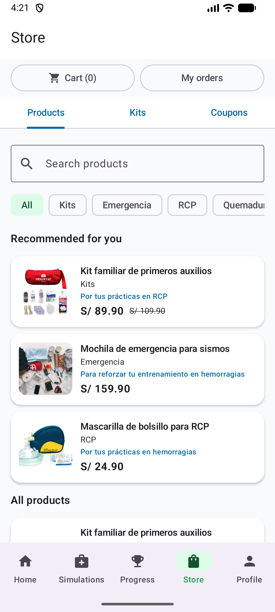
  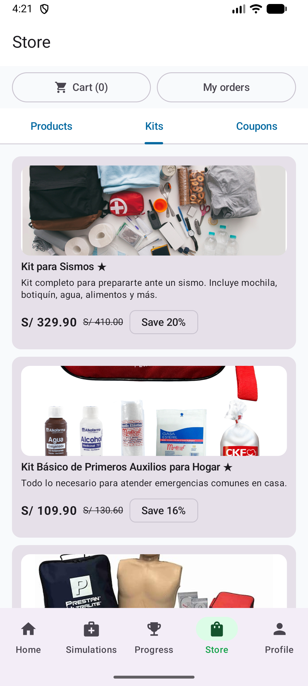
  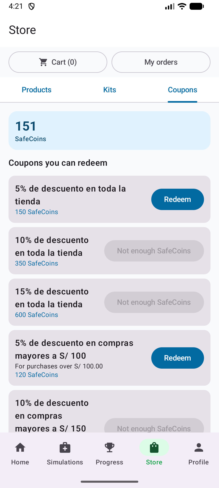
  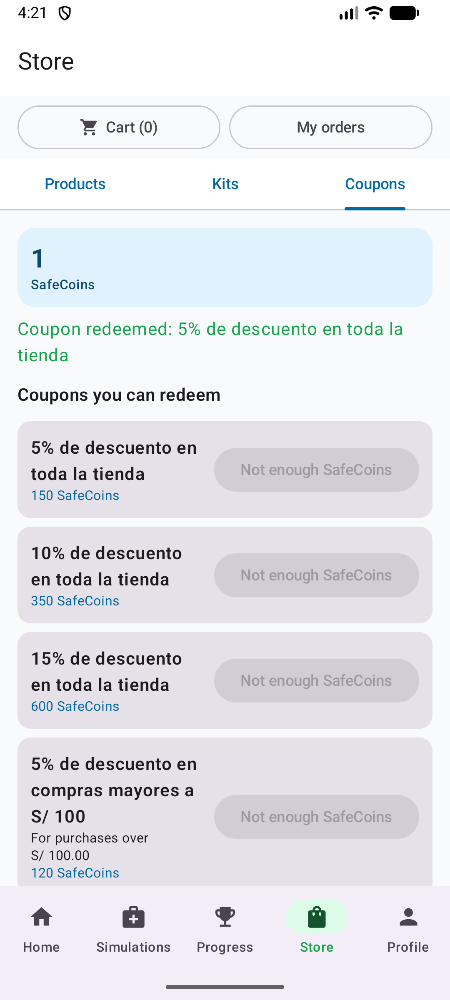
  

    <i><b>Fuente</b>: Captura de la aplicación SafeStep Android 1.0.0.</i>
  

  

    <b>Gráfico 4.4.16</b>: Mock-ups del detalle de producto y del carrito con cupón
  

  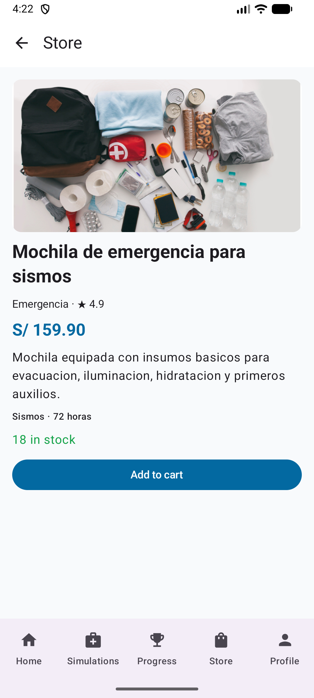
  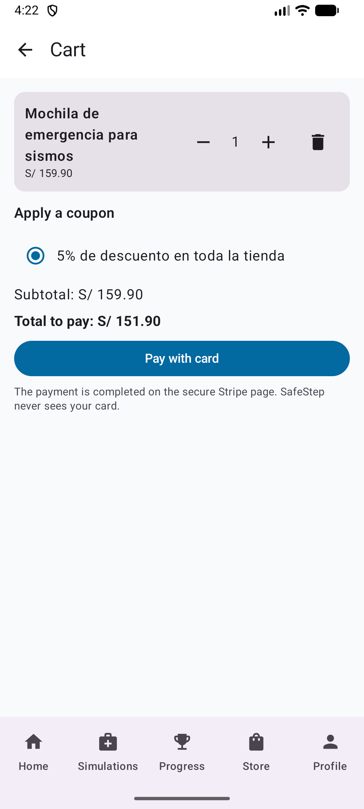
  

    <i><b>Fuente</b>: Captura de la aplicación SafeStep Android 1.0.0.</i>
  

El botón de canje solo se activa cuando el saldo alcanza; en el carrito, el total a pagar ya incluye el descuento del cupón elegido, de manera que el jugador ve el efecto de sus SafeCoins antes de pagar.

### 4.4.3.7. Perfil (W-16)

  

    <b>Gráfico 4.4.17</b>: Mock-up del perfil
  

  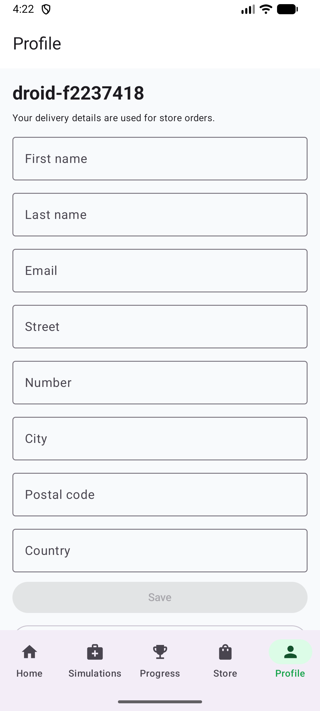
  

    <i><b>Fuente</b>: Captura de la aplicación SafeStep Android 1.0.0.</i>
  

### 4.4.3.8. Aplicación del sistema de diseño

| Elemento | Definición | Dónde se ve |
| --- | --- | --- |
| Color primario | `#0369a1` (azul) | Títulos de marca, botones principales, barras de avance |
| Color de estado activo | Verde (contenedor y texto) | Destino de la barra inferior, filtro seleccionado, acierto |
| Superficies | Fondo gris muy claro con tarjetas blancas de esquinas redondeadas y sombra suave | Listas de simulaciones, productos y cupones |
| Tipografía | Escala tipográfica de Material 3: título grande para el resultado, título para encabezados, cuerpo para descripciones | Todas las pantallas |
| Iconos | Material Icons con etiqueta de texto | Barra inferior, duración, búsqueda |
| Componentes | Campos contorneados, botones rellenos y de texto, chips de filtro, pestañas desplazables, tarjetas | Formularios, filtros y listas |

## 4.4.4. Mobile Applications User Flow Diagrams

Los user flows describen, por meta, el camino feliz (*happy path*) y los caminos infelices (*unhappy paths*), es decir, lo que ocurre cuando algo no sale como se espera. Los comportamientos descritos son los que implementa la aplicación y los que verifican las pruebas de 5.2.5.

### 4.4.4.1. User flow: registro e ingreso

**Happy path**

1. El jugador abre la aplicación y ve Ingreso.
2. Toca «Crear una cuenta», escribe usuario y contraseña (dos veces) y toca «Crear cuenta».
3. La aplicación guarda la sesión cifrada y abre Inicio.
4. En los siguientes arranques, la sesión se recupera sin pedir los datos de nuevo.

**Unhappy paths**

| Situación | Respuesta de la aplicación |
| --- | --- |
| Usuario demasiado corto o largo, o contraseña corta | Mensaje debajo del campo; no se envía nada al servidor. |
| La confirmación no coincide con la contraseña | Mensaje «las contraseñas no coinciden» debajo del campo de confirmación. |
| Usuario ya existe o credenciales incorrectas | La línea de error bajo los campos muestra el mensaje que devolvió el servidor. |
| El token de acceso venció durante el uso | La aplicación pide uno nuevo con el token de renovación y repite la solicitud sin que el jugador lo note; si la renovación también falla, cierra la sesión y vuelve a Ingreso. |

### 4.4.4.2. User flow: recuperar la contraseña

**Happy path**: el jugador toca «¿Olvidaste tu contraseña?», escribe su usuario, recibe un código, lo escribe con la nueva contraseña y su confirmación, y vuelve a Ingreso con la contraseña cambiada.

**Unhappy paths**

| Situación | Respuesta |
| --- | --- |
| Usuario vacío o inválido | Mensaje de validación; no se pide el código. |
| Código vacío | El campo se marca con error. |
| Contraseña corta o confirmación distinta | Mensaje debajo del campo correspondiente. |
| Código inválido o vencido | Se muestra el mensaje del servidor y el jugador puede volver a Ingreso y pedir un código nuevo. |
| Sin conexión | La línea de error indica el fallo y el botón vuelve a habilitarse. |

### 4.4.4.3. User flow: completar una simulación

**Happy path**

1. En Simulaciones, el jugador filtra o busca y abre una simulación.
2. Lee el detalle y toca «Iniciar simulación».
3. En cada paso elige una opción, lee la explicación y toca «Siguiente paso».
4. Al terminar, la aplicación envía el intento y muestra el resultado con la experiencia y las monedas que acreditó el servidor.
5. El jugador sigue a los productos sugeridos, al progreso o regresa a la lista.

**Unhappy paths**

| Situación | Respuesta |
| --- | --- |
| Aciertos por debajo de 70 % | No se acreditan SafeCoins, pero sí experiencia; el resultado lo explica. |
| Repetir una simulación ya aprobada | Cada repetición aprobada paga la mitad de la anterior; el resultado muestra la cifra real. |
| Falla el envío del intento | Vuelve al último paso con un mensaje de error; las respuestas se conservan y el jugador reintenta con «Finalizar simulación». |
| Falla la carga de la simulación | Se muestra el mensaje de error con el botón «Reintentar». |
| El jugador sale a mitad de la simulación | No se envía un intento incompleto; al abrirla de nuevo comienza desde el principio. |

### 4.4.4.4. User flow: canjear un cupón y pagar

**Happy path**

1. En Tienda, pestaña Cupones, el jugador canjea un cupón con sus SafeCoins.
2. Agrega un producto desde su detalle y abre el carrito.
3. Elige el cupón; el total se recalcula.
4. Toca «Pagar con tarjeta»; el pedido se crea con el cupón y se abre la página de pago en una pestaña del navegador.
5. Paga y vuelve a la aplicación, que verifica el pago con el servidor y muestra la confirmación; el pedido aparece en «Mis pedidos».

**Unhappy paths**

| Situación | Respuesta |
| --- | --- |
| Saldo insuficiente para un cupón | El botón de canje queda deshabilitado y la fila indica «SafeCoins insuficientes». |
| Cupón no válido al pagar | El servidor rechaza el pedido y la aplicación muestra su mensaje. |
| El jugador vuelve sin pagar | La pantalla de espera ofrece verificar de nuevo, abrir otra vez la página de pago o cancelar el pago. |
| El pago se confirma tarde | El botón «Ya pagué, verificar» consulta el servidor en el momento. |
| Producto sin stock | El detalle muestra «Sin stock» y el botón «Agregar al carrito» queda deshabilitado. |

### 4.4.4.5. Consideraciones

- Las metas 1, 3 y 5 forman el camino que más valor entrega: registrarse, practicar y convertir las monedas en un descuento real. Por eso se priorizó que cada una se pueda completar en pocas pantallas y con una sola acción principal por pantalla.
- Los caminos infelices se apoyan en dos reglas: nunca perder lo que el jugador ya escribió o respondió, y siempre mostrar el mensaje en texto junto al elemento que falló.
- Las verificaciones automáticas de estos flujos están en `SystemFlowTest` (flujos con el backend real) y `ViewModelsTest` (validaciones y errores); se detallan en 5.2.5.
