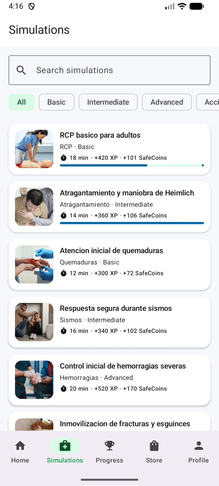

 
 

    

 
 

# 4.5. Mobile Applications Prototyping

Esta sección presenta el prototipo de la aplicación móvil de SafeStep. A diferencia de un prototipo de diseño con pantallas enlazadas, el de Android es una aplicación nativa funcional: cada interacción que se muestra ocurre contra la API real del proyecto (los mismos servicios que usa la aplicación web), por lo que el prototipo ya valida la navegación, los estados de espera y de error y las cifras de recompensa antes de pasar a un diseño de producción.

## 4.5.1. Android Mobile Applications Prototyping

### 4.5.1.1. Criterios de interacción

Las decisiones de interacción siguen los criterios de 4.7.1.2 (facilidad de uso, consistencia, eficiencia y retroalimentación) y la arquitectura de información de 4.2:

| Decisión de arquitectura de información | Interacción que la implementa |
| --- | --- |
| Sistema de navegación global con cinco destinos | Barra inferior (Inicio, Simulaciones, Progreso, Tienda, Perfil): un toque cambia de destino y cada destino conserva su pila; es la forma de navegar esperada en Android y queda al alcance del pulgar. |
| Jerarquía de dos niveles (lista → detalle) | Tocar una tarjeta abre el detalle con flecha de retorno; el gesto «atrás» del sistema regresa a la lista. |
| Contenido agrupado en secciones de una misma pantalla | Pestañas superiores (Progreso: cinco; Tienda: tres) que se cambian con un toque (las de Progreso también se desplazan en horizontal si no caben); los filtros por nivel y tema son chips que se desplazan en horizontal. |
| Una tarea principal por pantalla | Un solo botón relleno por pantalla para la acción principal (Iniciar sesión, Iniciar simulación, Siguiente paso, Pagar con tarjeta); las acciones secundarias son botones contorneados o de texto. |
| Entrada de datos con el teclado adecuado | Los campos de contraseña usan el teclado de contraseña y ocultan el texto; el resto usa el teclado de texto. |
| Salida controlada a otras aplicaciones | El pago se completa en la página del procesador, que se abre en una pestaña del navegador (Custom Tabs); al volver, la aplicación recupera el estado y verifica el pago por su cuenta. |

**Retroalimentación y estados.** Los botones de formularios y acciones que esperan al servidor se desactivan mientras tanto, y los de ingreso y registro muestran un indicador de progreso; las listas muestran cargando, vacío o error con «Reintentar»; la respuesta de cada paso de la simulación se marca de inmediato, y el resultado informa la recompensa que el servidor acreditó. La sesión se mantiene entre usos y el token de acceso se renueva sin intervención del jugador.

### 4.5.1.2. Prototipo en funcionamiento

La aplicación (`com.safestep.mobile`, versión 1.0.0, mínimo Android 8.0 / API 26) se ejecuta en emulador o dispositivo. Los flujos que cubre son los cinco wireflows de 4.4.2. El repositorio es `https://github.com/1ASI0732-2620-9090-Grupo-4/safeStept-android.git` y las instrucciones para compilar y ejecutarla están en su `README`.

| Flujo del prototipo | Pantallas (4.4.1) | Qué se demuestra |
| --- | --- | --- |
| Crear cuenta e ingresar | W-01, W-02, W-04 | Validación de formulario, sesión cifrada, entrada directa a Inicio |
| Recuperar contraseña | W-01, W-03 | Solicitud de código y cambio de contraseña en dos etapas |
| Completar una simulación | W-05 a W-09 | Filtros, retroalimentación por respuesta, recompensa calculada por el servidor |
| Revisar progreso | W-10 | Resumen, misiones, insignias, ranking y movimientos de monedas |
| Canjear un cupón y pagar | W-11 a W-15 | Canje con SafeCoins, carrito con descuento, pago en el navegador y verificación al volver |

  

    <b>Gráfico 4.5.1</b>: Lista de simulaciones del prototipo Android (fotograma del video)
  

  
  

    <i><b>Fuente</b>: Elaboración propia.</i>
  

### 4.5.1.3. Video del prototipo

El video recorre la aplicación sobre un emulador Android con el backend real: ingreso, registro con validación, lista y detalle de simulaciones, un paso con su retroalimentación, el progreso en sus cinco pestañas y la tienda con productos, kits y cupones. Se grabó mientras se ejecutaba la suite de pruebas de sistema (5.2.5), por lo que las acciones las realiza la automatización y el video no lleva narración.

Enlace del video: **pendiente de subir a la plataforma que indique el curso** (el archivo `prototipo-android-recorrido-pruebas.mp4`, 1:45 min, está listo en la carpeta de capturas del equipo).

### 4.5.1.4. Herramientas utilizadas

| Herramienta | Uso |
| --- | --- |
| Kotlin y Jetpack Compose (Material 3) | Construcción de la interfaz nativa |
| Navigation Compose | Navegación entre pantallas y pila por destino |
| Emulador de Android Studio (API 37) | Ejecución y captura del prototipo |
| `adb screenrecord` | Grabación del video |
| Prueba instrumentada `EvidenceTourTest` | Captura reproducible de las 21 pantallas |

## 4.5.2. iOS Mobile Applications Prototyping

El proyecto SafeStep entrega aplicación móvil solo para Android en esta etapa, por lo que no se desarrolló un prototipo para iOS. La decisión responde al alcance de la planificación del equipo (un solo lenguaje y una sola base de código móvil) y se mantiene abierta como línea futura: la API REST, las reglas de recompensa del servidor y los wireframes de 4.4.1 no dependen de la plataforma, de manera que un prototipo para iOS reutilizaría la misma estructura de pantallas y cambiaría la barra inferior y los componentes por sus equivalentes de las guías de interfaz de Apple.
