<br>
<br>

<div align="center">
    
</div>

<br>
<br>

# 5.2. Landing Page, Services & Applications Implementation.

### 5.2.1.6. Sprint 6

#### 5.2.1.6.1. Sprint Planning 6

En esta sección se especifican los aspectos principales del Sprint Planning Meeting correspondiente al Sprint 6. El Sprint 5 dejó el backend probado y con integración continua, pero quedaron tres brechas: el código no cumplía el estilo de Google (8,128 observaciones de Checkstyle) ni estaba limpio ante el perfil *Sonar way extended*, la aplicación web no tenía pruebas de sistema (la suite de Selenium se había retirado del alcance el 8 de octubre) y la aplicación móvil era un prototipo de una sola pantalla. Además, al comparar los dos clientes se detectó que la regla de recompensa de las simulaciones (umbral de 70 % y mitad por repetición) solo existía en el frontend web y no en el servidor. El sexto Sprint se dedica a **cerrar esas brechas y a planificar los experimentos**: dejar el backend sin infracciones de estilo y con el análisis estático limpio, publicar su imagen desde el pipeline, probar la aplicación web de extremo a extremo, completar la aplicación Android y diseñar los experimentos del capítulo 8.

> **[DATOS PENDIENTES · C-S6-1]** Completar con los datos reales de la reunión de planificación: fecha, hora, lugar, quién la preparó y quiénes asistieron. Por ahora la tabla indica el periodo del Sprint, que se calcula con las fechas de los commits.

<table align="center" border="1" cellpadding="8" cellspacing="0" style="border-collapse: collapse; width: 100%; font-family: Arial, sans-serif;">
    <tbody>
        <tr><td><b>Sprint #</b></td><td>Sprint 6</td></tr>
        <tr><td colspan="2"><b>Sprint Planning Background</b></td></tr>
        <tr><td>Date</td><td>Periodo del Sprint: del 09/10/2026 al 09/11/2026 (fecha de la reunión pendiente)</td></tr>
        <tr><td>Time</td><td>Pendiente</td></tr>
        <tr><td>Location</td><td>Pendiente</td></tr>
        <tr><td>Prepared By</td><td>Pendiente</td></tr>
        <tr><td>Attendees (to planning meeting)</td><td>Palacios Jáuregui, Kalid Jesus; Sanchez Arenas, Manuel Angel; Melgarejo Quiroz, Josep Eliu; Tello Palacios, Fabrizio Rafael; Aylas De La Cruz, Paulo Smit</td></tr>
        <tr><td>Sprint n - 1 Review Summary</td><td>Sprint 5 completado: panel de administración y roles, canje de cupones con SafeCoins, suites de pruebas unitarias, BDD y de API, cobertura de 93.8 % sobre las clases medidas, pipeline de Jenkins con SonarQube y despliegue en Render. Quedaron pendientes la limpieza de estilo y de incidencias, las pruebas de sistema de la aplicación web y la aplicación móvil.</td></tr>
        <tr><td>Sprint n - 1 Retrospective Summary</td><td>El Sprint 5 mostró que la cobertura alta no bastaba para afirmar la calidad: el estilo de Google tenía 8,128 observaciones, SonarQube reportaba incidencias de mantenibilidad que el Quality Gate no veía porque solo evalúa el código nuevo, y los flujos de la aplicación web solo se habían comprobado con pruebas de API. Se acordó dedicar el Sprint 6 a llevar esas mediciones a cero, a verificar la aplicación web de extremo a extremo, a completar la aplicación móvil y a documentar con evidencia verificable, incluidos los resultados desfavorables.</td></tr>
        <tr><td colspan="2"><b>Sprint Goal &amp; User Stories</b></td></tr>
        <tr><td>Sprint 6 Goal</td><td>Nuestro enfoque es dejar SafeStep verificable en la web y en el móvil y listo para experimentar. Creemos que esto da confianza a los jugadores y al equipo para cambiar las reglas del producto con evidencia. La meta se considera cumplida si Checkstyle no reporta infracciones, el Quality Gate de SonarQube aprueba con 0 incidencias de mantenibilidad, los 15 escenarios de Selenium y las pruebas de la aplicación Android aprueban, la recompensa se calcula en el servidor y los 10 experimentos quedan planificados y diseñados.</td></tr>
        <tr><td>Sprint 6 Velocity</td><td>El equipo acordó un velocity de 82 Story Points, que coincide con la suma de los puntos de las historias de usuario, technical stories y el spike incluidos en el Sprint.</td></tr>
        <tr><td>Sum of Story Points</td><td>Total: 82 SP - Estilo de Google y Checkstyle (8 SP), Sonar way extended (8 SP), evolución de la calidad (5 SP), imagen Docker (8 SP), pruebas de sistema web (8 SP), recompensa en el servidor (5 SP), términos y condiciones (3 SP), aplicación Android (8 + 13 + 8 SP) y diseño de experimentos (8 SP).</td></tr>
    </tbody>
</table>

**User Stories, Technical Stories y Spike incluidos en el Sprint 6:**

| ID | User Story / Technical Story | Prioridad | Story Points |
| -- | ---------------------------- | --------- | ------------ |
| TS36 | Como developer, quiero que el código del backend cumpla el estilo de Google Java sin observaciones y que el build falle ante cualquier infracción, para mantener un estándar verificable. | Must Have | 8 |
| TS37 | Como developer, quiero analizar el código con el perfil Sonar way extended y corregir las incidencias del backend y del frontend, para dejar la deuda técnica en cero. | Must Have | 8 |
| TS38 | Como developer, quiero reconstruir en SonarQube la evolución de la calidad del backend y del frontend en etapas ordenadas, para mostrar el punto de partida y el efecto de cada mejora. | Should Have | 5 |
| TS39 | Como developer, quiero que el pipeline construya la imagen Docker del backend y la publique en Docker Hub, para entregar un artefacto ejecutable en cada ejecución exitosa. | Must Have | 8 |
| TS40 | Como developer, quiero pruebas de sistema con Selenium y Cucumber que recorran la aplicación web contra el backend real, para verificar los flujos completos de extremo a extremo. | Must Have | 8 |
| US15 | Como usuario, quiero que el servidor otorgue SafeCoins solo cuando apruebo con 70 % o más y que cada repetición aprobada de la misma simulación pague la mitad, para que la recompensa sea la misma en la web y en el móvil. (Ajuste de la historia del Sprint 3.) | Must Have | 5 |
| US66 | Como visitante, quiero leer los términos y condiciones del servicio desde la Landing Page y desde el registro, para conocer mis derechos y obligaciones antes de crear una cuenta. | Should Have | 3 |
| TS41 | Como developer, quiero una aplicación Android con navegación, sesión cifrada y renovación automática del token, para consumir la API de forma segura. | Must Have | 8 |
| US67 | Como usuario, quiero usar en Android los flujos de registro, simulaciones, progreso, tienda, cupones y pago, para entrenar desde el teléfono. | Must Have | 13 |
| TS42 | Como developer, quiero pruebas unitarias y de sistema de la aplicación Android y capturas reproducibles de sus pantallas, para verificarla y documentarla. | Should Have | 8 |
| SP-01 | Spike: como developer, quiero planificar y diseñar experimentos de ingeniería de software sobre el ciclo SafeCoins → cupones, para decidir qué hipótesis de valor probar. | Should Have | 8 |

Los identificadores TS32 a TS35 y US62 a US65 están reservados para las historias To-Be de los experimentos (8.3.1), que no se construyeron en este Sprint; por eso este Sprint continúa desde TS36 y US66. La historia US15 es la del Sprint 3, cuya regla de negocio se amplía.

**Criterios de aceptación** (formato Gherkin):

| ID | Criterios de aceptación (Gherkin) |
| -- | --------------------------------- |
| TS36 | - **Dado que** el backend se compila, **cuando** Checkstyle revisa el código con las reglas de Google, **entonces** no reporta ninguna infracción.<br><br>- **Dado que** un cambio introduce una infracción de estilo, **cuando** se ejecuta el pipeline, **entonces** la etapa de estilo falla y las etapas siguientes no se ejecutan. |
| TS37 | - **Dado que** el proyecto usa el perfil Sonar way extended, **cuando** termina el análisis, **entonces** el backend y el frontend no tienen incidencias de mantenibilidad abiertas.<br><br>- **Dado que** se corrigieron las incidencias, **cuando** se ejecuta la suite completa, **entonces** todas las pruebas siguen aprobadas. |
| TS38 | - **Dado que** existe una secuencia de estados del código, **cuando** se analiza cada uno en SonarQube, **entonces** el historial muestra una versión por estado con su cobertura e incidencias.<br><br>- **Dado que** el historial es una reconstrucción, **cuando** se documenta, **entonces** el informe lo declara como tal y no como el orden cronológico original. |
| TS39 | - **Dado que** las pruebas y el análisis de calidad aprobaron, **cuando** el pipeline continúa, **entonces** construye la imagen Docker del backend.<br><br>- **Dado que** la imagen se construyó, **cuando** existe la credencial de Docker Hub, **entonces** la publica con la etiqueta de la ejecución y con latest. |
| TS40 | - **Dado que** el backend, la base de datos y el frontend están en ejecución, **cuando** se corre la suite, **entonces** cada escenario recorre la aplicación web en un navegador y verifica el resultado visible.<br><br>- **Dado que** cada escenario crea su propio jugador, **cuando** se ejecutan todos, **entonces** no dependen del orden ni de datos previos. |
| US15 | - **Dado que** un jugador completa una simulación con 70 % o más de aciertos, **cuando** el servidor procesa el intento, **entonces** acredita monedas en proporción a la exactitud y reduce a la mitad el pago por cada intento aprobado previo de esa simulación.<br><br>- **Dado que** el jugador obtiene menos de 70 %, **cuando** el servidor procesa el intento, **entonces** acredita experiencia pero ninguna moneda, y el siguiente intento aprobado paga la recompensa completa. |
| US66 | - **Dado que** un visitante está en la Landing Page o en el registro, **cuando** abre el enlace de términos y condiciones, **entonces** se muestra el texto completo de los términos.<br><br>- **Dado que** el servicio es un piloto académico, **cuando** se leen los términos, **entonces** indican que no sustituye la atención médica. |
| TS41 | - **Dado que** el jugador inicia sesión, **cuando** la aplicación guarda la sesión, **entonces** los tokens quedan cifrados con una clave del Android Keystore.<br><br>- **Dado que** el token de acceso venció, **cuando** una llamada recibe un 401, **entonces** la aplicación lo renueva una vez y repite la llamada; si la renovación falla, cierra la sesión. |
| US67 | - **Dado que** el jugador completa una simulación en Android, **cuando** termina, **entonces** la aplicación muestra la experiencia y las monedas que acreditó el servidor.<br><br>- **Dado que** el jugador tiene SafeCoins suficientes, **cuando** canjea un cupón y lo elige en el carrito, **entonces** el total a pagar incluye el descuento y el pago se completa en el navegador. |
| TS42 | - **Dado que** se ejecutan las pruebas unitarias, **cuando** termina Gradle, **entonces** las 25 pruebas del cliente, la sesión, el flujo de simulación y el carrito están aprobadas.<br><br>- **Dado que** el emulador y la API están en ejecución, **cuando** se ejecutan las pruebas instrumentadas, **entonces** las 9 pruebas, incluidas las de sistema, están aprobadas. |
| SP-01 | - **Dado que** se investigan las preguntas sobre el ciclo SafeCoins → cupones, **cuando** termina el spike, **entonces** existe un backlog priorizado con 10 tarjetas de experimento.<br><br>- **Dado que** cada tarjeta incluye una hipótesis, **cuando** se diseña el experimento, **entonces** se especifican medidas, condiciones, escala y método. |

**Distribución de Trabajo por Componente:**

- **Calidad de código y CI (TS36 a TS39):** 29 Story Points: estilo de Google, Sonar way extended, reconstrucción de la evolución de la calidad e imagen Docker publicada desde Jenkins.
- **Pruebas de sistema web (TS40):** 8 Story Points.
- **Aplicación Android (TS41, US67, TS42):** 29 Story Points.
- **Recompensas y términos (US15, US66):** 8 Story Points.
- **Experimentos (SP-01):** 8 Story Points.

#### 5.2.1.6.2. Aspect Leaders and Collaborators

En esta sección se elabora el artefacto Leadership-and-Collaboration Matrix (LACX) del Sprint 6. Los aspectos del Sprint son:

1. **Code Quality & CI:** Checkstyle, SonarQube, Jenkins y la imagen Docker.
2. **System Tests:** pruebas de sistema de la aplicación web.
3. **Android App:** aplicación móvil, sus pruebas y sus capturas.
4. **Rewards & Terms:** regla de recompensa en el servidor, datos semilla y términos y condiciones.
5. **Experiments & Docs:** planificación y diseño de experimentos y documentación del informe.

<table align="center" border="1" cellpadding="8" cellspacing="0" style="border-collapse: collapse; width: 100%; font-family: Arial, sans-serif;">
    <tbody>
        <tr><td><b>Team Member (Last Name, First Name)</b></td><td><b>GitHub Username</b></td><td><b>Code Quality &amp;amp; CI / L or C</b></td><td><b>System Tests / L or C</b></td><td><b>Android App / L or C</b></td><td><b>Rewards &amp;amp; Terms / L or C</b></td><td><b>Experiments &amp;amp; Docs / L or C</b></td></tr>
        <tr><td>Palacios Jáuregui, Kalid Jesus</td><td><b>kalidpalacios</b></td><td>C</td><td>—</td><td>C</td><td>C</td><td>L</td></tr>
        <tr><td>Sanchez Arenas, Manuel Angel</td><td><b>manuael7sa</b></td><td>C</td><td>L</td><td>C</td><td>C</td><td>C</td></tr>
        <tr><td>Melgarejo Quiroz, Josep Eliu</td><td><b>Melga1502</b></td><td>C</td><td>—</td><td>L</td><td>—</td><td>C</td></tr>
        <tr><td>Tello Palacios, Fabrizio Rafael</td><td><b>f4bris</b></td><td>L</td><td>—</td><td>C</td><td>—</td><td>C</td></tr>
        <tr><td>Aylas De La Cruz, Paulo Smit</td><td><b>paulosmi</b></td><td>C</td><td>—</td><td>C</td><td>L</td><td>C</td></tr>
    </tbody>
</table>

#### 5.2.1.6.3. Sprint Backlog 6

El Sprint Backlog 6 resume las tareas de cada User Story, Technical Story y Spike. Se repartieron 35 tareas entre los cinco integrantes, 7 a cada uno, y los commits de cada integrante equivalen a 6 o 7 según las tareas que implementa. Las tareas T633 a T635 son documentación que no depende de una historia en particular. Las horas de estimación no se registraron durante el Sprint.

**Trello Board:** el equipo utiliza un Trello Board con las listas estándar de Scrum: "Sprint Goal", "To Do", "In Progress", "To Review" y "Done".

> **[CAPTURA PENDIENTE · C-S6-2]** **URL pública del Trello Board del Sprint 6** y **captura del tablero** (archivo `markdown/assets/images/chapter-5/Sprint6trello.png`). Se agregan cuando el equipo cree el tablero del Sprint 6 con las 35 tareas de esta tabla.

<table align="center" border="1" cellpadding="8" cellspacing="0" style="border-collapse: collapse; width: 100%; font-family: Arial, sans-serif;">
    <tbody>
        <tr><td><b>Sprint #</b></td><td colspan="7">Sprint 6</td></tr>
        <tr><td colspan="2">User Story / Technical Story</td><td colspan="6">Work-Item / Task</td></tr>
        <tr><td>Id</td><td>Title</td><td>Id</td><td>Title</td><td>Description</td><td>Estimation (Hours)</td><td>Assigned to</td><td>Status (To-do / In-Process / To-Review / Done)</td></tr>
        <tr><td>TS36</td><td>Estilo de Google Java</td><td>T601</td><td>Formato automático</td><td>Formatear el código principal con google-java-format y exigir imports explícitos y llaves en todas las estructuras de control.</td><td>—</td><td>Palacios Jáuregui, Kalid Jesus</td><td>Done</td></tr>
        <tr><td>TS36</td><td>Estilo de Google Java</td><td>T602</td><td>Declaraciones y nombres</td><td>Separar las declaraciones de variables, agrupar los métodos sobrecargados y usar nombres descriptivos.</td><td>—</td><td>Palacios Jáuregui, Kalid Jesus</td><td>Done</td></tr>
        <tr><td>TS36</td><td>Estilo de Google Java</td><td>T603</td><td>Javadoc de los bounded contexts</td><td>Documentar con Javadoc iam, profiles, commerce, gamification, simulation, analytics y el shared kernel.</td><td>—</td><td>Sanchez Arenas, Manuel Angel</td><td>Done</td></tr>
        <tr><td>TS36</td><td>Estilo de Google Java</td><td>T604</td><td>Checkstyle como compuerta</td><td>Hacer que el build falle cuando Checkstyle encuentra una infracción.</td><td>—</td><td>Tello Palacios, Fabrizio Rafael</td><td>Done</td></tr>
        <tr><td>TS37</td><td>Sonar way extended y correcciones</td><td>T605</td><td>Perfil Sonar way extended</td><td>Cambiar el proyecto al perfil extendido y medir la línea base de incidencias (86 en el backend y 11 en el frontend).</td><td>—</td><td>Tello Palacios, Fabrizio Rafael</td><td>Done</td></tr>
        <tr><td>TS37</td><td>Sonar way extended y correcciones</td><td>T606</td><td>Corrección del backend</td><td>Resolver las incidencias java:S1452, S1192, S1186, S2696 y S3776 sin cambiar el comportamiento.</td><td>—</td><td>Melgarejo Quiroz, Josep Eliu</td><td>Done</td></tr>
        <tr><td>TS37</td><td>Sonar way extended y correcciones</td><td>T607</td><td>Corrección del frontend</td><td>Resolver las incidencias typescript:S9383, S7723 y S8786 y cubrir formatPrice con pruebas unitarias.</td><td>—</td><td>Melgarejo Quiroz, Josep Eliu</td><td>Done</td></tr>
        <tr><td>TS38</td><td>Evolución de la calidad en SonarQube</td><td>T608</td><td>Reconstrucción por etapas</td><td>Analizar en SonarQube 12 etapas del backend y 3 del frontend construidas a partir de commits reales y documentar el resultado en 6.2.1.2.</td><td>—</td><td>Aylas De La Cruz, Paulo Smit</td><td>Done</td></tr>
        <tr><td>TS39</td><td>Imagen Docker y Docker Hub</td><td>T609</td><td>Imagen de PostgreSQL y stack de Compose</td><td>Crear la imagen de PostgreSQL con el script de inicialización y el stack de Docker Compose que ejecuta la API con su base de datos.</td><td>—</td><td>Aylas De La Cruz, Paulo Smit</td><td>Done</td></tr>
        <tr><td>TS39</td><td>Imagen Docker y Docker Hub</td><td>T610</td><td>Jenkins con Docker y construcción de la imagen</td><td>Dar a Jenkins el cliente y el socket de Docker y agregar la etapa que construye la imagen de la aplicación.</td><td>—</td><td>Tello Palacios, Fabrizio Rafael</td><td>Done</td></tr>
        <tr><td>TS39</td><td>Imagen Docker y Docker Hub</td><td>T611</td><td>Webhook de SonarQube y job sobre main</td><td>Permitir los webhooks de SonarQube hacia Jenkins en la red de Docker y compilar la rama main en el job.</td><td>—</td><td>Tello Palacios, Fabrizio Rafael</td><td>Done</td></tr>
        <tr><td>TS39</td><td>Imagen Docker y Docker Hub</td><td>T612</td><td>Publicación en Docker Hub</td><td>Agregar la etapa que publica la imagen en Docker Hub con una credencial de Jenkins.</td><td>—</td><td>Tello Palacios, Fabrizio Rafael</td><td>Done</td></tr>
        <tr><td>TS40</td><td>Pruebas de sistema web</td><td>T613</td><td>Suite Selenium y Cucumber</td><td>Restaurar la suite con la configuración e2e de Angular y los objetos de página.</td><td>—</td><td>Sanchez Arenas, Manuel Angel</td><td>Done</td></tr>
        <tr><td>TS40</td><td>Pruebas de sistema web</td><td>T614</td><td>Escenarios de recompensa, canje y administración</td><td>Cubrir la recompensa de una simulación, el canje de un cupón y los cupones del administrador.</td><td>—</td><td>Sanchez Arenas, Manuel Angel</td><td>Done</td></tr>
        <tr><td>TS40</td><td>Pruebas de sistema web</td><td>T615</td><td>Redacción de 6.1.4</td><td>Documentar el diseño, los features, el resultado (15 de 15) y las limitaciones con capturas del reporte.</td><td>—</td><td>Sanchez Arenas, Manuel Angel</td><td>Done</td></tr>
        <tr><td>TS41</td><td>Android: arquitectura y sesión</td><td>T616</td><td>Proyecto, navegación y tema</td><td>Crear la aplicación con Jetpack Compose, Navigation, el tema de la web y el contenedor de dependencias.</td><td>—</td><td>Melgarejo Quiroz, Josep Eliu</td><td>Done</td></tr>
        <tr><td>TS41</td><td>Android: arquitectura y sesión</td><td>T617</td><td>Red y sesión</td><td>Cliente Retrofit, tokens cifrados con el Keystore y renovación automática ante un 401.</td><td>—</td><td>Melgarejo Quiroz, Josep Eliu</td><td>Done</td></tr>
        <tr><td>US67</td><td>Android: flujos del jugador</td><td>T618</td><td>Acceso y perfil</td><td>Registro, ingreso, recuperación de contraseña y perfil.</td><td>—</td><td>Palacios Jáuregui, Kalid Jesus</td><td>Done</td></tr>
        <tr><td>US67</td><td>Android: flujos del jugador</td><td>T619</td><td>Simulaciones y resultado</td><td>Catálogo con filtros, pasos con retroalimentación y resultado con la recompensa que acreditó el servidor.</td><td>—</td><td>Melgarejo Quiroz, Josep Eliu</td><td>Done</td></tr>
        <tr><td>US67</td><td>Android: flujos del jugador</td><td>T620</td><td>Progreso</td><td>Resumen, misiones, insignias, ranking y movimientos de monedas.</td><td>—</td><td>Palacios Jáuregui, Kalid Jesus</td><td>Done</td></tr>
        <tr><td>US67</td><td>Android: flujos del jugador</td><td>T621</td><td>Tienda, carrito y pago</td><td>Productos, kits, cupones, carrito con descuento, pedidos y pago con Stripe en el navegador.</td><td>—</td><td>Tello Palacios, Fabrizio Rafael</td><td>Done</td></tr>
        <tr><td>TS42</td><td>Android: pruebas y capturas</td><td>T622</td><td>Pruebas unitarias</td><td>Cliente de la API con MockWebServer, sesión, flujo de simulación, carrito y validación (25 pruebas).</td><td>—</td><td>Aylas De La Cruz, Paulo Smit</td><td>Done</td></tr>
        <tr><td>TS42</td><td>Android: pruebas y capturas</td><td>T623</td><td>Pruebas de sistema</td><td>Escenarios que usan la aplicación y la API reales en el emulador.</td><td>—</td><td>Sanchez Arenas, Manuel Angel</td><td>Done</td></tr>
        <tr><td>TS42</td><td>Android: pruebas y capturas</td><td>T624</td><td>Recorrido de capturas y README</td><td>Prueba que guarda las 21 pantallas, espera a que carguen las imágenes y documentación de la aplicación.</td><td>—</td><td>Palacios Jáuregui, Kalid Jesus</td><td>Done</td></tr>
        <tr><td>US15</td><td>Recompensa en el servidor</td><td>T625</td><td>Política de recompensa</td><td>Crear RewardPolicy y aplicarla en el manejador del evento de intento completado.</td><td>—</td><td>Aylas De La Cruz, Paulo Smit</td><td>Done</td></tr>
        <tr><td>US15</td><td>Recompensa en el servidor</td><td>T626</td><td>Pruebas de la regla</td><td>Pruebas unitarias, escenarios BDD y de Karate de la regla de 70 % y de la mitad por repetición.</td><td>—</td><td>Sanchez Arenas, Manuel Angel</td><td>Done</td></tr>
        <tr><td>US15</td><td>Recompensa en el servidor</td><td>T627</td><td>Datos semilla</td><td>Reparar las tildes dañadas del seed y agregar una prueba que falla si reaparecen.</td><td>—</td><td>Palacios Jáuregui, Kalid Jesus</td><td>Done</td></tr>
        <tr><td>US66</td><td>Términos y condiciones</td><td>T628</td><td>Términos en el frontend y en la Landing Page</td><td>Publicar la página de términos, enlazarla desde el registro y desde el pie de la Landing Page, y ajustar sus textos al alcance real de piloto académico.</td><td>—</td><td>Aylas De La Cruz, Paulo Smit</td><td>Done</td></tr>
        <tr><td>US59</td><td>Canje de cupones (ajuste)</td><td>T629</td><td>Título de cupones</td><td>Mostrar el título de la página de cupones del administrador en lugar del nombre de la columna.</td><td>—</td><td>Aylas De La Cruz, Paulo Smit</td><td>Done</td></tr>
        <tr><td>SP-01</td><td>Diseño de experimentos</td><td>T630</td><td>Planificación (8.1)</td><td>Material bruto, preguntas listas para el experimento, backlog priorizado y 10 tarjetas de experimento.</td><td>—</td><td>Palacios Jáuregui, Kalid Jesus</td><td>Done</td></tr>
        <tr><td>SP-01</td><td>Diseño de experimentos</td><td>T631</td><td>Diseño (8.2)</td><td>Hipótesis, catálogo de métricas, medidas, condiciones, escala, métodos y plan de seguimiento.</td><td>—</td><td>Melgarejo Quiroz, Josep Eliu</td><td>Done</td></tr>
        <tr><td>SP-01</td><td>Diseño de experimentos</td><td>T632</td><td>Historias y backlog To-Be (8.3)</td><td>Historias To-Be, backlog To-Be y preguntas en espera.</td><td>—</td><td>Sanchez Arenas, Manuel Angel</td><td>Done</td></tr>
        <tr><td>—</td><td>Documentación</td><td>T633</td><td>Capítulos 6 y 7</td><td>Pruebas, análisis estático y prácticas de DevOps con sus capturas.</td><td>—</td><td>Tello Palacios, Fabrizio Rafael</td><td>Done</td></tr>
        <tr><td>—</td><td>Documentación</td><td>T634</td><td>Documentación móvil</td><td>Diseño móvil (4.4), prototipo (4.5) y evidencia de la aplicación (5.2.5).</td><td>—</td><td>Melgarejo Quiroz, Josep Eliu</td><td>Done</td></tr>
        <tr><td>—</td><td>Documentación</td><td>T635</td><td>Revisiones y cierre</td><td>Sección de revisiones (6.2.2) y actualización de las cifras con la ejecución #7 de Jenkins.</td><td>—</td><td>Aylas De La Cruz, Paulo Smit</td><td>Done</td></tr>
    </tbody>
</table>

#### 5.2.1.6.4. Development Evidence for Sprint Review

En esta sección se presentan los avances de implementación del Sprint 6. Los commits siguen Conventional Commits y están en los repositorios del backend, el frontend, la Landing Page y la aplicación Android.

**Resumen de Avances Implementados:**

- **Estilo de código:** el backend se formateó con google-java-format, se documentó con Javadoc y el build ahora falla ante cualquier infracción de Checkstyle. Las observaciones pasaron de 8,128 a 0 (ver 6.2.1.1 y 7.1).
- **Análisis estático:** con el perfil *Sonar way extended* se corrigieron las 86 incidencias del backend y las 11 del frontend; SonarQube reporta 0 *code smells*, 0 bugs y el Quality Gate aprobado (ver 6.2.1.2). La evolución de la calidad se reconstruyó en 12 etapas del backend y 3 del frontend.
- **Pipeline:** Jenkins construye la imagen Docker del backend, la publica en Docker Hub y se ejecuta con el stack de Docker Compose (ver 7.1 y 7.2). La ejecución #7 del 9 de noviembre aprobó las 260 pruebas.
- **Recompensa en el servidor:** el servidor aplica el umbral de 70 % y paga la mitad por cada repetición aprobada; antes solo lo hacía el frontend web (ver 8.1.1).
- **Pruebas de sistema web:** 15 escenarios de Selenium y Cucumber aprobados contra el backend y el frontend reales (ver 6.1.4).
- **Aplicación Android 1.0.0:** navegación, sesión cifrada, simulaciones, progreso, tienda, cupones, carrito y pago, con 25 pruebas unitarias y 9 instrumentadas aprobadas (ver 5.2.5).
- **Términos y condiciones:** página de términos en el frontend y en la Landing Page, con el alcance real de piloto académico.
- **Experimentos:** 10 experimentos planificados y diseñados (8.1 a 8.3.2). **No se ejecutaron**: el seguimiento de eventos que necesitan (8.2.8) no se construyó en este Sprint.

**Commits Realizados (desarrollo de producto):**

<table align="center" border="1" cellpadding="8" cellspacing="0" style="border-collapse: collapse; width: 100%; font-family: Arial, sans-serif;">
    <tbody>
        <tr><td><b>Repository</b></td><td><b>Branch</b></td><td><b>Commit Id</b></td><td><b>Commit Message</b></td><td><b>Commit Message Body</b></td><td><b>Committed on (Date)</b></td></tr>
        <tr><td>safestept-backend</td><td>main</td><td>709bacf</td><td>chore(ci): build the main branch in the Jenkins job</td><td>—</td><td>25/10/2026</td></tr>
        <tr><td>safestept-backend</td><td>main</td><td>a30e086</td><td>feat(docker): add the PostgreSQL image with the SafeStep database init script</td><td>—</td><td>27/10/2026</td></tr>
        <tr><td>safestept-backend</td><td>main</td><td>d782a20</td><td>feat(docker): add the compose stack that runs the API with its PostgreSQL database</td><td>—</td><td>27/10/2026</td></tr>
        <tr><td>safestept-backend</td><td>main</td><td>c940acf</td><td>feat(ci): give Jenkins the Docker client and the host Docker socket to build images</td><td>—</td><td>27/10/2026</td></tr>
        <tr><td>safestept-backend</td><td>main</td><td>949483a</td><td>feat(ci): build the application Docker image in the pipeline</td><td>—</td><td>27/10/2026</td></tr>
        <tr><td>safestept-backend</td><td>main</td><td>a8b895c</td><td>fix(ci): allow SonarQube webhooks to the Jenkins container on the Docker network</td><td>—</td><td>27/10/2026</td></tr>
        <tr><td>safestept-backend</td><td>main</td><td>793e367</td><td>feat(ci): publish the application image to Docker Hub from the pipeline</td><td>—</td><td>28/10/2026</td></tr>
        <tr><td>safestept-backend</td><td>main</td><td>487a8a7</td><td>style: format the main sources with google-java-format (Google Java Style)</td><td>—</td><td>07/11/2026</td></tr>
        <tr><td>safestept-backend</td><td>main</td><td>2a72367</td><td>style: use explicit imports and braces on every control statement</td><td>—</td><td>07/11/2026</td></tr>
        <tr><td>safestept-backend</td><td>main</td><td>d69a1e6</td><td>style: split variable declarations, group overloaded methods and use descriptive names</td><td>Resolve the remaining non-Javadoc Google Checks findings: one variable per declaration, overloads declared next to each other, no single-letter fields, grouped constructors, lines up to 100 columns and BcryptHashingService as the interface name.</td><td>07/11/2026</td></tr>
        <tr><td>safestept-backend</td><td>main</td><td>e1b022f</td><td>docs: document the iam and profiles bounded contexts with Javadoc</td><td>—</td><td>07/11/2026</td></tr>
        <tr><td>safestept-backend</td><td>main</td><td>7e0cff3</td><td>docs: document the commerce and gamification bounded contexts with Javadoc</td><td>—</td><td>07/11/2026</td></tr>
        <tr><td>safestept-backend</td><td>main</td><td>0a34209</td><td>docs: document the simulation and analytics contexts and the shared kernel with Javadoc</td><td>—</td><td>07/11/2026</td></tr>
        <tr><td>safestept-backend</td><td>main</td><td>1103ccf</td><td>ci: fail the build when Checkstyle finds violations</td><td>Run checkstyle:check in a Validate Checkstyle stage and let the plugin fail on any Google Checks violation, so style is enforced before the tests run.</td><td>07/11/2026</td></tr>
        <tr><td>safestept-backend</td><td>main</td><td>7daa9dd</td><td>refactor: return ResponseEntity&lt;Object&gt; instead of a wildcard type in the REST layer (java:S1452)</td><td>—</td><td>08/11/2026</td></tr>
        <tr><td>safestept-backend</td><td>main</td><td>f105e82</td><td>refactor: extract repeated literals into constants and document intentionally empty or static members (java:S1192, S1186, S2696)</td><td>—</td><td>08/11/2026</td></tr>
        <tr><td>safestept-backend</td><td>main</td><td>d6afc1a</td><td>refactor: split order creation and commerce seeding into smaller methods (java:S3776)</td><td>—</td><td>08/11/2026</td></tr>
        <tr><td>safestept-backend</td><td>main</td><td>c79a1be</td><td>feat(gamification): apply the 70 percent pass threshold and the halving reward on the server</td><td>—</td><td>08/11/2026</td></tr>
        <tr><td>safestept-backend</td><td>main</td><td>b6707df</td><td>fix(seed): repair accented characters damaged by a wrong encoding in the seed data</td><td>—</td><td>08/11/2026</td></tr>
    </tbody>
</table>

<table align="center" border="1" cellpadding="8" cellspacing="0" style="border-collapse: collapse; width: 100%; font-family: Arial, sans-serif;">
    <tbody>
        <tr><td><b>Repository</b></td><td><b>Branch</b></td><td><b>Commit Id</b></td><td><b>Commit Message</b></td><td><b>Commit Message Body</b></td><td><b>Committed on (Date)</b></td></tr>
        <tr><td>safestept-frontend</td><td>develop</td><td>138a384</td><td>feat(shared): publish the terms and conditions page and link it from sign-up</td><td>—</td><td>09/10/2026</td></tr>
        <tr><td>safestept-frontend</td><td>main</td><td>f68acea</td><td>fix: mark ignored navigation promises with void and use new Array (typescript:S9383, S7723)</td><td>—</td><td>08/11/2026</td></tr>
        <tr><td>safestept-frontend</td><td>main</td><td>deeba5c</td><td>refactor: format prices without a backtracking regex and cover formatPrice with unit tests (typescript:S8786)</td><td>—</td><td>08/11/2026</td></tr>
        <tr><td>safestept-frontend</td><td>main</td><td>5d88d26</td><td>test(e2e): restore the Selenium and Cucumber system tests with the e2e Angular configuration</td><td>—</td><td>08/11/2026</td></tr>
        <tr><td>safestept-frontend</td><td>main</td><td>731b98c</td><td>test(e2e): cover the simulation reward, coupon redemption and administrator coupon flows</td><td>—</td><td>08/11/2026</td></tr>
        <tr><td>safestept-frontend</td><td>main</td><td>fd35c88</td><td>fix(i18n): show the coupons heading instead of the column title on the coupon admin page</td><td>—</td><td>08/11/2026</td></tr>
    </tbody>
</table>

<table align="center" border="1" cellpadding="8" cellspacing="0" style="border-collapse: collapse; width: 100%; font-family: Arial, sans-serif;">
    <tbody>
        <tr><td><b>Repository</b></td><td><b>Branch</b></td><td><b>Commit Id</b></td><td><b>Commit Message</b></td><td><b>Commit Message Body</b></td><td><b>Committed on (Date)</b></td></tr>
        <tr><td>safestept-landing-page</td><td>main</td><td>5a1b778</td><td>feat: updae indexhtml</td><td>—</td><td>19/10/2026</td></tr>
    </tbody>
</table>

<table align="center" border="1" cellpadding="8" cellspacing="0" style="border-collapse: collapse; width: 100%; font-family: Arial, sans-serif;">
    <tbody>
        <tr><td><b>Repository</b></td><td><b>Branch</b></td><td><b>Commit Id</b></td><td><b>Commit Message</b></td><td><b>Commit Message Body</b></td><td><b>Committed on (Date)</b></td></tr>
        <tr><td>safeStept-android</td><td>main</td><td>ae8ccbb</td><td>feat: rebuild the app with navigation, session, simulations, progress, store and checkout</td><td>—</td><td>08/11/2026</td></tr>
        <tr><td>safeStept-android</td><td>main</td><td>8a80008</td><td>test: cover the API client, session refresh, simulation flow, cart totals and validation</td><td>—</td><td>08/11/2026</td></tr>
        <tr><td>safeStept-android</td><td>main</td><td>af560dd</td><td>test: add system tests that drive the app against the real API on the emulator</td><td>—</td><td>08/11/2026</td></tr>
        <tr><td>safeStept-android</td><td>main</td><td>d9fcc3c</td><td>test: add the screenshot tour, share the system test set-up and document the app in the README</td><td>—</td><td>08/11/2026</td></tr>
        <tr><td>safeStept-android</td><td>main</td><td>e379c06</td><td>test: wait for images and lists to settle before each evidence screenshot</td><td>—</td><td>08/11/2026</td></tr>
    </tbody>
</table>

#### 5.2.1.6.5. Testing Suite Evidence for Sprint Review

En esta sección se presentan las pruebas del Sprint 6. El backend pasó de 242 a 260 pruebas aprobadas, la aplicación web tiene por primera vez pruebas de sistema y la aplicación Android tiene sus propias suites. Los resultados completos están en 6.1.

**Relación de pruebas del Sprint:**

| Suite | Herramienta | Qué verifica | Historias | Resultado |
|-------|-------------|--------------|-----------|-----------|
| `RewardPolicyTest` | JUnit 5 | Umbral de 69 % y 70 %, recompensa completa, mitad por cada intento aprobado previo y proporcionalidad a la exactitud | US15 | Aprobadas |
| `SimulationAttemptCompletedIntegrationEventHandlerTest` | JUnit 5 y Mockito | El manejador cuenta los intentos aprobados previos de la misma simulación y registra la recompensa | US15 | Aprobadas |
| `GamificationResourceAssemblerTest` | JUnit 5 | La transacción de monedas informa si el intento fue exitoso según su exactitud | US15 | Aprobadas |
| `SeedDataEncodingTest` | JUnit 5 | Los datos semilla no contienen caracteres dañados por una codificación incorrecta | TS19 | Aprobada |
| `simulation-rewards.feature` | Cucumber | Escenarios de la regla de recompensa (código abajo) | US15, US16 | Aprobados |
| 5 features de Karate | Karate | Contratos, seguridad, catálogo, cupones y recompensas; se actualizó el ayudante que completa una simulación con un número de aciertos | US15, US40, US59, US60 | Actualizados; su ejecución contra la API en marcha está pendiente (C-505) |
| 5 features de Selenium | Selenium y Cucumber | Autenticación, catálogos, recompensa de una simulación, canje de un cupón y administración de cupones sobre el navegador | US01, US02, US10 a US16, US59 a US61 | 15 de 15 |
| `ApiAndSessionTest`, `AttemptScorerTest`, `SimulationFlowTest`, `ViewModelsTest` | JUnit 4 y MockWebServer | Cliente de la API de Android, sesión, flujo de simulación, carrito y validación | TS41, US67 | 25 de 25 |
| `SystemFlowTest`, `MainActivityTest`, `EvidenceTourTest` | Compose UI Test | Seis escenarios de sistema, dos de interfaz y el recorrido de 21 capturas, contra la API real en el emulador | TS42, US67 | 9 de 9 |

**Feature Gherkin de la regla de recompensa** (`simulation-rewards.feature`, historias US15 y US16):

```gherkin
@gamification @simulation @US15 @US16
Feature: Earn SafeCoins and XP by completing simulations

  Background:
    Given a signed-in player with no SafeCoins

  Scenario: A perfect first attempt pays the full reward
    When the player completes the simulation "rcp-basico" answering 5 of 5 steps correctly
    Then the response status is 201
    And the player's summary shows 101 SafeCoins and 420 XP

  Scenario: An attempt below the 70 percent threshold pays XP but no coins
    When the player completes the simulation "rcp-basico" answering 3 of 5 steps correctly
    Then the player's summary shows 0 SafeCoins and 252 XP

  Scenario: Each successful repetition of the same simulation pays half of the previous one
    When the player completes the simulation "rcp-basico" answering 5 of 5 steps correctly
    And the player completes the simulation "rcp-basico" answering 5 of 5 steps correctly
    Then the player's summary shows 151 SafeCoins and 840 XP
```

**Resultado de la ejecución de Jenkins #7 (9 de noviembre de 2026):** 260 pruebas aprobadas (223 unitarias y de integración y 37 escenarios BDD) en 54 segundos, cobertura de JaCoCo de 93.9 % y Quality Gate aprobado.

<div align="center">
  <p><b>Captura:</b> Resultado de las 260 pruebas en Jenkins</p>
  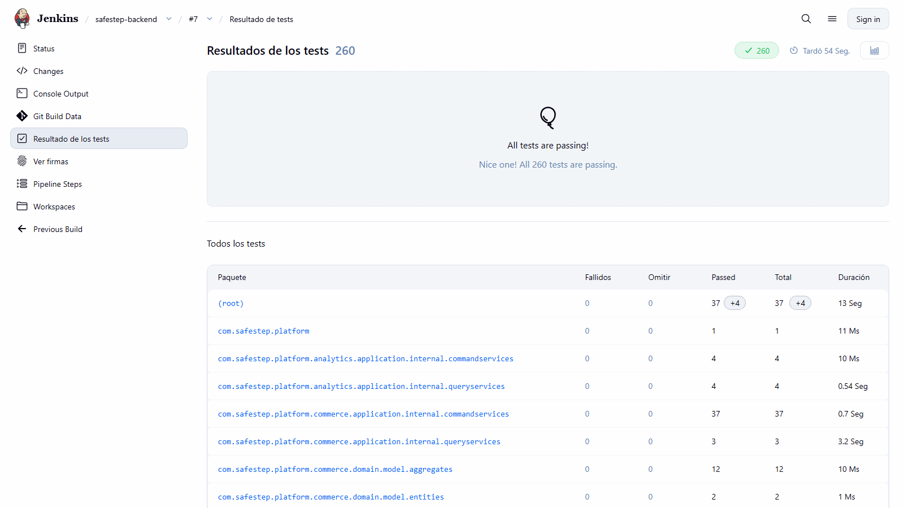
  <p><i><b>Fuente</b>: Elaboración propia.</i></p>
</div>

<div align="center">
  <p><b>Captura:</b> Reporte de las pruebas de sistema de la aplicación web (Cucumber)</p>
  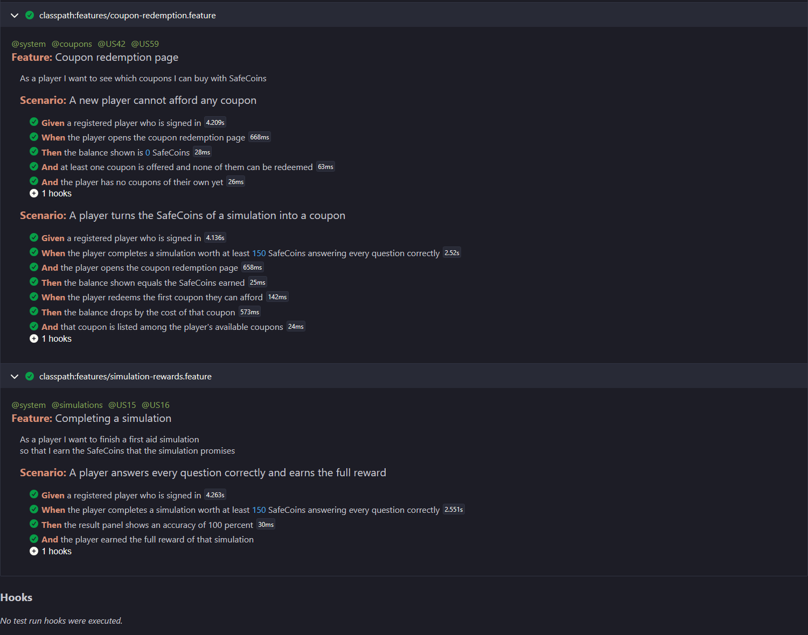
  <p><i><b>Fuente</b>: Elaboración propia.</i></p>
</div>

<div align="center">
  <p><b>Captura:</b> Reporte de las pruebas instrumentadas de la aplicación Android (9 de 9)</p>
  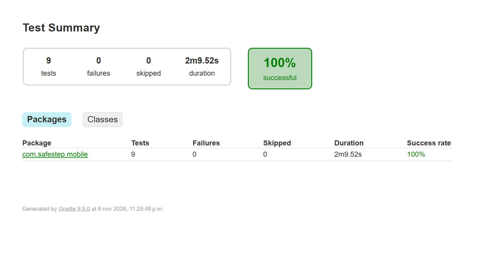
  <p><i><b>Fuente</b>: Elaboración propia.</i></p>
</div>

**Commits Realizados (testing):** repositorios de los proyectos de prueba y de la configuración que las ejecuta.

<table align="center" border="1" cellpadding="8" cellspacing="0" style="border-collapse: collapse; width: 100%; font-family: Arial, sans-serif;">
    <tbody>
        <tr><td><b>Repository</b></td><td><b>Branch</b></td><td><b>Commit Id</b></td><td><b>Commit Message</b></td><td><b>Commit Message Body</b></td><td><b>Committed on (Date)</b></td></tr>
        <tr><td>safestept-backend</td><td>main</td><td>1103ccf</td><td>ci: fail the build when Checkstyle finds violations</td><td>Run checkstyle:check in a Validate Checkstyle stage and let the plugin fail on any Google Checks violation, so style is enforced before the tests run.</td><td>07/11/2026</td></tr>
        <tr><td>safestept-backend</td><td>main</td><td>c79a1be</td><td>feat(gamification): apply the 70 percent pass threshold and the halving reward on the server</td><td>—</td><td>08/11/2026</td></tr>
        <tr><td>safestept-backend</td><td>main</td><td>b6707df</td><td>fix(seed): repair accented characters damaged by a wrong encoding in the seed data</td><td>—</td><td>08/11/2026</td></tr>
    </tbody>
</table>

<table align="center" border="1" cellpadding="8" cellspacing="0" style="border-collapse: collapse; width: 100%; font-family: Arial, sans-serif;">
    <tbody>
        <tr><td><b>Repository</b></td><td><b>Branch</b></td><td><b>Commit Id</b></td><td><b>Commit Message</b></td><td><b>Commit Message Body</b></td><td><b>Committed on (Date)</b></td></tr>
        <tr><td>safestept-frontend</td><td>main</td><td>deeba5c</td><td>refactor: format prices without a backtracking regex and cover formatPrice with unit tests (typescript:S8786)</td><td>—</td><td>08/11/2026</td></tr>
        <tr><td>safestept-frontend</td><td>main</td><td>5d88d26</td><td>test(e2e): restore the Selenium and Cucumber system tests with the e2e Angular configuration</td><td>—</td><td>08/11/2026</td></tr>
        <tr><td>safestept-frontend</td><td>main</td><td>731b98c</td><td>test(e2e): cover the simulation reward, coupon redemption and administrator coupon flows</td><td>—</td><td>08/11/2026</td></tr>
    </tbody>
</table>

<table align="center" border="1" cellpadding="8" cellspacing="0" style="border-collapse: collapse; width: 100%; font-family: Arial, sans-serif;">
    <tbody>
        <tr><td><b>Repository</b></td><td><b>Branch</b></td><td><b>Commit Id</b></td><td><b>Commit Message</b></td><td><b>Commit Message Body</b></td><td><b>Committed on (Date)</b></td></tr>
        <tr><td>safeStept-android</td><td>main</td><td>8a80008</td><td>test: cover the API client, session refresh, simulation flow, cart totals and validation</td><td>—</td><td>08/11/2026</td></tr>
        <tr><td>safeStept-android</td><td>main</td><td>af560dd</td><td>test: add system tests that drive the app against the real API on the emulator</td><td>—</td><td>08/11/2026</td></tr>
        <tr><td>safeStept-android</td><td>main</td><td>d9fcc3c</td><td>test: add the screenshot tour, share the system test set-up and document the app in the README</td><td>—</td><td>08/11/2026</td></tr>
        <tr><td>safeStept-android</td><td>main</td><td>e379c06</td><td>test: wait for images and lists to settle before each evidence screenshot</td><td>—</td><td>08/11/2026</td></tr>
    </tbody>
</table>

#### 5.2.1.6.6. Execution Evidence for Sprint Review

El Sprint 6 dejó la aplicación Android con todos los flujos del jugador y la aplicación web verificada de extremo a extremo. Las capturas siguientes muestran la aplicación Android, tomadas por una prueba automática en un emulador contra el backend real, y la aplicación web durante las pruebas de sistema.

**Resumen de lo Alcanzado:**

- Ingreso, registro y recuperación de contraseña en Android.
- Lista de simulaciones, paso con retroalimentación y resultado con la recompensa que acreditó el servidor.
- Progreso con sus cinco pestañas, tienda, canje de cupones y carrito con descuento.
- Resultado de una simulación y canje de un cupón en la aplicación web durante las pruebas de sistema.

<div align="center">
<table>
<tr>
<td align="center">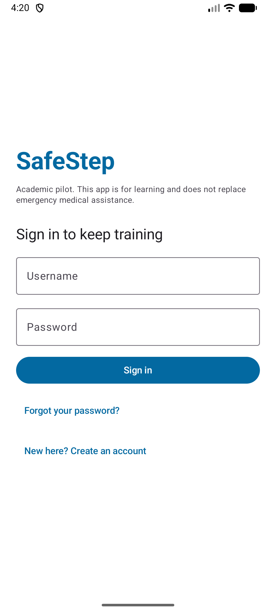<br><i>Ingreso</i></td>
<td align="center">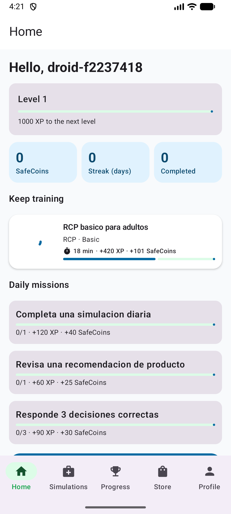<br><i>Inicio</i></td>
<td align="center">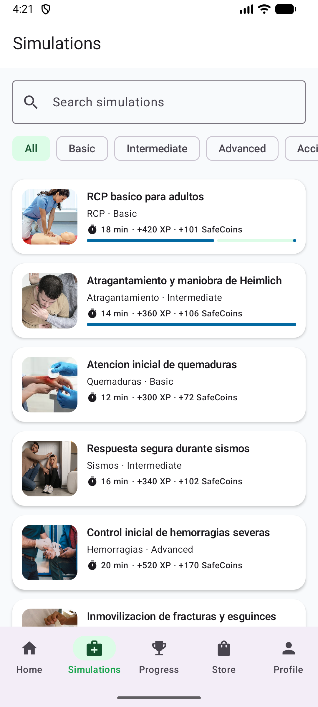<br><i>Simulaciones</i></td>
</tr>
<tr>
<td align="center">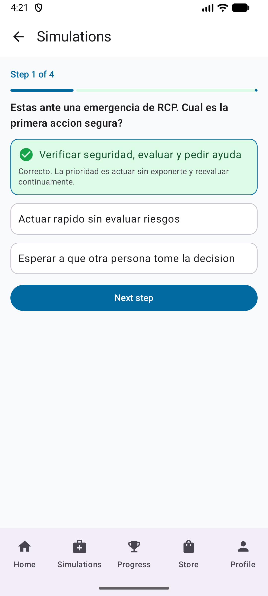<br><i>Retroalimentación</i></td>
<td align="center">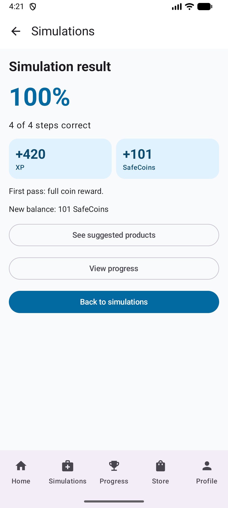<br><i>Resultado</i></td>
<td align="center">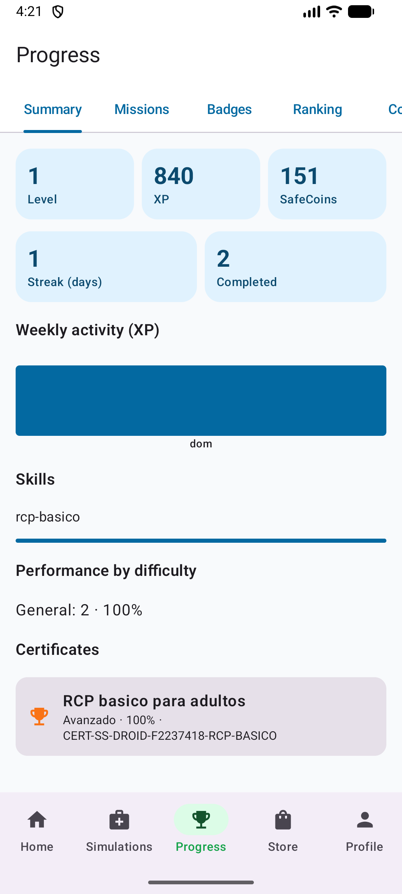<br><i>Progreso</i></td>
</tr>
<tr>
<td align="center">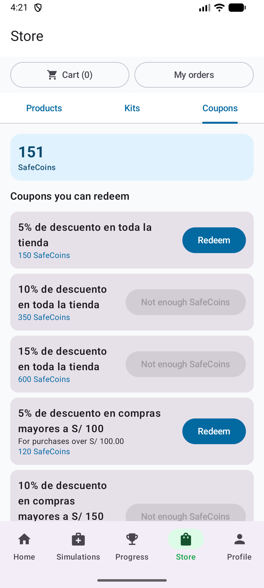<br><i>Cupones</i></td>
<td align="center">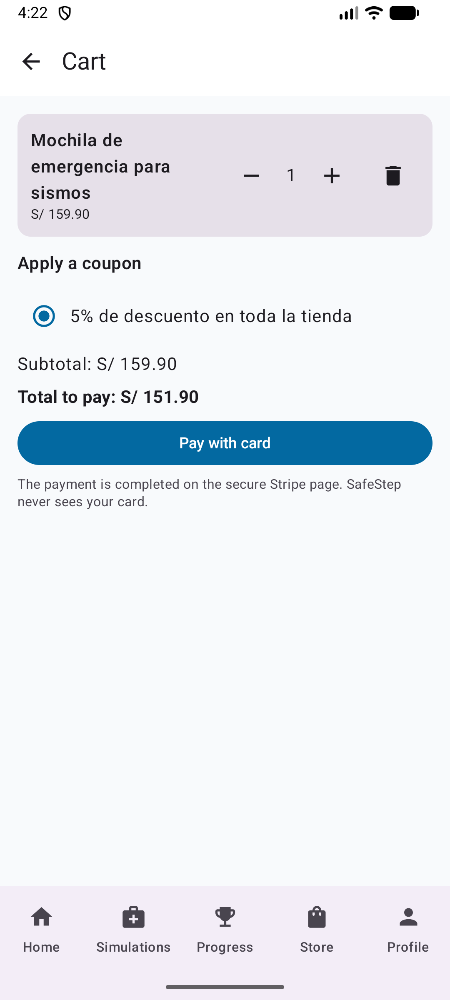<br><i>Carrito con cupón</i></td>
<td align="center">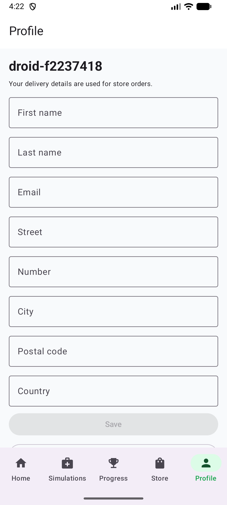<br><i>Perfil</i></td>
</tr>
</table>
<p><i><b>Fuente</b>: Elaboración propia (SafeStep Android 1.0.0). Las 21 capturas están en 5.2.5.</i></p>
</div>

<div align="center">
  <p><b>Captura:</b> Resultado de una simulación en la aplicación web durante la prueba de sistema</p>
  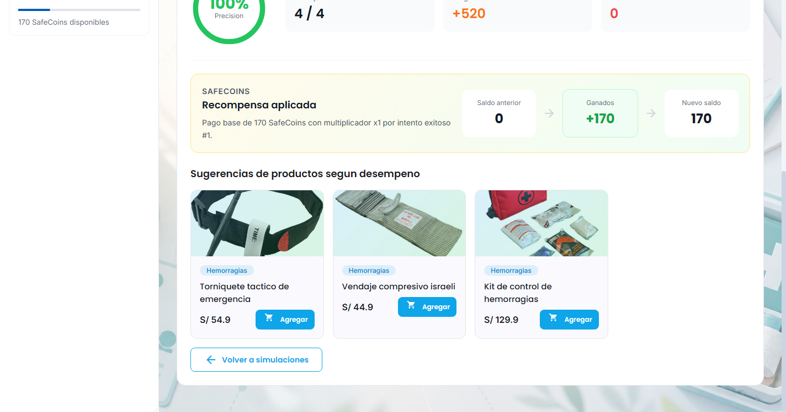
  <p><i><b>Fuente</b>: Elaboración propia.</i></p>
</div>

<div align="center">
  <p><b>Captura:</b> Página de canje de cupones después de canjear un cupón</p>
  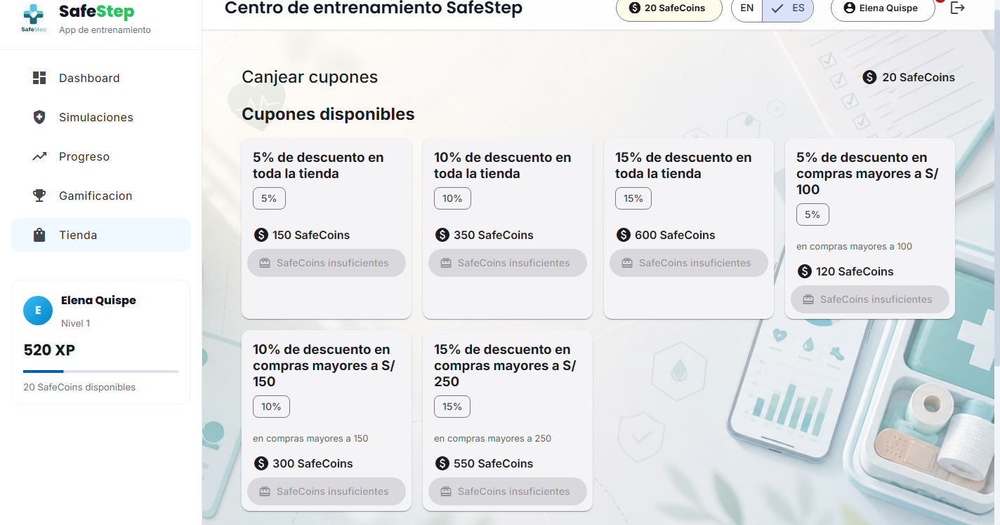
  <p><i><b>Fuente</b>: Elaboración propia.</i></p>
</div>


#### 5.2.1.6.7. Services Documentation Evidence for Sprint Review

En este Sprint no se agregaron *endpoints* nuevos al backend. Los cambios de contrato son de comportamiento y no de forma: la documentación OpenAPI publicada (5.2.7) sigue siendo vigente porque los campos de las respuestas no cambiaron.

| Endpoint | Acción | Qué cambió en el Sprint 6 |
|----------|--------|---------------------------|
| `POST /simulations/{id}/attempts` | Registra un intento y publica el evento | El servidor decide la recompensa: 70 % de aciertos como mínimo y mitad por cada intento aprobado previo |
| `GET /gamification/summary/me` | Resumen del jugador | Devuelve las monedas y la experiencia que resultan de la nueva regla |
| `GET /gamification/coin-transactions/me` | Movimientos de monedas | `successful` se deriva de la exactitud y `multiplier` informa el factor aplicado (1, 0.5, 0.25...) |

La aplicación Android consume 36 operaciones de la API (lista completa en 5.2.5.2), de modo que es el segundo cliente que ejerce el contrato documentado. El repositorio de los servicios es <a href="https://github.com/1ASI0732-2620-9090-Grupo-4/safestept-backend.git" style="word-break: break-all; overflow-wrap: anywhere;">https://github.com/1ASI0732-2620-9090-Grupo-4/safestept-backend.git</a>; los commits relacionados son `c79a1be` y `b6707df`.

#### 5.2.1.6.8. Software Deployment Evidence for Sprint Review

El despliegue del Sprint 6 se concentró en el pipeline y en los artefactos ejecutables. Los pasos, con sus capturas y comandos, están en 7.1 y 7.2.

- **Stack local con Docker Compose:** imagen de PostgreSQL con el script de inicialización y un Compose que levanta la API junto con su base de datos (`a30e086`, `d782a20`).
- **Imagen del backend en el pipeline:** Jenkins recibió el cliente de Docker y construye la imagen de la aplicación (`c940acf`, `949483a`).
- **Publicación en Docker Hub:** la etapa final publica la imagen con la etiqueta del número de ejecución y con `latest` (`793e367`). La ejecución #7 publicó las etiquetas `7` y `latest`.
- **Aplicación Android:** el comando `./gradlew assembleDebug` genera el APK de depuración de 1.0.0 (unos 20 MB). No se generó un APK firmado de publicación.
- **Render:** el despliegue de producción (7.3) se produce cuando los cambios llegan a la rama `main` del repositorio remoto.

<div align="center">
  <p><b>Captura:</b> Vista de etapas de Jenkins tras la ejecución #7</p>
  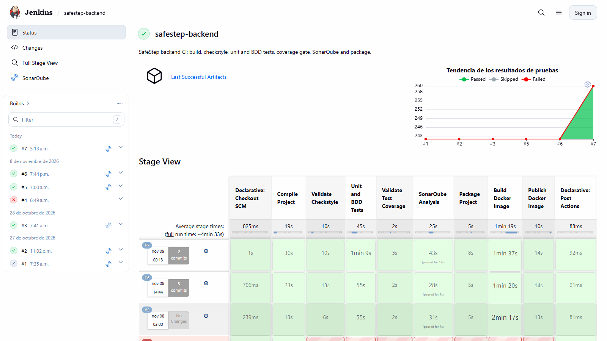
  <p><i><b>Fuente</b>: Elaboración propia.</i></p>
</div>

<div align="center">
  <p><b>Captura:</b> Etiquetas de la imagen publicada en Docker Hub</p>
  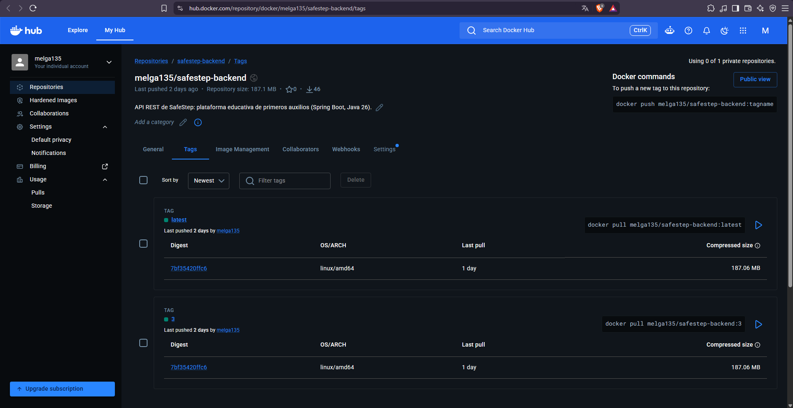
  <p><i><b>Fuente</b>: Elaboración propia.</i></p>
</div>

<div align="center">
  <p><b>Captura:</b> Servicios del stack de Docker Compose en ejecución</p>
  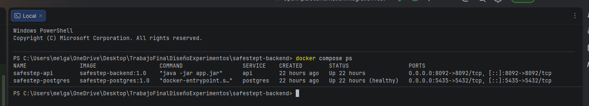
  <p><i><b>Fuente</b>: Elaboración propia.</i></p>
</div>

#### 5.2.1.6.9. Team Collaboration Insights during Sprint

En esta sección se explica cómo se desarrollaron las actividades del Sprint 6 y se presentan los analíticos de colaboración.

**Distribución de Trabajo:** el equipo repartió las 35 tareas del Sprint Backlog 6 en partes iguales, 7 por integrante, y cada integrante lidera un aspecto de la matriz LACX (5.2.1.6.2): Tello Palacios, Fabrizio Rafael (Code Quality & CI), Sanchez Arenas, Manuel Angel (System Tests), Melgarejo Quiroz, Josep Eliu (Android App), Aylas De La Cruz, Paulo Smit (Rewards & Terms) y Palacios Jáuregui, Kalid Jesus (Experiments & Docs). Las tareas de cada uno son: Palacios Jáuregui, Kalid Jesus: T601, T602, T618, T620, T624, T627, T630; Sanchez Arenas, Manuel Angel: T603, T613, T614, T615, T623, T626, T632; Melgarejo Quiroz, Josep Eliu: T606, T607, T616, T617, T619, T631, T634; Tello Palacios, Fabrizio Rafael: T604, T605, T610, T611, T612, T621, T633; Aylas De La Cruz, Paulo Smit: T608, T609, T622, T625, T628, T629, T635.

**Métricas de Colaboración:**

<table align="center" border="1" cellpadding="8" cellspacing="0" style="border-collapse: collapse; width: 100%; font-family: Arial, sans-serif;">
    <tbody>
        <tr><td><b>Miembro</b></td><td><b>Repositorio</b></td><td><b>Tareas</b></td><td><b>Commits (según tareas asignadas)</b></td><td><b>Líneas agregadas</b></td><td><b>Líneas eliminadas</b></td><td><b>PRs merged</b></td></tr>
        <tr><td>Palacios Jáuregui, Kalid Jesus</td><td>safeStept-android / safestept-backend</td><td>7</td><td>6</td><td>12,714</td><td>10,074</td><td>—</td></tr>
        <tr><td>Sanchez Arenas, Manuel Angel</td><td>safeStept-android / safestept-backend / safestept-frontend</td><td>7</td><td>6</td><td>2,334</td><td>60</td><td>—</td></tr>
        <tr><td>Melgarejo Quiroz, Josep Eliu</td><td>safeStept-android / safestept-backend / safestept-frontend</td><td>7</td><td>6</td><td>4,159</td><td>843</td><td>—</td></tr>
        <tr><td>Tello Palacios, Fabrizio Rafael</td><td>safestept-backend</td><td>7</td><td>6</td><td>89</td><td>12</td><td>—</td></tr>
        <tr><td>Aylas De La Cruz, Paulo Smit</td><td>safeStept-android / safestept-backend / safestept-frontend / safestept-landing-page</td><td>7</td><td>7</td><td>1,640</td><td>168</td><td>—</td></tr>
    </tbody>
</table>

Los commits se asocian a cada integrante según las tareas del Sprint Backlog 6 (5.2.1.6.3) que implementan, y cada commit se cuenta una sola vez, en el área principal que modifica. Se consideran los 31 commits de desarrollo del Sprint en los repositorios de backend, frontend, Landing Page y aplicación Android (19, 6, 1 y 5 respectivamente; los commits de fusión no se cuentan). Los commits asociados son: Palacios Jáuregui, Kalid Jesus (`487a8a7`, `2a72367`, `d69a1e6`, `d9fcc3c`, `e379c06`, `b6707df`); Sanchez Arenas, Manuel Angel (`e1b022f`, `7e0cff3`, `0a34209`, `5d88d26`, `731b98c`, `af560dd`); Melgarejo Quiroz, Josep Eliu (`7daa9dd`, `f105e82`, `d6afc1a`, `f68acea`, `deeba5c`, `ae8ccbb`); Tello Palacios, Fabrizio Rafael (`1103ccf`, `c940acf`, `949483a`, `a8b895c`, `709bacf`, `793e367`); Aylas De La Cruz, Paulo Smit (`a30e086`, `d782a20`, `8a80008`, `c79a1be`, `138a384`, `5a1b778`, `fd35c88`). Las líneas incluyen los archivos de datos y de configuración que cada commit modifica; el commit `ae8ccbb` (reconstrucción de la aplicación Android) concentra la mayoría de las líneas agregadas de la columna de Melgarejo Quiroz, Josep Eliu. El trabajo de documentación del informe (tareas T615, T630 a T635) se registra en el repositorio del informe y no se cuenta en esta tabla. Esta asociación es por tareas asignadas, no por autor del commit: la cuenta con la que se confirmó cada cambio puede ser distinta de la del integrante responsable de la tarea.

