 
 

    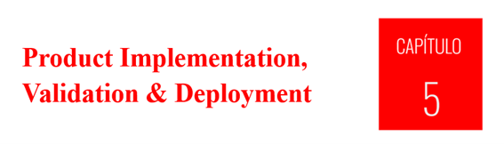

 
 

# 5.2. Landing Page, Services & Applications Implementation.

### 5.2.1.6. Sprint 6 (versión 2): todo lo realizado

Este documento cuenta, sin seguir la plantilla de los Sprints anteriores, **todo lo que el equipo hizo entre el 9 de octubre y el 10 de noviembre de 2026**. La versión con la estructura habitual (planificación, matriz LACX, backlog, evidencias) está en `5-2-1-6-Sprint-6.md`. Aquí el orden lo da el trabajo: primero las cifras, después la línea de tiempo, luego cada frente con su motivo, su resultado y su evidencia, y al final los hallazgos, lo que no se hizo y la lista completa de commits.

## 1. Resumen en cifras

| Frente | Antes del Sprint | Al cierre del Sprint |
| --- | --- | --- |
| Observaciones de estilo (Checkstyle, reglas de Google) | 8,128 en 367 archivos | **0**, y el build falla ante cualquier infracción |
| Incidencias de mantenibilidad (SonarQube, perfil *Sonar way extended*) | 86 en el backend y 11 en el frontend | **0** en ambos; queda solo la vulnerabilidad CSRF, que es una decisión de diseño |
| Pruebas del backend | 242 | **260** (223 unitarias y de integración y 37 escenarios BDD) |
| Cobertura del backend | 93.8 % (JaCoCo) | 93.9 % (JaCoCo) y 91.6 % (SonarQube, líneas) |
| Pruebas de sistema de la aplicación web | Ninguna (la suite se había retirado el 8 de octubre) | **15 de 15** escenarios de Selenium y Cucumber |
| Aplicación Android | Prototipo de una pantalla | Versión **1.0.0** con todos los flujos del jugador: 25 pruebas unitarias y 9 instrumentadas aprobadas, 21 capturas |
| Pipeline de Jenkins | 3 ejecuciones del pipeline anterior | **7 ejecuciones**; la #7 aprueba las 10 etapas y publica la imagen en Docker Hub |
| Regla de recompensa (70 % y mitad por repetición) | Solo en el frontend web | **En el servidor**, con una sola fuente de verdad para web y móvil |
| Experimentos | Sin planificar | **10 experimentos planificados y diseñados** (capítulo 8); ninguno ejecutado |
| Informe | Capítulos 6 a 8 y diseño móvil sin escribir | Capítulos 6, 7 y 8 (hasta 8.3.2), 4.4, 4.5, 5.2.5 y 6.2.2 escritos |

## 2. Línea de tiempo

| Fecha | Qué pasó |
| --- | --- |
| 9 de octubre | Se publica la página de términos y condiciones en el frontend y se enlaza desde el registro. |
| 19 de octubre | La Landing Page recibe su propia página de términos y política de privacidad, y se corrigen afirmaciones que el producto no podía sostener (por ejemplo, «+50,000 estudiantes capacitados» pasa a «Piloto académico de aprendizaje»). |
| 25 al 28 de octubre | El pipeline aprende a construir y publicar imágenes: el job compila `main`, se crean la imagen de PostgreSQL y el stack de Docker Compose, Jenkins recibe el cliente de Docker, se agrega la etapa de la imagen, se corrige el webhook de SonarQube y se publica en Docker Hub. Jenkins ejecuta las compilaciones #1 a #3. |
| 28 al 30 de octubre | Se documentan la entrega continua con Docker y el despliegue en Render (7.2 y 7.3), se capturan las evidencias de pruebas, de Docker y de CI, se renombra «Trabajo Parcial» a TB1 y se redactan 6.2.1.1 y 6.2.1.2. |
| 30 de octubre | A pedido del profesor se reconstruye en SonarQube cómo evolucionó la calidad: 12 etapas del backend y 3 del frontend. |
| 7 de noviembre | Limpieza de estilo del backend en cinco tandas (de 8,128 a 0 observaciones) y compuerta de Checkstyle en el build. |
| 8 de noviembre | Se cambia SonarQube al perfil extendido y se corrigen 97 incidencias. Jenkins #4 (roja a propósito), #5 y #6. Se restaura y amplía la suite de Selenium. Se redactan 8.1 a 8.3.2. Se detecta que la recompensa solo se aplicaba en la web y se mueve al servidor. Se repara el seed. Se reconstruye la aplicación Android, con sus pruebas y capturas. Se redactan 4.4, 4.5 y 5.2.5. |
| 9 de noviembre | Jenkins #7 con 260 pruebas. Revisión del informe contra el enunciado, redacción de 6.2.2, corrección del curso en 6.3.3, de la portada y de los términos que el Anexo E penaliza. |
| 10 de noviembre | Se documenta el Sprint 6 con la estructura habitual y se agrega la captura de la línea base de Checkstyle a 6.2.1.1. |

## 3. Frentes de trabajo

### 3.1. Docker y publicación de la imagen

**Para qué.** Que cada cambio aprobado por el pipeline termine en un artefacto ejecutable, y que cualquiera pueda levantar la API con su base de datos con un solo comando.

**Qué se hizo.**

- **Imagen de PostgreSQL** (`a30e086`): `postgres:18-alpine` con el script que crea la base `safestep`; las tablas las genera la aplicación. Se publica en el puerto 5435 del anfitrión porque el 5432 estaba ocupado.
- **Stack de Docker Compose** (`d782a20`): levanta la API junto con su base de datos, con un volumen para los datos.
- **Jenkins con Docker** (`c940acf`): el contenedor de Jenkins recibe el cliente de Docker y acceso al motor del anfitrión.
- **Etapa «Build Docker Image»** (`949483a`): construye la imagen del backend con el `Dockerfile` multietapa que ya existía (Temurin 26).
- **Webhook de SonarQube** (`a8b895c`): SonarQube no podía avisar a Jenkins dentro de la red de Docker, y por eso la compilación #1 se abortó tras esperar 10 minutos el Quality Gate. Se habilitó el aviso y el resto de las ejecuciones lo recibió.
- **Job sobre `main`** (`709bacf`): el job de Jenkins compila la rama `main` del repositorio.
- **Publicación en Docker Hub** (`793e367`): la última etapa publica `melga135/safestep-backend` con la etiqueta de la ejecución y con `latest`, con una credencial de Jenkins definida como código.

**Decisión.** El frontend en Docker se descartó por ahora: sigue desplegándose en Render y se consultará al profesor si lo exige.

**Resultado.** Las ejecuciones #3, #5, #6 y #7 publicaron imagen. Las capturas están en 7.1 y 7.2.

  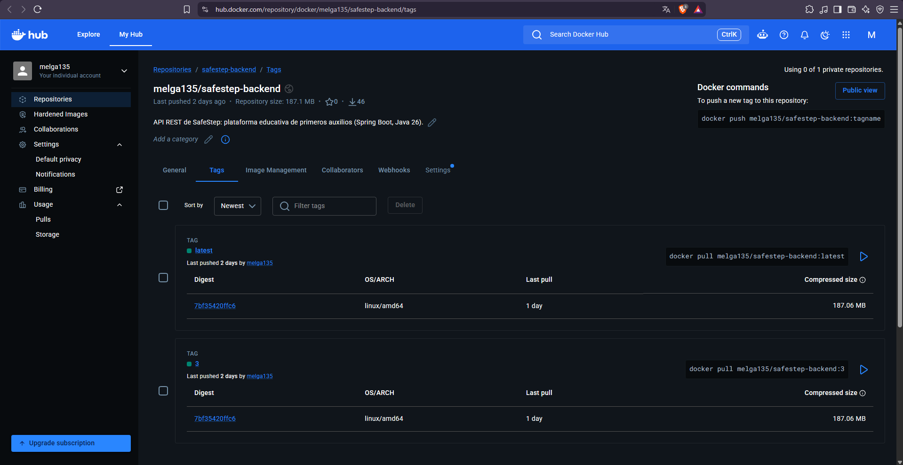
  
<i><b>Figura.</b> Etiquetas de la imagen publicada por el pipeline en Docker Hub. <b>Fuente</b>: Elaboración propia.</i>

### 3.2. Estilo de código: de 8,128 observaciones a cero

**Punto de partida.** La primera medición con las reglas de Google dio 8,128 observaciones en 367 de los 377 archivos del backend. Eran diferencias de estilo y no defectos: sangría de 4 espacios en lugar de 2 (5,582), líneas de más de 100 caracteres (732), Javadoc ausente (827) y orden de las importaciones (267), entre otras.

**Cómo se corrigió, en tandas medidas con la caché de Checkstyle limpia.**

| Tanda | Commit | Cambio | Observaciones |
| --- | --- | --- | --- |
| 1 | `487a8a7` | Formato automático con google-java-format | 8,128 → 1,280 |
| 2 | `2a72367`, `d69a1e6` | Importaciones explícitas, llaves, declaraciones separadas y nombres descriptivos | → 873 |
| 3 | `e1b022f` | Javadoc de `iam` y `profiles` | → 698 |
| 4 | `7e0cff3` | Javadoc de `commerce` y `gamification` | → 183 |
| 5 | `0a34209` | Javadoc de `simulation`, `analytics` y el shared kernel | → **0** |
| Compuerta | `1103ccf` | `checkstyle:check` falla el build ante cualquier infracción | — |

**La compuerta se probó.** La ejecución #4 de Jenkins falló a propósito con un import desordenado en un archivo, y se detuvo en la etapa de estilo sin ejecutar las siguientes; ese commit temporal se descartó y nunca se publicó. La #5, sin infracciones, pasó las diez etapas.

  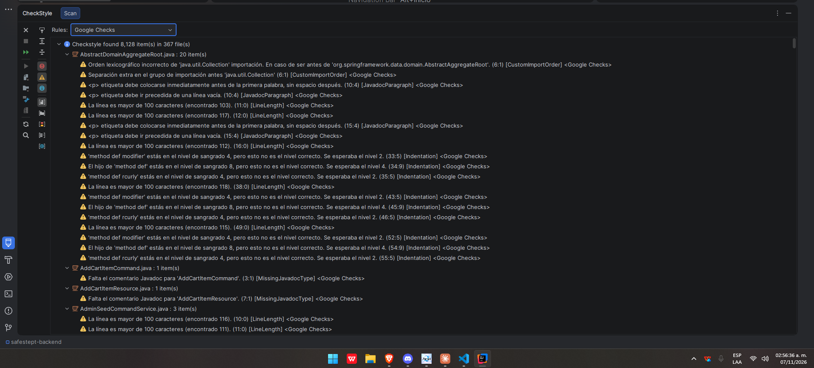
  
<i><b>Figura.</b> Línea base: plugin Checkstyle de IntelliJ con la regla Google Checks, 8,128 observaciones en 367 archivos. <b>Fuente</b>: Elaboración propia.</i>

  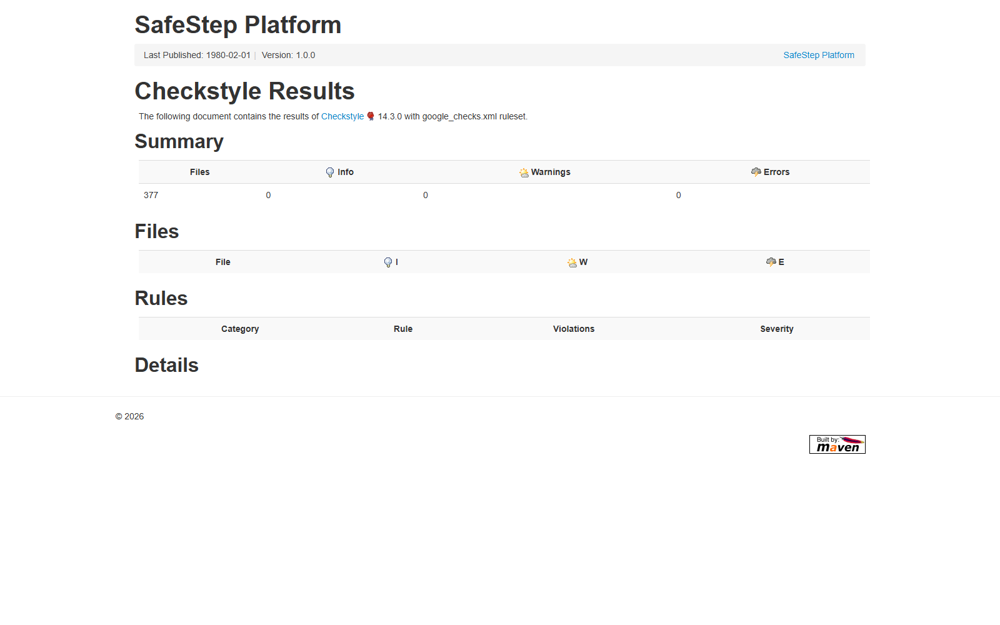
  
<i><b>Figura.</b> Informe de Checkstyle tras la tanda 5: 377 archivos, 0 advertencias y 0 errores. <b>Fuente</b>: Elaboración propia.</i>

**Qué no cubre.** Checkstyle no revisa `src/test` (el plugin lo excluye por defecto: 54 archivos sin medir).

### 3.3. SonarQube: reconstrucción de la evolución y perfil extendido

**La reconstrucción (30 de octubre).** El profesor pidió ver cómo empezó el trabajo y cómo mejoró. Como los análisis reales empezaron tarde y varios cambios del historial venían mezclados en un mismo commit, se analizaron en orden **12 estados del backend y 3 del frontend**, construidos con archivos de commits reales y validados antes (compilan y pasan sus pruebas: de 41 pruebas en la base a 242 en el estado final). El informe la presenta como reconstrucción y no como el orden cronológico original.

| Etapa del backend | Qué se agrega | Cobertura (SonarQube) | Quality Gate |
| --- | --- | --- | --- |
| 00 | Base importada del curso anterior | 43.2 % | Passed |
| 01 | Cupones (estado previo al TB1) | 47.3 % | **Failed** (cobertura nueva 52.5 %, duplicación nueva 6.1 %, 7 incidencias nuevas) |
| 02 | JaCoCo, Checkstyle y plugin de SonarQube | 47.3 % | Passed |
| 03 a 05 | Pruebas unitarias por contexto | 67.8 %, 80.8 % y 90.9 % | Passed, Passed y **Failed** (1 incidencia nueva) |
| 06 | BDD, Karate e integración continua | 91.7 % | Passed |
| 07 | Corrección de CORS (`java:S5122`) | 91.7 % | Passed |
| 08 | Dos bugs (`java:S2184`, `java:S2637`) | 91.7 % | Passed |
| 09 | 400 ante un JSON mal formado | 91.7 % | **Failed** (aparece `java:S1452`) |
| 10 y 11 | Corrección de `java:S1452` y estado final | 91.7 % | Passed |

Lo que mostró: el Quality Gate hizo su trabajo tres veces, deteniendo código nuevo sin pruebas o con una incidencia. En el frontend, la cobertura real es de 0.04 % y el 100 % que Angular muestra por defecto es engañoso.

  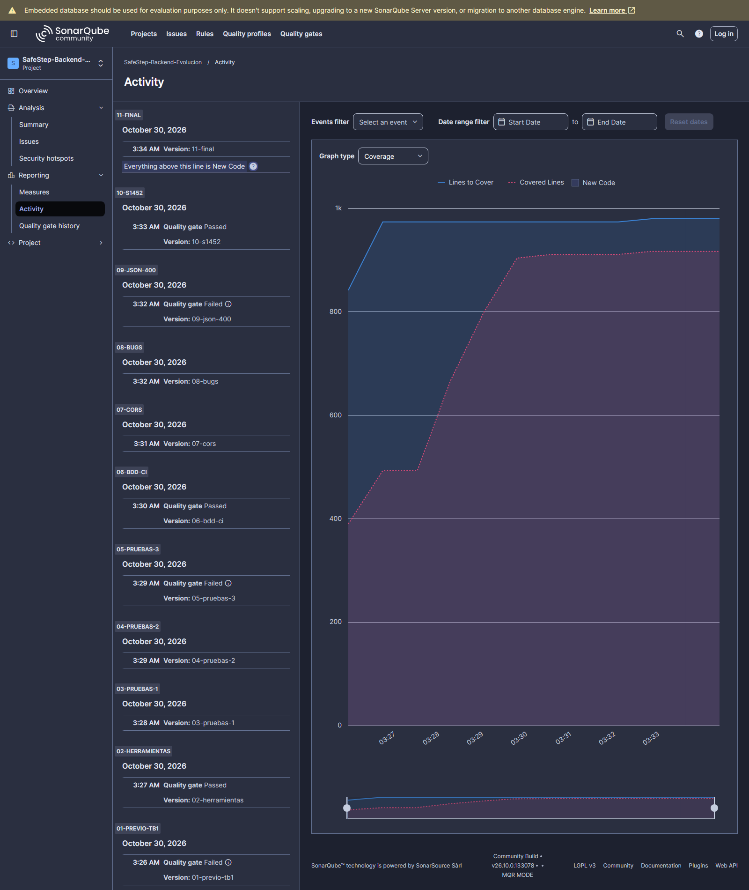
  
<i><b>Figura.</b> Evolución de la cobertura del backend a lo largo de las 12 etapas. <b>Fuente</b>: Elaboración propia.</i>

**El perfil extendido (8 de noviembre).** Con el perfil *Sonar way core* el backend tenía 0 incidencias de mantenibilidad, pero el Quality Gate solo evalúa el código nuevo, así que ocultaba la deuda anterior. Al pasar los proyectos reales a *Sonar way extended* (337 reglas de Java y 251 de TypeScript) aparecieron 86 incidencias en el backend y 11 en el frontend, que se corrigieron sin cambiar el comportamiento:

| Repositorio | Commit | Incidencias corregidas |
| --- | --- | --- |
| Backend | `7daa9dd` | 65 `java:S1452`: `ResponseEntity<Object>` en lugar del comodín |
| Backend | `f105e82` | 16 `java:S1192`, 2 `java:S1186` y 1 `java:S2696`: constantes y métodos vacíos documentados |
| Backend | `d6afc1a` | 2 `java:S3776`: creación de órdenes y datos de comercio divididos en métodos más pequeños |
| Frontend | `f68acea` | 9 `typescript:S9383` (promesas ignoradas marcadas con `void`) y `typescript:S7723` |
| Frontend | `deeba5c` | `typescript:S8786`: `formatPrice` sin expresión regular con retroceso, comparada con la anterior sobre 50,018 valores, con 4 pruebas nuevas |

Tras las correcciones, SonarQube reporta en el backend 0 *code smells*, 0 bugs, 0.9 % de duplicación, el Quality Gate aprobado y la misma vulnerabilidad documentada (CSRF deshabilitado a propósito, aceptable en una API con JWT). Se creó el proyecto `safestep-frontend` con el perfil extendido: de 12 incidencias a 0 y de 0.4 % a 0.7 % de cobertura.

### 3.4. Jenkins: siete ejecuciones

| Ejecución | Resultado | Qué ocurrió |
| --- | --- | --- |
| #1 | Abortada | SonarQube no podía enviar el aviso del Quality Gate; Jenkins esperó 10 minutos |
| #2 | Éxito | Nueve etapas con la construcción de la imagen |
| #3 | Éxito | Diez etapas: se agrega la publicación en Docker Hub |
| #4 | Fallo (a propósito) | Infracción de Checkstyle: el pipeline se detiene en la etapa de estilo |
| #5 | Éxito | Backend sin infracciones; compuerta de estilo en verde |
| #6 | Éxito | Perfil extendido y 86 incidencias corregidas: 242 pruebas, 3 min 58 s |
| #7 | Éxito | Recompensa en el servidor: **260 pruebas**, JaCoCo 93.9 %, 5 min 8 s |

  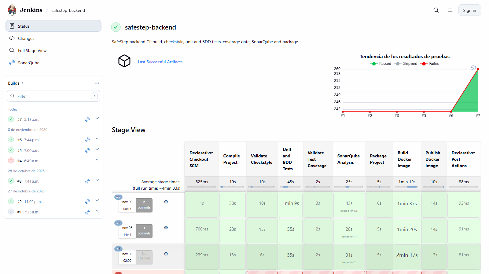
  
<i><b>Figura.</b> Job <code>safestep-backend</code> tras la ejecución #7: tendencia de pruebas (de 242 a 260) y las diez etapas en verde. <b>Fuente</b>: Elaboración propia.</i>

### 3.5. Cambios de producto

**La recompensa pasó al servidor (`c79a1be`).** Al comparar los dos clientes se encontró que el umbral de aprobación de 70 % y el pago de la mitad por cada repetición aprobada solo existían en el frontend web; el backend acreditaba siempre la recompensa completa. Eso hacía que la aplicación móvil no pudiera mostrar los mismos valores y que el capítulo 8 describiera como vigentes reglas que el servidor no aplicaba. Ahora `RewardPolicy` decide: un intento es exitoso con 70 % o más de aciertos; las monedas son `floor(base × exactitud × 0.5^k)`, con `k` los intentos aprobados previos de esa simulación por ese jugador; la experiencia es proporcional a la exactitud aunque no se apruebe. La bandera `successful` de los movimientos de monedas se deriva de la exactitud. Tienen prueba la política (`RewardPolicyTest`), el manejador, el ensamblador y ocho escenarios de BDD (uno con dos ejemplos).

**Datos semilla reparados (`b6707df`).** El seed tenía tildes dañadas por una codificación incorrecta (por ejemplo «Ã¡» en lugar de «á»). Se reparó con un script y se agregó `SeedDataEncodingTest`, que falla si reaparecen esos caracteres.

**Título de la página de cupones (`fd35c88`).** Al escribir las pruebas de sistema se vio que el panel de administración mostraba «Titulo» (el nombre de una columna) como encabezado de la página de cupones; se separó la clave de traducción.

**Términos y condiciones (`138a384`, `5a1b778`).** Página de términos en el frontend, enlazada desde el registro, y página de términos y de privacidad en la Landing Page, enlazadas desde su pie. Se ajustaron los textos al alcance real: piloto académico, que no sustituye la atención médica, y sin cifras de estudiantes capacitados que no existían.

### 3.6. Pruebas

| Suite | Antes | Ahora | Qué se agregó |
| --- | --- | --- | --- |
| Backend (Maven en Jenkins) | 242 | **260** | Política de recompensa, manejador, ensamblador y codificación del seed |
| BDD (Cucumber, dentro del backend) | 33 escenarios | **37** | `simulation-rewards.feature` reescrito para la regla del 70 % y la mitad por repetición |
| API (Karate) | 36 escenarios | 36 | Se actualizó el ayudante que completa una simulación con un número de aciertos. **No se volvió a ejecutar** contra la API en marcha |
| Sistema web (Selenium y Cucumber) | 0 | **15** | Autenticación, catálogos, recompensa, canje de cupón y administración de cupones |
| Android, unitarias | 0 | **25** | Cliente de la API, sesión, flujo de simulación, carrito y validación |
| Android, instrumentadas | 0 | **9** | Seis escenarios de sistema, dos de interfaz y el recorrido de 21 capturas |

**Pruebas de sistema web.** Se recuperó del historial la suite que se había retirado el 8 de octubre, con la configuración `e2e` de Angular (`5d88d26`): los 12 escenarios originales pasaron sin cambios. Se agregaron tres escenarios (`731b98c`): una simulación completada que paga la recompensa completa, el canje de un cupón con las monedas ganadas y un cupón creado por el administrador que ven los jugadores. Se ejecutaron contra el backend y el frontend reales con una base de datos desechable: **15 de 15** en unos 2 minutos, con Chrome 156, Selenium 4.50.0 y Cucumber 8.0.4. No corren en Jenkins.

  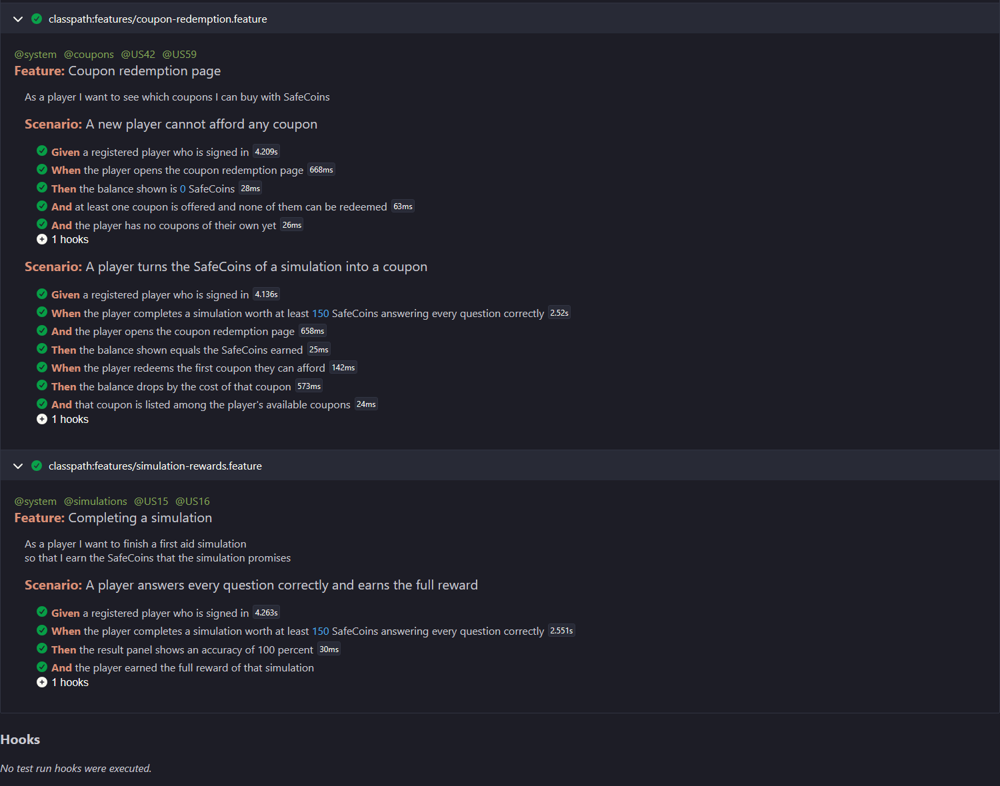
  
<i><b>Figura.</b> Reporte de las pruebas de sistema de la aplicación web. <b>Fuente</b>: Elaboración propia.</i>

### 3.7. Aplicación Android 1.0.0

**Punto de partida.** Un prototipo de 500 líneas: una sola pantalla con pestañas, sin navegación ni `ViewModel`, token solo en memoria y HTTP manual.

**Qué se construyó** (Kotlin, Jetpack Compose y Material 3; 3,300 líneas de producción):

- **Arquitectura:** una carpeta por contexto (`iam`, `profile`, `home`, `simulation`, `gamification`, `commerce`), `ViewModel` con `StateFlow`, navegación con barra inferior de cinco destinos y un contenedor de dependencias creado a mano.
- **Red y sesión:** Retrofit con `kotlinx-serialization`, tokens cifrados con AES-GCM con una clave del Android Keystore y renovación automática del token ante un 401.
- **Flujos:** registro, ingreso, recuperación de contraseña, perfil; catálogo de simulaciones con filtros, pasos con retroalimentación y resultado con la recompensa que acreditó el servidor; progreso en cinco pestañas (resumen, misiones, insignias, ranking, monedas); tienda con productos, kits y cupones; carrito con descuento, pedidos y pago con Stripe en una pestaña del navegador, con verificación del pago al volver. La aplicación consume 36 operaciones de la API.
- **Decisiones:** la administración queda solo en la web; la recompensa la calcula el servidor y la aplicación solo la muestra; el pago real con Stripe se verificó con un servidor simulado.
- **Pruebas y capturas:** 25 unitarias y 9 instrumentadas; una prueba recorre las 21 pantallas contra el backend real y guarda una captura de cada una (con una espera de 3 segundos para que carguen las imágenes). Se grabó un video de 1:45 mientras corría la suite.

Problemas que hubo que resolver: la ruta del proyecto contiene una «ñ» y JUnit no encontraba las clases (se monta en una unidad con ruta ASCII); una interfaz del sistema que tapaba las capturas con el emulador de renderizado por software (se arregló con `-gpu host`); una incompatibilidad de Espresso con la API 37.

<table>
<tr>
<td align="center">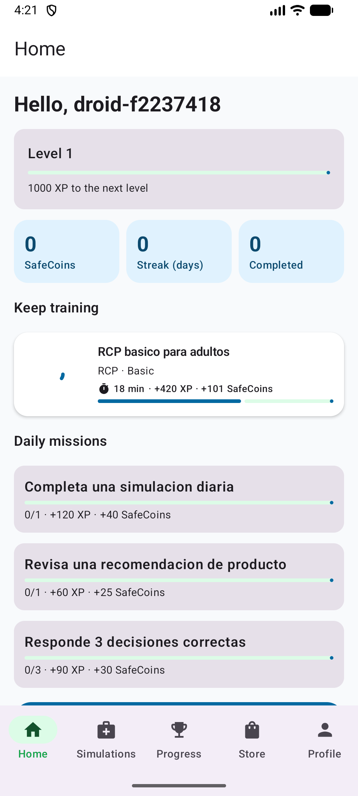 <i>Inicio</i></td>
<td align="center">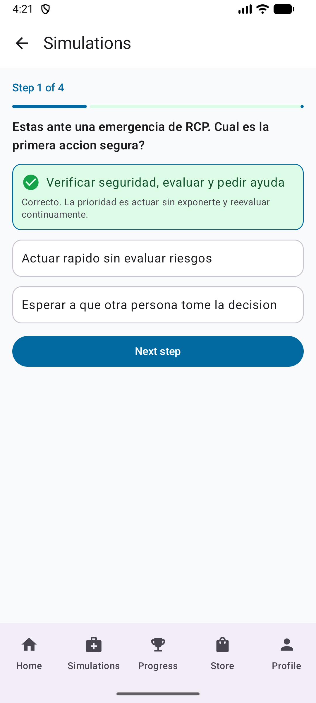 <i>Retroalimentación</i></td>
<td align="center">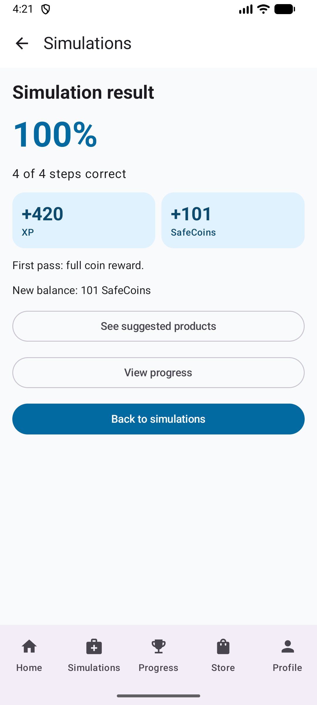 <i>Resultado</i></td>
<td align="center">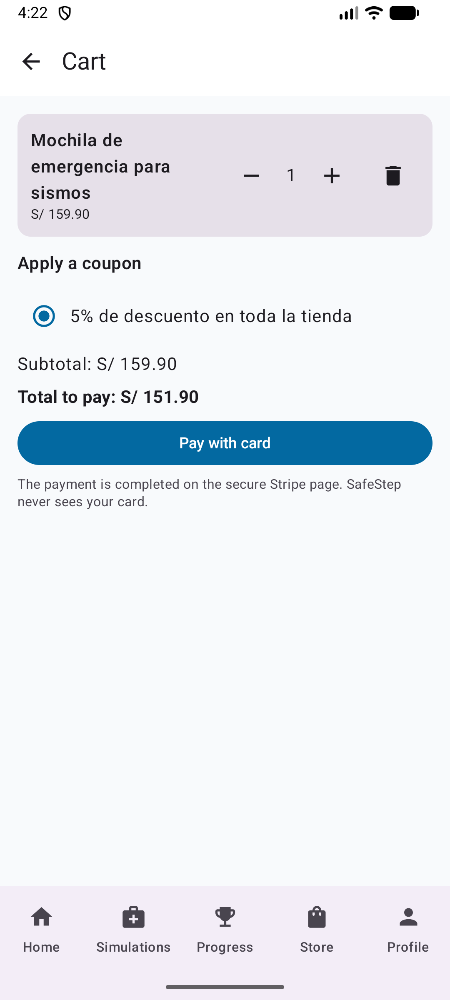 <i>Carrito con cupón</i></td>
</tr>
</table>

<i><b>Fuente</b>: SafeStep Android 1.0.0 en el emulador. Las 21 capturas están en 5.2.5.</i>

### 3.8. Diseño y documentación móvil

Se redactaron las secciones que faltaban de la parte móvil:

- **4.4 Diseño UX/UI móvil:** 16 wireframes numerados (W-01 a W-16), 5 wireflows (uno por meta del jugador), mock-ups con las capturas reales, y user flows con caminos felices e infelices. Los diagramas se generaron como SVG con un script, no con Figma.
- **4.5 Prototipado:** el prototipo Android y su video; el prototipo para iOS se declara fuera de alcance.
- **5.2.5 Evidencia de la aplicación nativa:** cobertura por historia de usuario (US01 a US61), arquitectura, endpoints, resultados de pruebas y las 21 figuras.
- **Textos desactualizados:** 1.2, 2.1, 4.1.3, 4.2 y 8.2 decían que no existía una aplicación nativa y se corrigieron.

  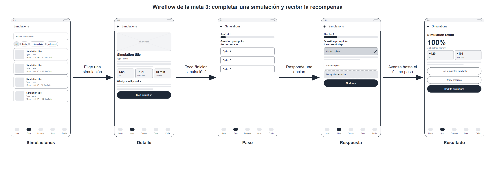
  
<i><b>Figura.</b> Wireflow de la meta «completar una simulación y recibir la recompensa». <b>Fuente</b>: Elaboración propia.</i>

### 3.9. Experimentos (capítulo 8)

Se aplicó el proceso de diseño de experimentos del curso (XDPD) al ciclo central del producto: ganar SafeCoins con las simulaciones y cambiarlas por cupones.

- **8.1 Planificación:** resumen del estado actual, material bruto (ideas, afirmaciones, suposiciones y brechas de conocimiento), 10 preguntas listas para el experimento, un backlog priorizado con confianza, riesgo, impacto e interés (desempata el riesgo) y **10 tarjetas de experimento**. Las tres de mayor prioridad: motivo del abandono de una simulación (Q5), costo del primer cupón (Q7) y guía de bienvenida (Q1).
- **8.2 Diseño:** hipótesis alternativa y nula para cada pregunta, un **catálogo cerrado de 24 métricas** (M1 a M24) que las tarjetas deben citar, medidas, condiciones de control y experimentales, y cálculos de escala con significancia de 0.05, potencia de 0.8, efecto mínimo detectable y corrección de Bonferroni cuando hay tres brazos. Tamaños de muestra, por ejemplo: 91 personas para Q1, 115 para Q7 y 197 para Q6. También se comparan herramientas de recolección y se justifica la elección de un registro propio de eventos, con un plan de seguimiento de 17 eventos.
- **8.3.1 y 8.3.2:** historias To-Be (US62 a US65 y TS32 a TS35, con escenarios de error) y backlog To-Be (elementos #89 a #96, 32 puntos). Las siete tarjetas restantes quedan diseñadas y en espera.

**Estado honesto.** Los experimentos **no se ejecutaron** y el seguimiento de eventos **no se construyó**. El alcance es solo la aplicación web: la aplicación móvil no emite eventos.

### 3.10. Informe

Además de lo ya mencionado:

- **Capítulo 6:** 6.1.4 (pruebas de sistema web), 6.2.1.1 (estilo, con el cuadro por tandas), 6.2.1.2 (SonarQube: 38 capturas de la reconstrucción y las correcciones) y 6.2.2 (revisiones).
- **Capítulo 7:** 7.1 (integración continua con las ejecuciones #1 a #7), 7.2 (entrega continua con Docker) y 7.3 (despliegue continuo en Render).
- **Revisión contra el enunciado (9 de noviembre).** Se revisó el enunciado completo y el informe desde el capítulo 6. Se corrigió el curso y el NRC de 6.3.3, que decían otra materia, la fecha de la portada, las palabras que el Anexo E penaliza y las cifras de los capítulos 5 a 8 con la ejecución #7.
- **6.2.2 Reviews:** se declara con honestidad que los repositorios de producto no tienen pull requests (solo el del informe tiene tres, sin revisiones), y se documenta una revisión técnica del cambio de recompensas, hecha por el autor con apoyo de una herramienta de inteligencia artificial, con cuatro hallazgos y un plan de mejora.

## 4. Hallazgos y lecciones

1. **La cobertura alta no bastaba.** El Quality Gate de SonarQube solo evalúa el código nuevo: con 93.8 % de cobertura y el gate aprobado convivían 8,128 observaciones de estilo y 86 incidencias de mantenibilidad.
2. **Los dos clientes se contradecían.** La regla de recompensa vivía solo en el frontend; el servidor no la aplicaba. Construir la aplicación móvil lo dejó en evidencia.
3. **Las pruebas de sistema encuentran lo que las de API no.** Mostraron el encabezado incorrecto de la página de cupones del administrador.
4. **Los datos de ejemplo tenían errores.** Las tildes dañadas del seed llegaban hasta las pantallas.
5. **El informe afirmaba cosas que no eran ciertas.** 5.1.2 dice que cada rama se integra con un pull request con revisión, y no se hizo; 6.3.3 tenía el curso equivocado; varias secciones decían que no había aplicación nativa.
6. **El 100 % de cobertura que Angular muestra por defecto engaña:** el frontend real tiene 0.7 %.

## 5. Qué no se hizo

- **Los experimentos no se ejecutaron** y el seguimiento de eventos (17 eventos planificados) no se construyó.
- **Pruebas de sistema de la aplicación Android** documentadas como sección 6.1.4: las suites existen, pero no se redactaron en el informe para móvil.
- **Karate** no se volvió a ejecutar tras cambiar el ayudante de recompensas.
- **Stripe real:** no se probó el pago con una cuenta de Stripe; solo con un servidor simulado.
- **6.4 Auditoría de experiencias de usuario** (requiere otro grupo) y **7.4 Monitoreo continuo** (no existe nada implementado) siguen vacíos.
- **APK firmado y `ASSETS_BASE_URL` de publicación** de la aplicación Android.
- **Checkstyle sobre `src/test`:** 54 archivos sin medir.
- **Wireframes en Figma:** los de móvil son diagramas generados por un script.
- **Datos del Sprint que solo conoce el equipo:** fecha y datos de la reunión de planificación, tablero de Trello, video de ejecución y analíticos de GitHub (marcados como pendientes en el informe).

## 6. Trazabilidad con las historias de usuario

| Frente | Historias del Product Backlog | Historias propias del Sprint |
| --- | --- | --- |
| Recompensa en el servidor | US15, US16 | US15 (ajuste) |
| Cupones | US59, US60, US61 | Ajuste del título del administrador |
| Aplicación Android | US01 a US08 (US04 y US05 parciales), US10 a US19, US22 a US32, US34 a US42, US44, US46, US59 a US61 (ver 5.2.5.1) | US67, TS41, TS42 |
| Términos y condiciones | — (requisito de ética y responsabilidad del enunciado) | US66 |
| Pruebas, estilo y CI | TS25 a TS31 | TS36 a TS40 |
| Experimentos | — | SP-01 (spike); US62 a US65 y TS32 a TS35 reservadas para los experimentos |

## 7. Dónde está la evidencia

| Tema | Sección del informe |
| --- | --- |
| Pruebas unitarias, de integración, BDD y de sistema | 6.1 |
| Estilo y calidad estática | 6.2.1.1 y 6.2.1.2 |
| Revisiones | 6.2.2 |
| Integración, entrega y despliegue continuos | 7.1, 7.2 y 7.3 |
| Planificación y diseño de los experimentos | 8.1 y 8.2 |
| Historias y backlog To-Be | 8.3.1 y 8.3.2 |
| Diseño móvil y prototipo | 4.4 y 4.5 |
| Aplicación Android | 5.2.5 |
| Sprint 6 con la estructura habitual | 5.2.1.6 |

## 8. Anexo: todos los commits del periodo

Commits sin fusiones entre el 9 de octubre y el 10 de noviembre de 2026, tomados del historial de cada repositorio.
Total: 74 commits.

### Backend (`safestept-backend`): 19 commits

| Fecha | Commit | Mensaje |
| --- | --- | --- |
| 25/10/2026 | `709bacf` | chore(ci): build the main branch in the Jenkins job |
| 27/10/2026 | `a30e086` | feat(docker): add the PostgreSQL image with the SafeStep database init script |
| 27/10/2026 | `d782a20` | feat(docker): add the compose stack that runs the API with its PostgreSQL database |
| 27/10/2026 | `c940acf` | feat(ci): give Jenkins the Docker client and the host Docker socket to build images |
| 27/10/2026 | `949483a` | feat(ci): build the application Docker image in the pipeline |
| 27/10/2026 | `a8b895c` | fix(ci): allow SonarQube webhooks to the Jenkins container on the Docker network |
| 28/10/2026 | `793e367` | feat(ci): publish the application image to Docker Hub from the pipeline |
| 07/11/2026 | `487a8a7` | style: format the main sources with google-java-format (Google Java Style) |
| 07/11/2026 | `2a72367` | style: use explicit imports and braces on every control statement |
| 07/11/2026 | `d69a1e6` | style: split variable declarations, group overloaded methods and use descriptive names |
| 07/11/2026 | `e1b022f` | docs: document the iam and profiles bounded contexts with Javadoc |
| 07/11/2026 | `7e0cff3` | docs: document the commerce and gamification bounded contexts with Javadoc |
| 07/11/2026 | `0a34209` | docs: document the simulation and analytics contexts and the shared kernel with Javadoc |
| 07/11/2026 | `1103ccf` | ci: fail the build when Checkstyle finds violations |
| 08/11/2026 | `7daa9dd` | refactor: return ResponseEntity<Object> instead of a wildcard type in the REST layer (java:S1452) |
| 08/11/2026 | `f105e82` | refactor: extract repeated literals into constants and document intentionally empty or static members (java:S1192, S1186, S2696) |
| 08/11/2026 | `d6afc1a` | refactor: split order creation and commerce seeding into smaller methods (java:S3776) |
| 08/11/2026 | `c79a1be` | feat(gamification): apply the 70 percent pass threshold and the halving reward on the server |
| 08/11/2026 | `b6707df` | fix(seed): repair accented characters damaged by a wrong encoding in the seed data |

### Frontend (`safestept-frontend`): 6 commits

| Fecha | Commit | Mensaje |
| --- | --- | --- |
| 09/10/2026 | `138a384` | feat(shared): publish the terms and conditions page and link it from sign-up |
| 08/11/2026 | `f68acea` | fix: mark ignored navigation promises with void and use new Array (typescript:S9383, S7723) |
| 08/11/2026 | `deeba5c` | refactor: format prices without a backtracking regex and cover formatPrice with unit tests (typescript:S8786) |
| 08/11/2026 | `5d88d26` | test(e2e): restore the Selenium and Cucumber system tests with the e2e Angular configuration |
| 08/11/2026 | `731b98c` | test(e2e): cover the simulation reward, coupon redemption and administrator coupon flows |
| 08/11/2026 | `fd35c88` | fix(i18n): show the coupons heading instead of the column title on the coupon admin page |

### Landing Page (`safestept-landing-page`): 1 commits

| Fecha | Commit | Mensaje |
| --- | --- | --- |
| 19/10/2026 | `5a1b778` | feat: updae indexhtml |

### Aplicación Android (`safeStept-android`): 5 commits

| Fecha | Commit | Mensaje |
| --- | --- | --- |
| 08/11/2026 | `ae8ccbb` | feat: rebuild the app with navigation, session, simulations, progress, store and checkout |
| 08/11/2026 | `8a80008` | test: cover the API client, session refresh, simulation flow, cart totals and validation |
| 08/11/2026 | `af560dd` | test: add system tests that drive the app against the real API on the emulator |
| 08/11/2026 | `d9fcc3c` | test: add the screenshot tour, share the system test set-up and document the app in the README |
| 08/11/2026 | `e379c06` | test: wait for images and lists to settle before each evidence screenshot |

### Informe (documentación) (`safeStept-report`): 43 commits

| Fecha | Commit | Mensaje |
| --- | --- | --- |
| 09/10/2026 | `b598fa9` | docs: update report |
| 28/10/2026 | `118a35d` | docs(ch7): document continuous delivery with Docker and update continuous integration |
| 28/10/2026 | `16b11d3` | docs(tests): add screenshot placeholders to the testing sections |
| 29/10/2026 | `a8cf38d` | docs: rename Trabajo Parcial to TB1 in the report |
| 29/10/2026 | `722f7b4` | docs(tests): add the JaCoCo profiles coverage screenshot and the Swagger method for the 400 capture |
| 29/10/2026 | `fd01b43` | docs(tests): add test evidence screenshots to chapters 5 and 6 |
| 29/10/2026 | `e05be5e` | docs(tests): add the Cucumber console screenshot |
| 30/10/2026 | `7a63bc3` | docs(ch7): add the local Docker environment screenshots to continuous delivery |
| 30/10/2026 | `7144a92` | docs(ch7): add the Docker Desktop containers screenshot |
| 30/10/2026 | `2f7eb6c` | docs(ch7): refine the screenshot instructions with the real console output |
| 30/10/2026 | `1a2b632` | docs(ch7): add the CI and Docker Hub screenshots to chapter 7 |
| 30/10/2026 | `c63d058` | docs(ch6): document the SonarQube code quality and security analysis in 6.2.1.2 |
| 30/10/2026 | `74d8962` | docs(ch6): cite the course reference configuration for the coverage exclusions |
| 30/10/2026 | `051944f` | docs(ch5): set the Sprint 5 date in the sprint backlogs table |
| 30/10/2026 | `e69c57d` | docs(ch6): document coding standards with Checkstyle and Prettier results |
| 30/10/2026 | `3394012` | docs(ch7): document continuous deployment on Render |
| 30/10/2026 | `faef462` | docs: update the chapter VI and VII status labels in the README |
| 07/11/2026 | `7b2e737` | docs(ch6): use the IntelliJ Checkstyle plugin result as main evidence in 6.2.1.1 |
| 08/11/2026 | `7a964a5` | docs(report): document the Checkstyle cleanup by batches in 6.2.1.1 |
| 08/11/2026 | `a6a3e44` | docs(report): describe the Checkstyle quality gate and its Jenkins evidence in 7.1 |
| 08/11/2026 | `a5ae21f` | docs(report): update the Checkstyle status in 5.1 and the conclusions |
| 08/11/2026 | `d10210d` | docs(report): remove the word 'reconstruido' and its variants from the whole report |
| 08/11/2026 | `113210b` | docs(report): add the IntelliJ Checkstyle plugin evidence (0 problems) to 6.2.1.1 |
| 08/11/2026 | `08028af` | docs(report): document the SonarQube corrections with the extended profile in 6.2.1.2 |
| 08/11/2026 | `14d9421` | docs(report): document Jenkins build 6 with the extended profile in 7.1 and 7.2 |
| 08/11/2026 | `9338428` | docs(report): document the Selenium and Cucumber system tests in 6.1.4 |
| 08/11/2026 | `bdc088e` | docs(report): write 8.1 Experiment Planning with ten questions, backlog matrix and experiment cards |
| 08/11/2026 | `7c7f446` | docs(report): write 8.2 Experiment Design for the ten experiment cards |
| 08/11/2026 | `6bdb1c5` | docs(report): write 8.3.1 To-Be user stories and 8.3.2 To-Be product backlog |
| 08/11/2026 | `bbaad8f` | docs(report): define a closed metric catalog in 8.2.2 and make every experiment card cite it |
| 08/11/2026 | `b2bb125` | docs(report): add business and user outcomes to the raw material in 8.1.2 |
| 08/11/2026 | `de51106` | docs(report): add the belief and the null-hypothesis template to each hypothesis in 8.2.1 |
| 08/11/2026 | `438e6c4` | docs(report): add decision rules to the scale decisions in 8.2.5 |
| 08/11/2026 | `c189ecc` | docs(report): compare data collection tools and justify the choice in 8.2.6 |
| 08/11/2026 | `031d704` | docs(report): add error scenarios to the To-Be user stories in 8.3.1 |
| 08/11/2026 | `6ec9a9a` | docs(report): write 4.4 mobile UX/UI design with wireframes, wireflows, mock-ups and user flows |
| 08/11/2026 | `4ae348b` | docs(report): write 4.5 mobile prototyping with the Android prototype and the iOS scope |
| 08/11/2026 | `24794d2` | docs(report): rewrite 5.2.5 for the Android app 1.0.0 with story coverage, tests and screenshots |
| 08/11/2026 | `d5a57db` | docs(report): update the earlier sections that said there was no native mobile app |
| 09/11/2026 | `5b6dfbb` | docs(report): write 6.2.2 reviews, fix the course data in 6.3.3, the cover date and terms to avoid |
| 09/11/2026 | `2afe537` | docs(report): update the test, coverage and pipeline figures to Jenkins build 7 |
| 10/11/2026 | `350f857` | docs(report): document Sprint 6 with planning, backlog, evidence and collaboration |
| 10/11/2026 | `8640c13` | docs(report): add the IntelliJ Checkstyle baseline screenshot to 6.2.1.1 and renumber the figures |

