# 6.1. Testing Suites & Validation

Esta sección documenta las suites de prueba que verifican SafeStep. La estrategia sigue la pirámide de pruebas: muchas pruebas unitarias rápidas sobre las entidades y los servicios de aplicación, pruebas de integración de la API desde fuera del sistema y pruebas de comportamiento (BDD) que automatizan los criterios de aceptación de las historias de usuario. Las pruebas unitarias y las de BDD se ejecutan dentro del pipeline de Jenkins descrito en 7.1; las de integración de la API se ejecutan contra una instancia del backend levantada localmente. Las pruebas de sistema (6.1.4) recorren la aplicación web completa en un navegador real, contra un backend y una base de datos levantados en el equipo del desarrollador.

| Nivel | Herramienta | Repositorio y carpeta | Pruebas | Resultado de la última ejecución |
|-------|-------------|-----------------------|---------|----------------------------------|
| Unitarias de entidades y servicios | JUnit Jupiter 6, Mockito 5, AssertJ | `safeStept-backend/src/test/java/com/safestep/platform` | 209 | 209 aprobadas, 0 fallidas |
| Integración de API | Karate 2.1.2 | `safeStept-backend/api-tests` | 36 escenarios (5 features) | 36 aprobados, 0 fallidos |
| BDD de aceptación | Cucumber-JVM 8.0.4 + Gherkin | `safeStept-backend/src/test/resources/features` | 33 escenarios (5 features) | 33 aprobados, 0 fallidos |
| Sistema (web) | Selenium WebDriver 4.50 + Cucumber-JVM 8.0.4 | `safeStept-frontend/e2e-tests` | 15 escenarios (5 features) | 15 aprobados, 0 fallidos |

Las 242 pruebas del backend que ejecuta Maven (209 unitarias y de integración con contexto de Spring, más los 33 escenarios BDD) se ejecutaron en Jenkins (ejecución #8) en 60.2 segundos, sin fallos ni omisiones. Antes de la TB1 el repositorio contaba con 54 métodos de prueba en 15 clases; las suites actuales reúnen 209 métodos en 41 clases. Entre ellas está `OpenApiDocumentationIntegrationTest`, con cuatro pruebas que verifican la documentación OpenAPI publicada (5.2.7.14).

<div align="center">
  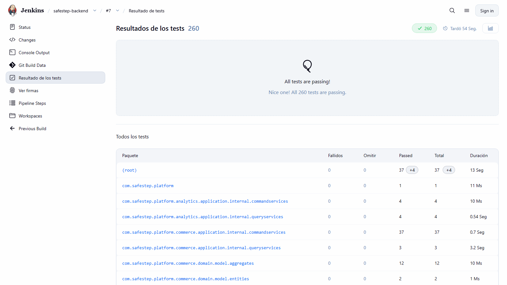
  <p><i><b>Figura 6.1.1.</b> Resultado de las 242 pruebas del backend en Jenkins (ejecución #8). <b>Fuente</b>: Elaboración propia</i></p>
</div>

<div align="center">
  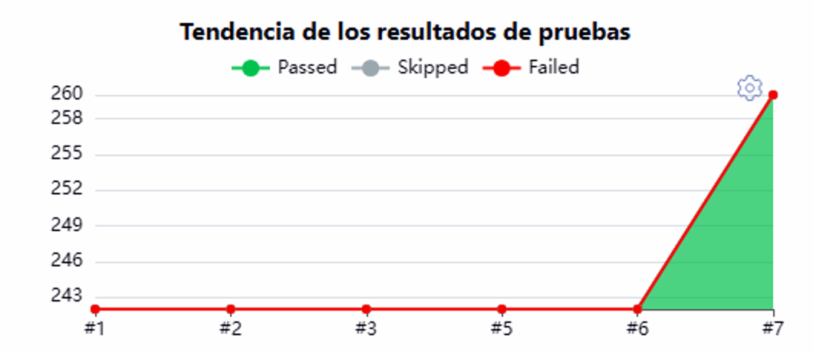
  <p><i><b>Figura 6.1.2.</b> Tendencia de los resultados de pruebas en Jenkins: las 242 pruebas aprobadas en cada ejecución del entorno actual. <b>Fuente</b>: Elaboración propia</i></p>
</div>

<div align="center">
  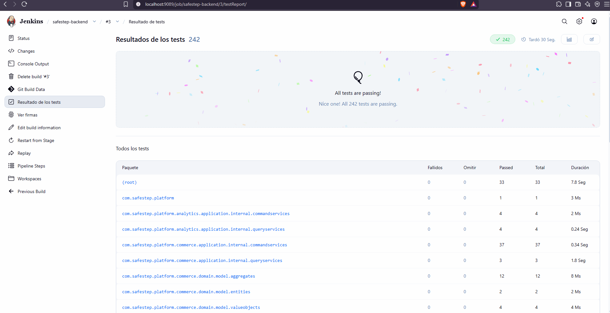
  <p><i><b>Figura 6.1.3.</b> Resultado de las pruebas por paquete en Jenkins: cada contexto delimitado con sus pruebas aprobadas. <b>Fuente</b>: Elaboración propia</i></p>
</div>

## 6.1.1. Core Entities Unit Tests

Las pruebas unitarias validan en aislamiento las entidades de dominio (agregados, entidades y value objects) y los servicios de aplicación (command y query services, manejadores de eventos y fachadas ACL) de cada bounded context. Todas están escritas con JUnit Jupiter y siguen la estructura **Arrange-Act-Assert**; cuando una clase depende de repositorios o de la fachada de otro contexto (por ejemplo, el canje de cupones consulta al contexto de gamificación) esas dependencias se sustituyen con dobles de Mockito, de modo que cada prueba verifica una sola unidad sin base de datos.

**Pruebas por bounded context:**

| Bounded context | Pruebas | Qué se verifica |
|-----------------|---------|-----------------|
| `commerce` | 66 | Reglas de carrito y órdenes, cálculo del total y del total final con descuento, catálogo de productos y cupones, canje de cupones con SafeCoins, liberación del cupón cuando falla el pago, sesión de pago con Stripe, value objects y validaciones de los recursos REST |
| `iam` | 41 | Registro e inicio de sesión, asignación de roles, regla que impide al administrador quitarse su propio rol, semilla del primer administrador, fachada ACL e integración con la seguridad JWT |
| `gamification` | 37 | Recompensas por simulación, misiones e insignias, gasto de SafeCoins (`PlayerProgress.spendCoins`), registro del gasto (`CoinSpend`), manejador del evento de intento completado y fachada ACL |
| `simulation` | 21 | Registro de intentos, CRUD de simulaciones, eventos de dominio y validación del puntaje |
| `shared` | 26 | Tipo `Result`, manejador global de excepciones, ensamblador de errores, configuración de idioma y documentación OpenAPI publicada |
| `profiles` | 9 | Comandos y consultas de perfiles |
| `analytics` | 8 | Resumen, progreso y emisión de certificados |
| Contexto de aplicación | 1 | Arranque de Spring Boot |

**Ejemplo de prueba de entidad.** El cupón canjeado solo puede usarse una vez y vuelve a estar disponible si el pago falla:

```java
@Test
@DisplayName("RedeemedCoupon should start available and become used once (AAA)")
void redeemedCoupon_IsUsedOnlyOnce() {
    // Arrange
    var coupon = availableCoupon();
    var usedAt = Instant.parse("2026-09-15T10:00:00Z");

    // Act
    coupon.markUsed(usedAt);

    // Assert
    assertEquals(RedemptionStatus.USED, coupon.getStatus());
    assertEquals(usedAt, coupon.getUsedAt());
    assertThrows(IllegalStateException.class, () -> coupon.markUsed(Instant.now()));
}
```

<div align="center">
  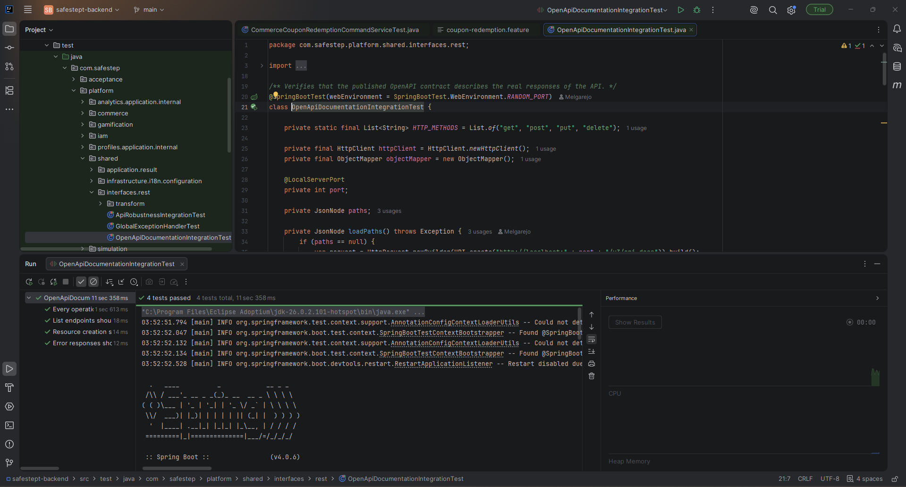
  <p><i><b>Figura 6.1.4.</b> Ejecución de <code>OpenApiDocumentationIntegrationTest</code> en el IDE: sus cuatro pruebas verifican el contrato OpenAPI publicado. <b>Fuente</b>: Elaboración propia</i></p>
</div>

**Cobertura.** JaCoCo mide la cobertura de instrucciones y el build exige un mínimo de 80 %. Siguiendo la configuración de JaCoCo del proyecto de referencia del curso (`pom.xml` de `learning-center-platform-small`, que excluye `domain`, `infrastructure`, `interfaces/rest/resources`, los controladores y las clases `*Application*`), la medición excluye las clases que el equipo considera sin lógica de aplicación: el paquete `domain` completo, la capa `infrastructure`, los recursos y controladores REST, y las clases cuyo nombre contiene `Application` (`**/*Application*`). En 6.2.1.2 se detalla el alcance y se compara con la cobertura sin exclusiones. La regla vive en el `pom.xml` (`jacoco:check`, `COVEREDRATIO` mínimo de `0.80`) y por tanto rompe el build si la cobertura baja.

| Medición | Antes de la TB1 | Después |
|----------|---------------------------|---------|
| Cobertura de instrucciones (clases medidas) | 44.3 % | **93.8 %** (5,169 de 5,512 instrucciones) |
| Pruebas del backend | 54 métodos | 242 pruebas |

| Bounded context | Clases medidas | Cobertura |
|-----------------|----------------|-----------|
| `analytics` | 3 | 100.0 % |
| `gamification` | 6 | 100.0 % |
| `commerce` | 3 | 98.6 % |
| `shared` | 7 | 94.5 % |
| `iam` | 17 | 92.0 % |
| `simulation` | 11 | 91.2 % |
| `profiles` | 7 | 62.1 % |

El contexto `profiles` es el único por debajo del 80 % por sí solo; el umbral se evalúa sobre el conjunto de clases medidas, y la cobertura de `profiles` queda como deuda técnica identificada. SonarQube, que cuenta las líneas y no las instrucciones, reporta 91.5 % de cobertura sobre 1,390 líneas medibles (ver 7.1.2).

<div align="center">
  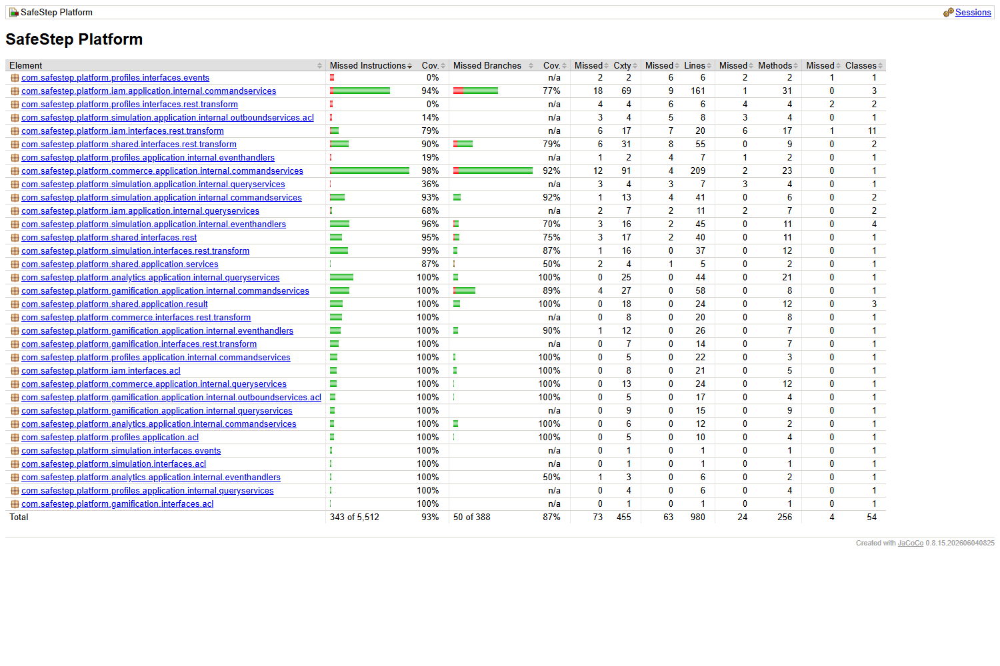
  <p><i><b>Figura 6.1.5.</b> Reporte HTML de JaCoCo generado por el pipeline. <b>Fuente</b>: Elaboración propia</i></p>
</div>

<div align="center">
  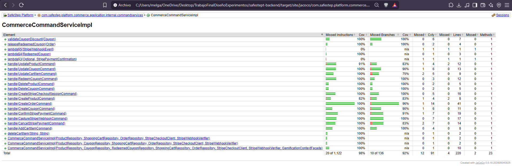
  <p><i><b>Figura 6.1.6.</b> Cobertura por método de <code>CommerceCommandServiceImpl</code> en JaCoCo: 98 % de las instrucciones cubiertas (20 de 1,122 sin cubrir). <b>Fuente</b>: Elaboración propia</i></p>
</div>

<div align="center">
  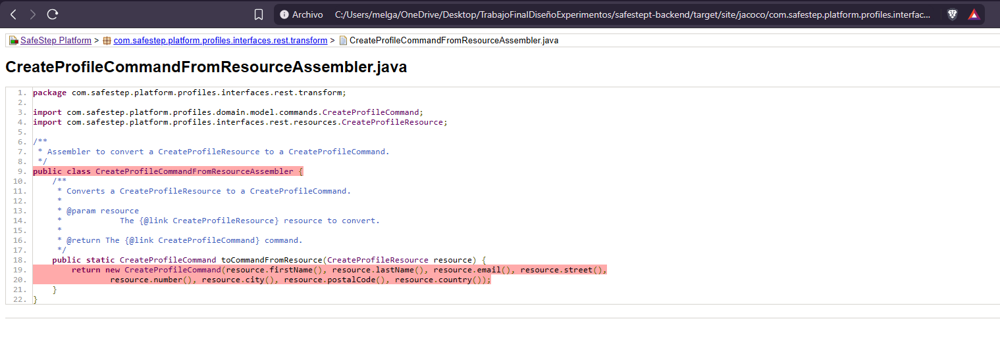
  <p><i><b>Figura 6.1.7.</b> Código fuente de <code>CreateProfileCommandFromResourceAssembler</code> en el reporte de JaCoCo: las líneas rojas no están cubiertas por ninguna prueba. El contexto <code>profiles</code> (62.1 %) es la deuda técnica identificada. <b>Fuente</b>: Elaboración propia</i></p>
</div>

<div align="center">
  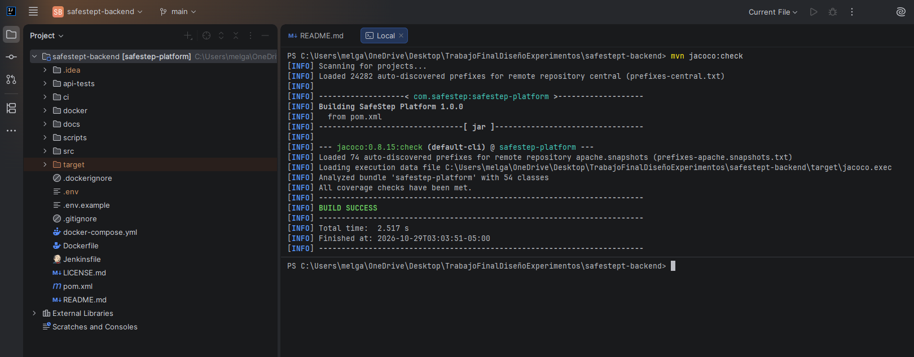
  <p><i><b>Figura 6.1.8.</b> Verificación del umbral de cobertura: <code>jacoco:check</code> confirma que se cumple el mínimo de 80 %. <b>Fuente</b>: Elaboración propia</i></p>
</div>

**Cómo ejecutarlas:**

```bash
mvn test            # unitarias + BDD, genera target/site/jacoco
mvn jacoco:check    # falla si la cobertura es menor a 80 %
```

## 6.1.2. Core Integration Tests

Las pruebas de integración verifican que el backend funciona correctamente cuando se consume como lo haría el frontend: por HTTP, atravesando seguridad JWT, controladores, servicios, persistencia en PostgreSQL y la comunicación entre bounded contexts. Se escribieron con **Karate** en un proyecto Maven independiente (`api-tests`) que solo conoce la URL base de la API, por lo que sirve contra una instancia local o un entorno desplegado.

| Feature | Historias | Escenarios | Qué valida |
|---------|-----------|------------|------------|
| `authentication` | US01, US02 | 12 | Registro dirigido por datos (`users-batch.json`), inicio de sesión, rotación del refresh token, conflicto por usuario duplicado y validaciones |
| `security/authorization` | US57, US58 | 9 | Respuestas 401 sin token y 403 para jugadores en rutas de administrador, listado de usuarios y roles, asignación de roles y protección contra auto-degradación (422) |
| `catalog` | US30, US31 | 7 | Catálogos de productos, categorías, kits y cupones |
| `commerce/coupon-flow` | US15, US40, US59, US60 | 3 | El jugador gana SafeCoins, canjea un cupón y lo usa en una orden con el descuento aplicado |
| `gamification/rewards` | US15, US16 | 5 | Recompensas por simulación completada, historial de monedas y rechazo de puntajes fuera de rango |

Cada escenario crea sus propios usuarios con nombres aleatorios, por lo que la suite puede repetirse sobre una base de datos con datos previos; se ejecutó tres veces consecutivas sin fallos. El flujo extremo a extremo de cupones ilustra el estilo de las pruebas:

```gherkin
# 2. Redeem the 5% coupon, which costs 150 SafeCoins
Given path 'api/v1/commerce/coupons/cpn-5/redeem'
And header Authorization = 'Bearer ' + player.token
And request {}
When method post
Then status 201
And match response.status == 'AVAILABLE'
And match response.discountPercentage == 5
```

<div align="center">
  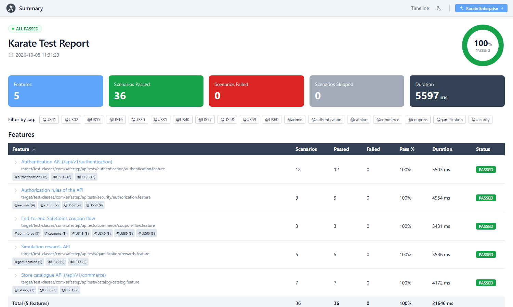
  <p><i><b>Figura 6.1.9.</b> Resumen del reporte HTML de Karate: 5 features y 36 escenarios aprobados contra una instancia local del backend. <b>Fuente</b>: Elaboración propia</i></p>
</div>

<div align="center">
  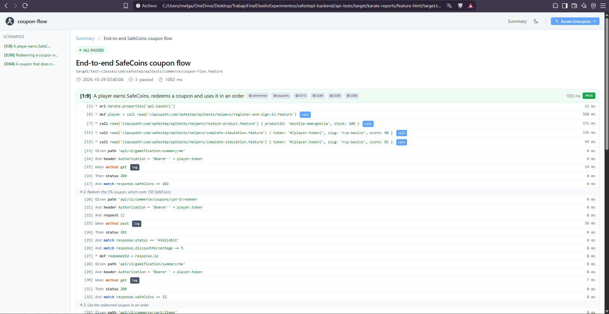
  <p><i><b>Figura 6.1.10.</b> Detalle del escenario de cupones en el reporte de Karate: solicitudes, respuestas y verificaciones paso a paso. <b>Fuente</b>: Elaboración propia</i></p>
</div>

**Hallazgo corregido.** Durante el desarrollo de estas pruebas se detectó que la API respondía HTTP 500 (`UNEXPECTED_ERROR`) cuando recibía un cuerpo JSON mal formado, en lugar de un 400, porque el manejador global de excepciones atendía `RuntimeException` de forma genérica y no registraba el error. Se agregó un manejador específico que responde 400 con un error de validación, sin exponer el mensaje interno del analizador, y los errores inesperados ahora se registran. Lo verifican una prueba unitaria y una prueba de integración por HTTP (`ApiRobustnessIntegrationTest`).

<div align="center">
  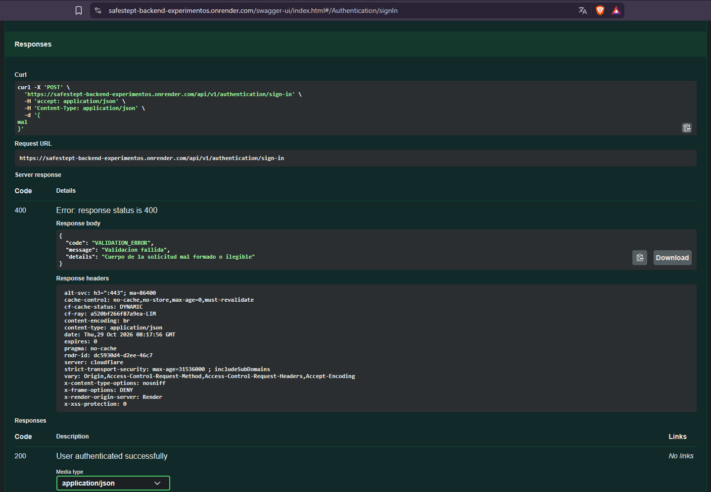
  <p><i><b>Figura 6.1.11.</b> Respuesta 400 de la API desplegada en Render ante un cuerpo JSON mal formado (antes respondía 500): el error de validación no expone mensajes internos del analizador. <b>Fuente</b>: Elaboración propia</i></p>
</div>

**Cómo ejecutarlas:**

```bash
cd api-tests
mvn test -Dapi.baseUrl=http://localhost:8092 -Dapi.admin.username=<admin> -Dapi.admin.password=<clave>
```

## 6.1.3. Core Behavior-Driven Development

Los criterios de aceptación redactados en Gherkin en 3.2 se automatizaron con **Cucumber-JVM**. Cada archivo `.feature` describe una historia con su narrativa (*As a… I want… So that…*), cada escenario lleva una etiqueta con el identificador de la historia que verifica (por ejemplo `@US42`) y los pasos se implementan en clases `*Steps` que comparten un contexto por escenario. Los escenarios levantan la aplicación Spring Boot completa en un puerto aleatorio sobre una base de datos H2 aislada y la consumen por HTTP, por lo que prueban el comportamiento real sin tocar la base de datos de desarrollo.

| Feature | Historias | Escenarios |
|---------|-----------|------------|
| `authentication.feature` | US01, US02 | 6 |
| `coupon-redemption.feature` | US42, US59, US61 | 5 (uno es un *Scenario Outline* con un ejemplo por cupón del catálogo) |
| `checkout-with-coupon.feature` | US60 | 6 |
| `role-management.feature` | US57, US58 | 6 |
| `simulation-rewards.feature` | US15, US16 | 4 |

La ejecución produce 33 escenarios, todos aprobados. Ejemplo del feature de canje de cupones:

```gherkin
@coupons @US42
Feature: Redeem SafeCoins for store coupons
  As a player who earns SafeCoins by training
  I want to exchange my SafeCoins for discount coupons
  So that I pay less when I buy emergency products

  Background:
    Given a signed-in player with 500 SafeCoins

  Scenario: A player cannot redeem a coupon that costs more than their balance
    When the player redeems the coupon "cpn-15"
    Then the response status is 422
    And the response contains the error code "BUSINESS_RULE_VIOLATION"
    And the player has 500 SafeCoins left
    And the player has no redeemed coupons
```

Y el step definition que lo implementa:

```java
@When("the player redeems the coupon {string}")
public void thePlayerRedeemsTheCoupon(String couponId) {
    context.response(api.post("/api/v1/commerce/coupons/%s/redeem".formatted(couponId), Map.of(), context.token()));
    if (context.response().status() == 201) {
        context.redeemedCouponId(context.response().text("id"));
    }
}
```

<div align="center">
  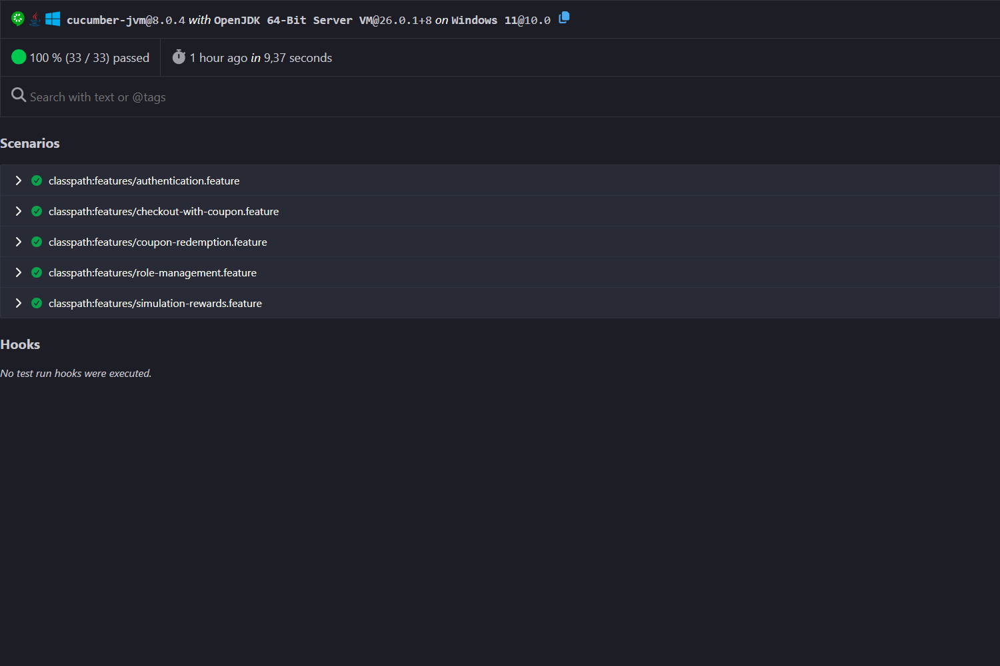
  <p><i><b>Figura 6.1.12.</b> Reporte HTML de Cucumber: 33 de 33 escenarios aprobados. <b>Fuente</b>: Elaboración propia</i></p>
</div>

<div align="center">
  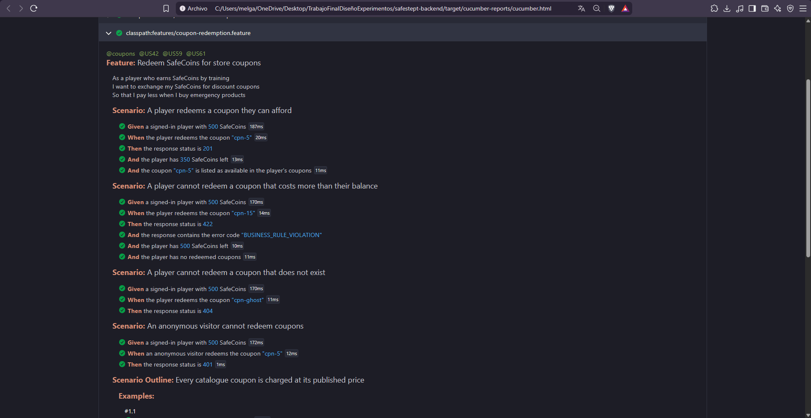
  <p><i><b>Figura 6.1.13.</b> Detalle de un escenario del feature de canje de cupones en el reporte de Cucumber, con cada paso *Given/When/Then* aprobado. <b>Fuente</b>: Elaboración propia</i></p>
</div>

<div align="center">
  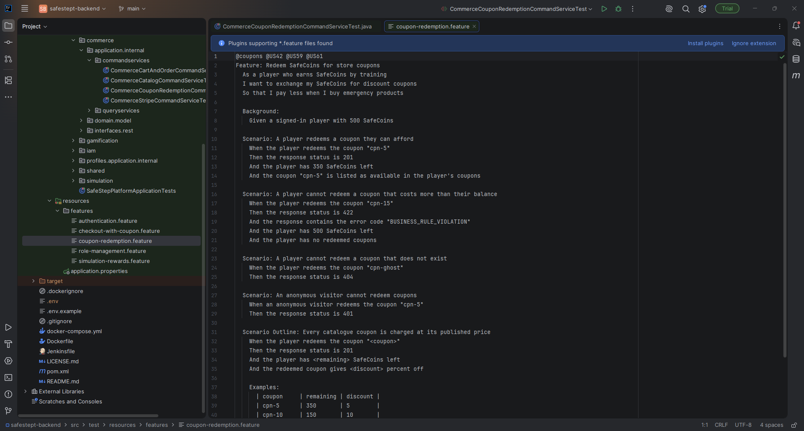
  <p><i><b>Figura 6.1.14.</b> Archivo <code>coupon-redemption.feature</code> en el editor, con las etiquetas que enlazan cada escenario con su historia de usuario (<code>@US42</code>, <code>@coupons</code>). <b>Fuente</b>: Elaboración propia</i></p>
</div>

<div align="center">
  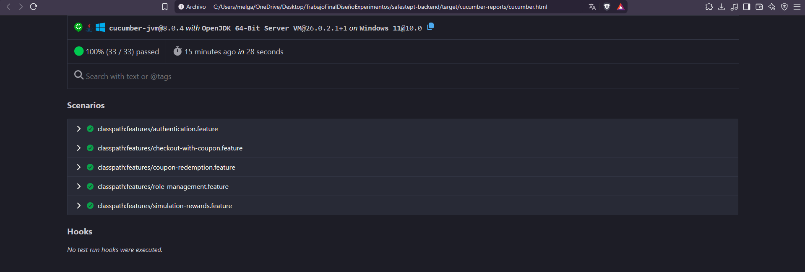
  <p><i><b>Figura 6.1.15.</b> Resumen del reporte de Cucumber: los cinco features con sus escenarios aprobados. <b>Fuente</b>: Elaboración propia</i></p>
</div>

## 6.1.4. Core System Tests

Las pruebas de sistema verifican la aplicación completa tal como la usa una persona: un navegador real (Google Chrome 156, controlado con **Selenium WebDriver 4.50**) recorre el frontend Angular, que a su vez habla con el backend Spring Boot y una base de datos PostgreSQL. Los escenarios se escriben en Gherkin y los ejecuta **Cucumber-JVM 8.0.4** sobre la plataforma JUnit, igual que las pruebas de comportamiento del backend (6.1.3), pero aquí no se simula ninguna capa: cambiar el comportamiento del frontend, de la API o de la base de datos puede hacer fallar un escenario. Se mantienen en el repositorio del frontend, en `safeStept-frontend/e2e-tests`, con su propio `pom.xml`.

**Diseño.** Cada escenario crea su propio jugador con un correo aleatorio a través del formulario de registro, de modo que las pruebas no dependen de datos previos y se pueden repetir sobre la misma base de datos. Las clases se organizan en tres capas: los *page objects* y los localizadores de cada pantalla (`AuthPage`, `AppShellPage`, `CatalogPages`, `SimulationPages`), las clases de pasos (`AuthenticationSteps`, `CatalogSteps`, `SimulationSteps`, `CouponSteps`) y el soporte (`Browser`, con las esperas explícitas, y `Journey`, que guarda lo que un escenario descubre en una pantalla para comprobarlo en otra, como las SafeCoins ganadas). Al terminar cada escenario, un *hook* adjunta una captura de pantalla al reporte y cierra el navegador.

| Feature | Historias | Escenarios |
|---------|-----------|------------|
| `authentication.feature` | US01, US02 | 6: ruta protegida, registro, contraseñas distintas, inicio de sesión, contraseña errónea y cierre de sesión |
| `catalogs.feature` | US30, US31 | 3: catálogo de simulaciones, filtros y catálogo de la tienda |
| `simulation-rewards.feature` | US15, US16 | 1: el jugador responde bien todas las preguntas de una simulación y gana la recompensa completa |
| `coupon-redemption.feature` | US42, US59 | 2: un jugador nuevo no puede pagar ningún cupón; un jugador convierte las SafeCoins de una simulación en un cupón |
| `administration.feature` | US57, US58, US60 | 3: el administrador entra al panel, un jugador es devuelto al dashboard y un cupón creado por el administrador llega a los jugadores y se retira |

Los dos escenarios más largos encadenan varias funciones del sistema. El primero es el flujo central del producto: el jugador completa una simulación que paga al menos 150 SafeCoins y responde correctamente cada pregunta; el panel de resultado anuncia la recompensa; en la página de canje el saldo coincide con lo ganado; el jugador canjea el primer cupón que puede pagar y comprueba que el saldo baja exactamente el costo del cupón y que el cupón aparece entre los suyos. El segundo involucra a dos actores: el administrador crea un cupón desde su panel, cierra sesión, un jugador inicia sesión y ve el cupón ofrecido en la página de canje, y el administrador vuelve a entrar y lo elimina, con lo que la base de datos queda como estaba.

```gherkin
@system @coupons @US42 @US59
Scenario: A player turns the SafeCoins of a simulation into a coupon
  Given a registered player who is signed in
  When the player completes a simulation worth at least 150 SafeCoins answering every question correctly
  And the player opens the coupon redemption page
  Then the balance shown equals the SafeCoins earned
  When the player redeems the first coupon they can afford
  Then the balance drops by the cost of that coupon
  And that coupon is listed among the player's available coupons
```

El paso que responde la simulación no conoce de antemano las respuestas correctas: elige una opción, la interfaz marca cuál es la correcta y el paso hace clic en esa.

```java
private void answerEveryQuestionCorrectly() {
  int questions = browser.waitAll(SimulationPages.STEP_CARD).size();
  for (int index = 0; index < questions; index++) {
    WebElement question = browser.driver().findElements(SimulationPages.STEP_CARD).get(index);
    // Picking any option reveals which one is correct; then the correct one is picked.
    browser.click(question.findElements(SimulationPages.OPTION).get(0));
    browser.click(browser.driver().findElements(SimulationPages.STEP_CARD).get(index)
        .findElement(SimulationPages.CORRECT_OPTION));
  }
}
```

**Cómo se ejecutan.** Las pruebas necesitan tres piezas en marcha: una base de datos PostgreSQL desechable, el backend con un administrador sembrado (puerto 8093) y el frontend servido con la configuración `e2e` de Angular, que apunta a ese backend y por eso nunca toca la base de desarrollo. El `README.md` de la carpeta detalla los tres comandos. Después:

```bash
cd safeStept-frontend/e2e-tests
mvn test -De2e.baseUrl=http://localhost:4300 -De2e.admin.username=apitest-admin -De2e.admin.password=<clave>
```

**Resultado.** El 8 de noviembre de 2026 se ejecutaron los 15 escenarios sobre el código de `main` del backend (con las correcciones de SonarQube) y del frontend: los 15 pasaron, sin fallos ni omisiones, en 1 min 58 s según el reporte de Cucumber. El reporte HTML (`target/cucumber-reports/system-tests.html`) lista cada paso con su duración y adjunta la captura final del escenario.

<div align="center">
  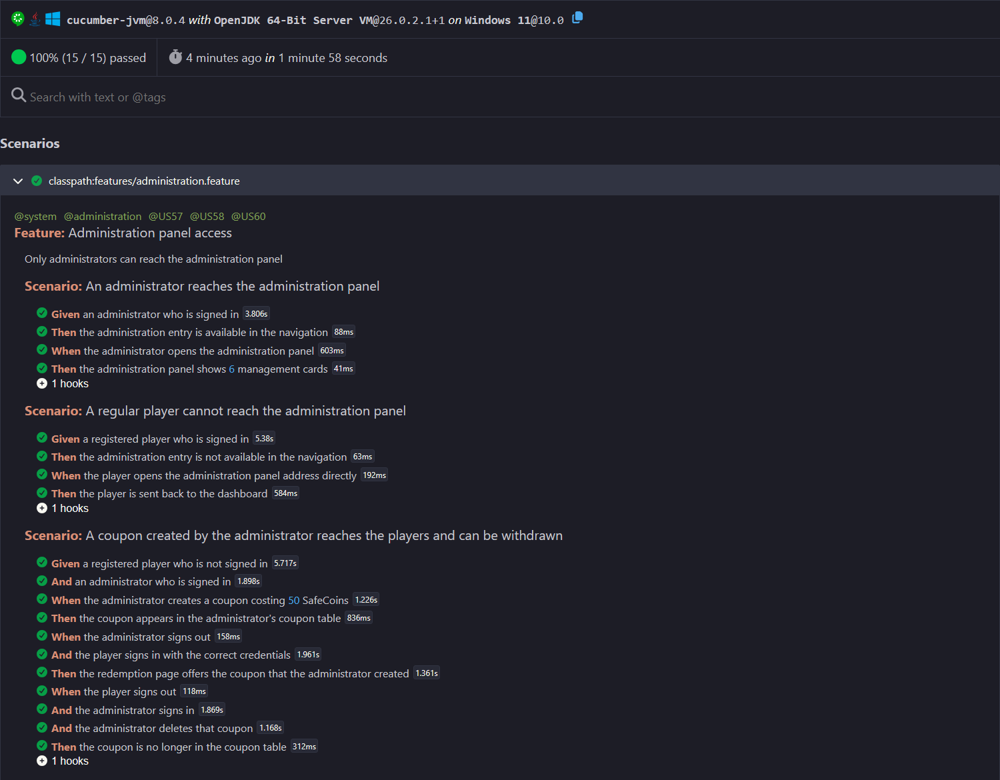
  <p><i><b>Figura 6.1.16.</b> Reporte de las pruebas de sistema: 15 de 15 escenarios aprobados y el feature de administración, con el escenario del cupón que llega a los jugadores y se retira. <b>Fuente</b>: Elaboración propia</i></p>
</div>

<div align="center">
  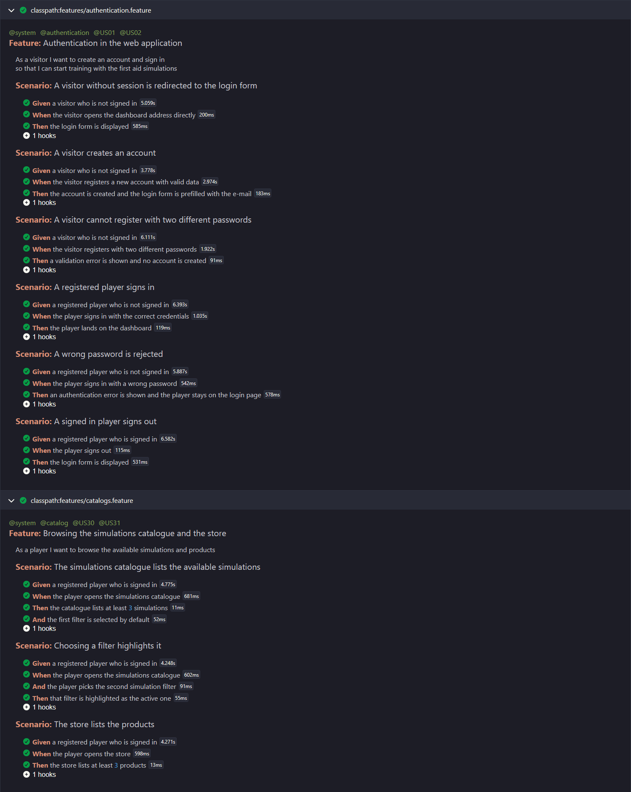
  <p><i><b>Figura 6.1.17.</b> Reporte de las pruebas de sistema: features de autenticación (6 escenarios) y de catálogos (3 escenarios), con la duración de cada paso. <b>Fuente</b>: Elaboración propia</i></p>
</div>

<div align="center">
  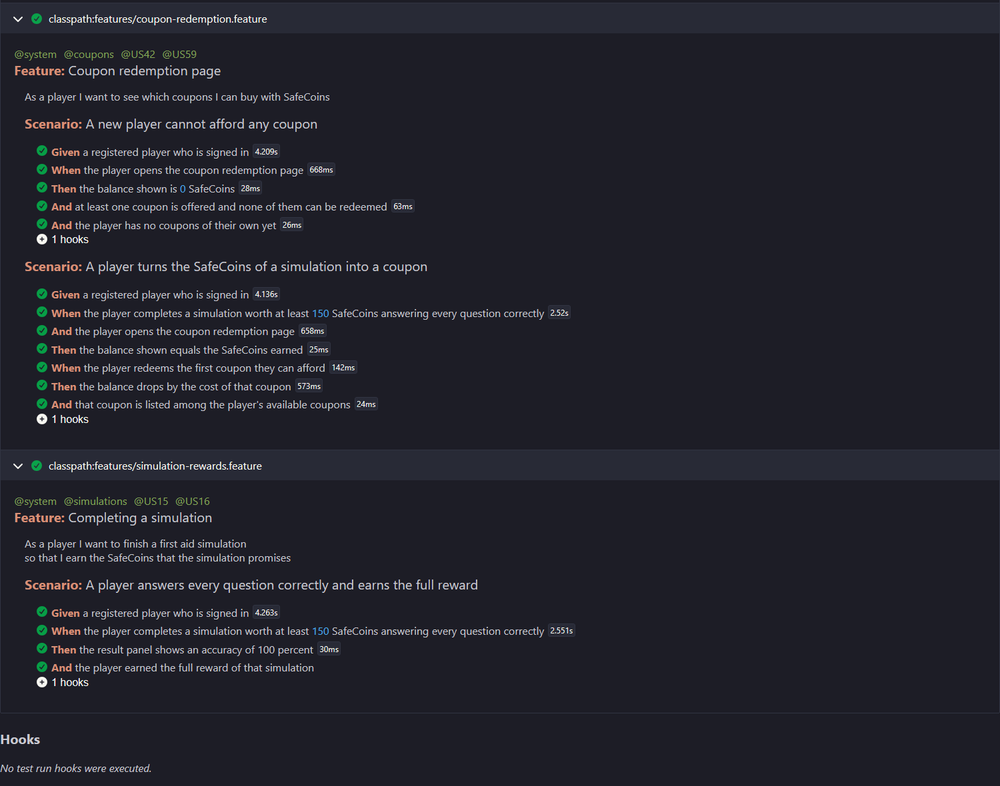
  <p><i><b>Figura 6.1.18.</b> Reporte de las pruebas de sistema: features de canje de cupones (2 escenarios) y de recompensas de simulaciones (1 escenario). <b>Fuente</b>: Elaboración propia</i></p>
</div>

<div align="center">
  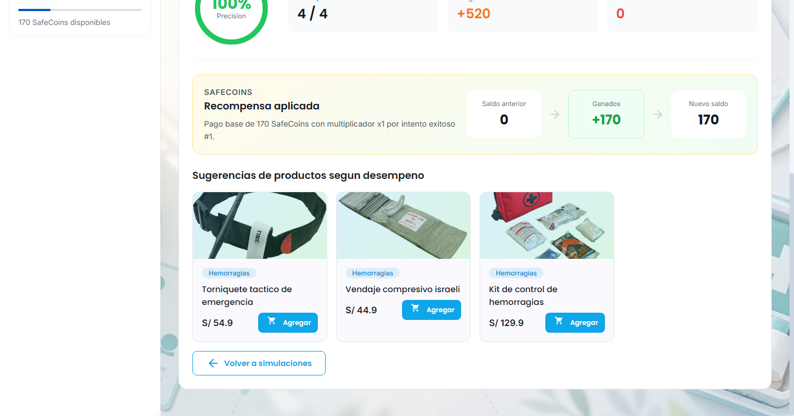
  <p><i><b>Figura 6.1.19.</b> Captura que adjunta la prueba <i>A player answers every question correctly and earns the full reward</i>: precisión de 100 %, saldo anterior de 0 SafeCoins, +170 ganados y saldo nuevo de 170. <b>Fuente</b>: Elaboración propia</i></p>
</div>

<div align="center">
  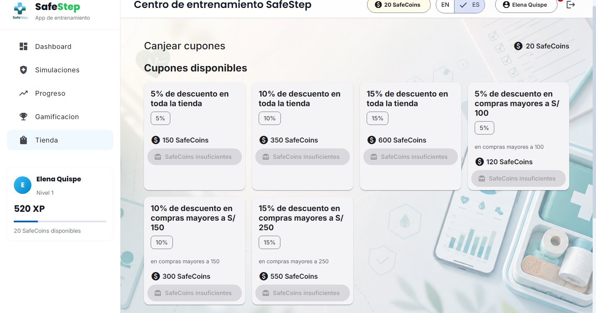
  <p><i><b>Figura 6.1.20.</b> Captura final del escenario que convierte las SafeCoins de una simulación en un cupón: tras canjear el cupón de 150 SafeCoins, el saldo pasó de 170 a 20. <b>Fuente</b>: Elaboración propia</i></p>
</div>

**Alcance y limitaciones.**

- **No forman parte del pipeline de Jenkins.** Necesitan un navegador, el frontend y una base de datos propios; hoy se ejecutan a mano en el equipo del desarrollador. Incorporarlas a la integración continua exigiría una imagen con Chrome y los tres servicios levantados por `docker compose`.
- **El pago con Stripe no está cubierto.** Requiere una cuenta de Stripe en modo de prueba y el paso por la página de pago alojada por Stripe, que no es parte de SafeStep; se verifica por separado con pruebas de humo (7.3).
- **Solo la aplicación web.** La aplicación móvil no tiene pruebas de sistema automatizadas.
- **Dependen del texto de la interfaz en español en un par de puntos** (por ejemplo, la etiqueta accesible del botón de cierre de sesión), por lo que un cambio de idioma por defecto obligaría a ajustar los localizadores.
