# 6.2. Static testing & Verification

Pendiente.

## 6.2.1. Static Code Analysis

### 6.2.1.1. Coding standard & Code conventions

Pendiente.

### 6.2.1.2. Code Quality & Code Security

La calidad y la seguridad del código se verifican con **SonarQube Community Build 26.10** (modo MQR), que analiza el código sin ejecutarlo y clasifica los hallazgos en tres cualidades de software: **seguridad**, **fiabilidad** (bugs) y **mantenibilidad** (*code smells*). Esta sección documenta el análisis del backend en 12 etapas y del frontend en 3 etapas: en cada etapa se indica qué se implementó o se corrigió, qué hallazgos aparecieron o se cerraron y cómo respondió el Quality Gate. Los análisis se ejecutaron el 30 de octubre de 2026 sobre el código de cada etapa; el commit de origen se indica en cada una.

**Configuración del análisis**

| Elemento | Backend | Frontend |
|----------|---------|----------|
| Proyecto en SonarQube | `safestep-backend-evolucion` | `safestep-frontend-evolucion` |
| Lenguajes analizados | Java y XML | TypeScript, HTML y CSS |
| Perfil de reglas | *Sonar way extended* (337 reglas activas en Java) | *Sonar way extended* (251 reglas en TypeScript y JavaScript) |
| Quality Gate | *Sonar way* (condiciones sobre el código nuevo) | *Sonar way* |
| Herramienta de análisis | `sonar-maven-plugin` 5.8.0.7211 con JDK 26 | `sonar-scanner-cli` en Docker |
| Cobertura | JaCoCo 0.8.15 (informe XML) | Vitest 4 con cobertura V8 (informe `lcov`) |
| Referencia del código nuevo | Versión anterior (cada etapa se compara con la anterior) | Versión anterior |

El **perfil de reglas** determina qué hallazgos se reportan. Se usó *Sonar way extended*, que activa más reglas que el perfil por defecto de la instancia (*Sonar way core*, 274 reglas en Java). Por esa razón, el conteo de *code smells* que muestra el panel del pipeline de Jenkins (7.1.2), que usa el perfil por defecto, puede diferir del que aparece en esta sección.

  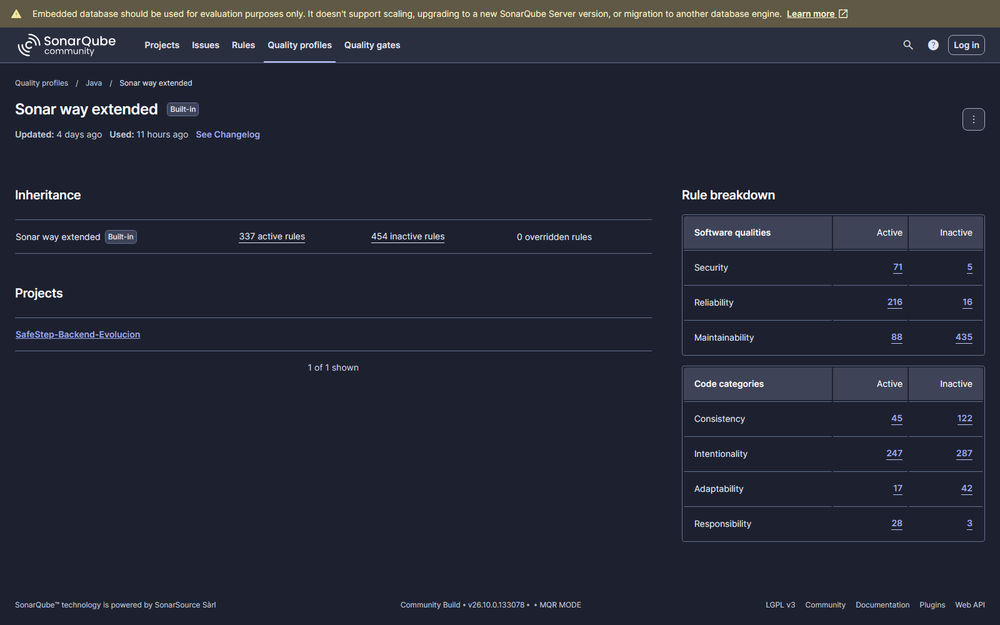
  
<i><b>Figura 6.2.1.</b> Perfil Sonar way extended para Java en SonarQube: 337 reglas activas. <b>Fuente</b>: Elaboración propia</i>

**Quality Gate.** Se usó el Quality Gate *Sonar way*, que evalúa únicamente el **código nuevo** respecto a la versión anterior con cuatro condiciones: cero incidencias nuevas, todos los puntos críticos de seguridad nuevos revisados, cobertura del código nuevo de al menos 80 % y duplicación del código nuevo de a lo sumo 3 %. Por eso un estado puede tener muchas incidencias antiguas y aun así aprobar, y un cambio pequeño con una sola incidencia nueva puede hacer fallar el gate.

  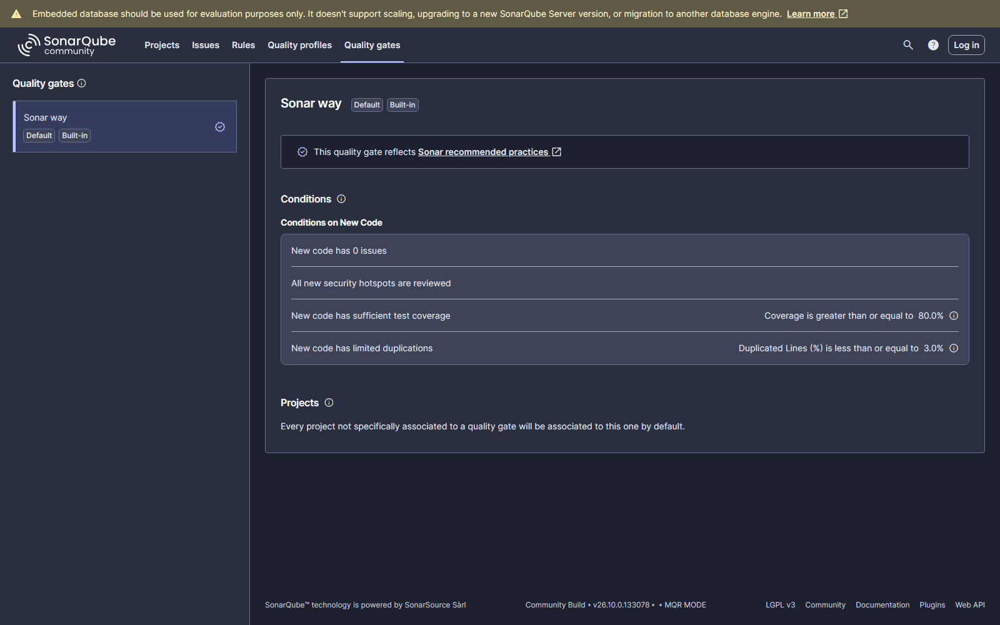
  
<i><b>Figura 6.2.2.</b> Condiciones del Quality Gate Sonar way sobre el código nuevo. <b>Fuente</b>: Elaboración propia</i>

**Alcance del análisis y exclusiones de cobertura**

En el backend **no se excluyó ninguna carpeta del análisis de calidad**: SonarQube revisó los 369 archivos Java de `src/main` y las pruebas de `src/test`. Prueba de ello es que se detectaron incidencias también en las capas que se excluyen de la cobertura: 59 en controladores, 7 en `infrastructure` (entre ellas CORS, CSRF y el desbordamiento de Stripe) y 1 en `domain`. Lo que se excluye es solo el **cálculo del porcentaje de cobertura**, con las mismas reglas en JaCoCo (`pom.xml`), en el `Jenkinsfile` (`sonar.coverage.exclusions`) y en este análisis, de modo que las tres herramientas midan el mismo código. Siguiendo la configuración de JaCoCo del proyecto de referencia del curso (`pom.xml` de `learning-center-platform-small`, que excluye `domain`, `infrastructure`, `interfaces/rest/resources`, los controladores y la clase de arranque), el equipo considera que estas capas no contienen lógica de aplicación: entidades y objetos de valor, configuración y conexión con frameworks, objetos de transferencia de datos, capa HTTP delgada y clase de arranque.

Para que el efecto de esta decisión sea transparente, se midió además la cobertura del estado final **sin ninguna exclusión**:

| Capa | Archivos Java | Cobertura de instrucciones sin exclusiones | ¿Se mide en la cobertura reportada? |
|------|---------------|--------------------------------------------|--------------------------------------|
| `domain` | 140 | 90.9 % | No |
| `infrastructure` | 105 | 77.7 % | No |
| `interfaces/rest/resources` | 41 | 84.5 % | No |
| Controladores (`*Controller*`) | 9 | 27.9 % | No |
| Clases cuyo nombre contiene `Application` | 3 | 93.9 % | No |
| Resto (`application`, `shared`, etc.) | 54 clases medidas | 93.8 % | **Sí** |
| **Total** | 319 clases | **82.1 %** (14,533 de 17,697 instrucciones) | 93.8 % reportado (5,169 de 5,512) |

El patrón `**/*Application*` coincide, por su nombre, con tres archivos (`SafeStepPlatformApplication`, `ApplicationReadyEventHandler` y `ApplicationError`) y no solo con la clase de arranque. Sin exclusiones la cobertura seguiría superando el mínimo de 80 %. La única capa claramente baja son los controladores (27.9 %): su lógica se ejercita por HTTP con las pruebas BDD y Karate, pero JaCoCo no la mide por completo. SonarQube calcula la cobertura sobre líneas y condiciones, por lo que reporta 91.7 % para el mismo código en lugar del 93.8 % por instrucciones de JaCoCo. En el frontend se excluyen del análisis `node_modules`, `dist`, `coverage` y los archivos `*.spec.ts` (se tratan como pruebas), y la cobertura se mide sobre todo `src/**/*.ts`.

**Backend: evolución de las 12 etapas**

La tabla resume el resultado de cada análisis. *Seguridad*, *Fiabilidad* y *Mantenibilidad* son los conteos de incidencias abiertas que muestra el Summary de SonarQube; la cobertura es la que calcula SonarQube con las exclusiones descritas.

| Etapa | Qué se implementó o corrigió | Líneas | Pruebas | Cobertura | Seguridad | Fiabilidad | Mantenibilidad | Quality Gate |
|-------|------------------------------|--------|---------|-----------|-----------|------------|----------------|--------------|
| 00 | Código base heredado | 8953 | 41 | 43.2 % | 2 | 2 | 80 | Passed |
| 01 | Canje de cupones (estado previo al TB1) | 9754 | 54 | 47.3 % | 2 | 3 | 85 | Failed |
| 02 | Herramientas de calidad: JaCoCo, Checkstyle y SonarQube | 9830 | 54 | 47.3 % | 2 | 3 | 85 | Passed |
| 03 | Pruebas unitarias de commerce e iam | 9830 | 126 | 67.8 % | 2 | 3 | 85 | Passed |
| 04 | Pruebas unitarias de gamification y simulation | 9830 | 172 | 80.8 % | 2 | 3 | 85 | Passed |
| 05 | Pruebas unitarias de analytics, profiles y shared | 9830 | 201 | 90.9 % | 2 | 3 | 86 | Failed |
| 06 | BDD con Cucumber, pruebas de API con Karate e integración continua | 9854 | 234 | 91.7 % | 2 | 3 | 86 | Passed |
| 07 | Corrección de la política CORS (java:S5122) | 9858 | 234 | 91.7 % | 1 | 3 | 86 | Passed |
| 08 | Corrección de dos bugs (java:S2184 y java:S2637) | 9859 | 234 | 91.7 % | 1 | 0 | 86 | Passed |
| 09 | Respuesta 400 ante un JSON mal formado | 9871 | 238 | 91.7 % | 1 | 0 | 87 | Failed |
| 10 | Corrección de java:S1452 en el manejador nuevo | 9872 | 238 | 91.7 % | 1 | 0 | 86 | Passed |
| 11 | Estado final del backend | 9964 | 242 | 91.7 % | 1 | 0 | 86 | Passed |

El Quality Gate falló en tres etapas, siempre por el **código nuevo** respecto a la etapa anterior:

| Etapa | Causa del fallo |
|-------|-----------------|
| 01 | Cobertura nueva de 52.5 % (mínimo 80 %), duplicación nueva de 6.1 % (máximo 3 %) y 7 incidencias nuevas |
| 05 | 1 incidencia nueva (`java:S1186`, método vacío en una prueba) |
| 09 | 1 incidencia nueva (`java:S1452` en el manejador de errores recién agregado) |

  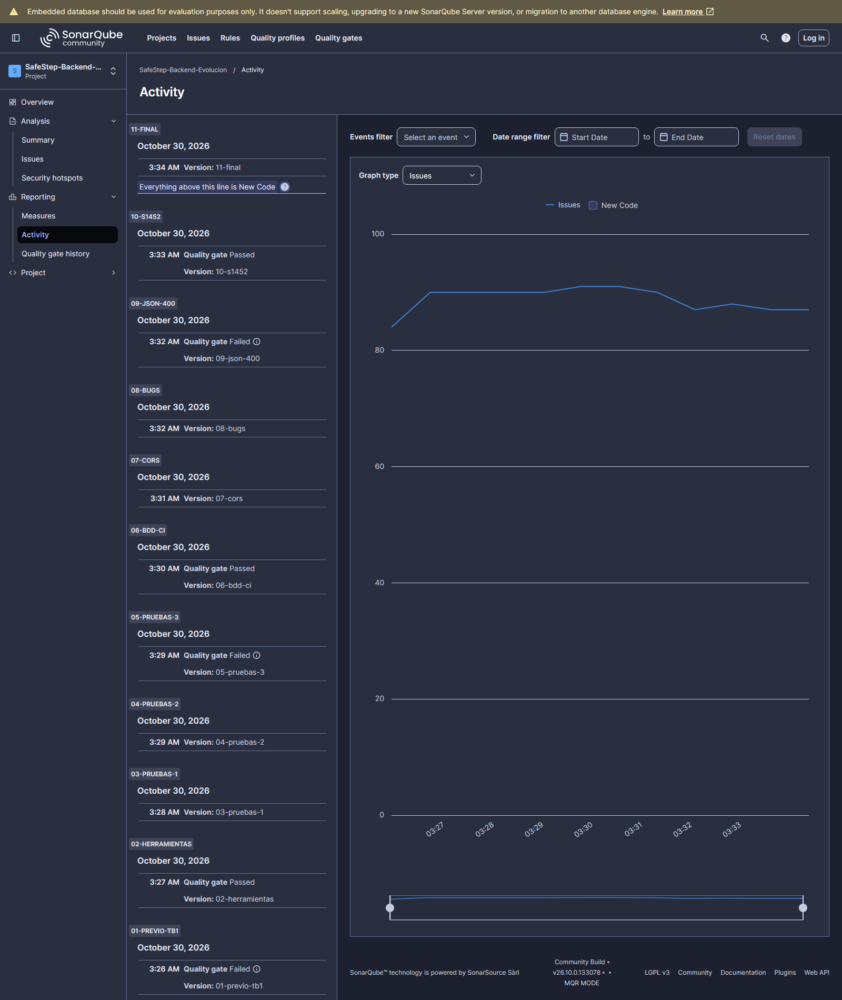
  
<i><b>Figura 6.2.3.</b> Actividad del proyecto en SonarQube: evolución de las incidencias en las 12 etapas del backend, con la versión y los eventos del Quality Gate. <b>Fuente</b>: Elaboración propia</i>

  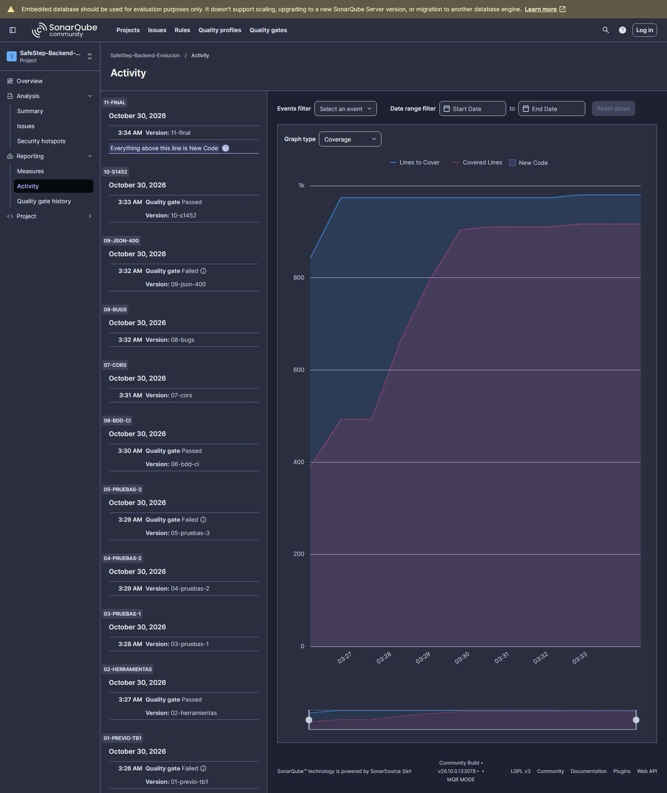
  
<i><b>Figura 6.2.4.</b> Actividad del proyecto en SonarQube: evolución de las líneas a cubrir y las líneas cubiertas del backend. <b>Fuente</b>: Elaboración propia</i>

  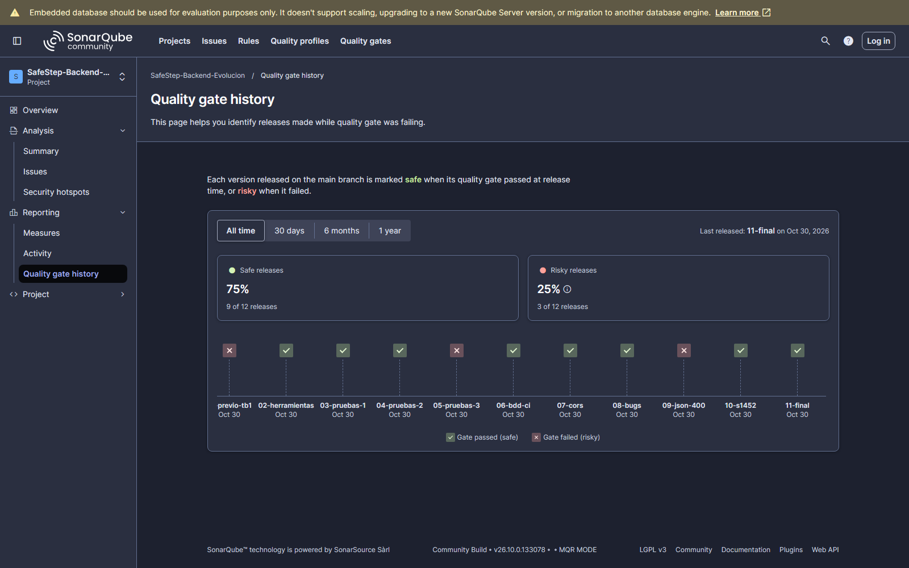
  
<i><b>Figura 6.2.5.</b> Historial del Quality Gate del backend: 9 de las 12 versiones aprobaron y 3 fallaron (etapas 01, 05 y 09). <b>Fuente</b>: Elaboración propia</i>

**Backend: análisis etapa por etapa**

#### Etapa 00. Código base heredado

**Qué se implementó o corrigió.** Es el punto de partida: el código base heredado del curso anterior, tal como se importó al repositorio. Contiene 350 archivos Java organizados por contextos delimitados, 41 pruebas automáticas y ninguna herramienta de calidad configurada (sin JaCoCo, Checkstyle, SonarQube, BDD ni pipeline).

**Código analizado.** Commit `0222e59` (5 de septiembre de 2026).

**Hallazgos.** SonarQube detecta 84 incidencias abiertas: 2 de seguridad (`java:S4502`, protección CSRF deshabilitada, y `java:S5122`, política CORS abierta a cualquier origen), 2 de fiabilidad (`java:S2637`, dos retornos de `null` en `ErrorResponseAssembler`) y 80 de mantenibilidad (62 `java:S1452` por comodines genéricos en tipos de retorno, 15 `java:S1192` por literales duplicados y una incidencia de cada una de `java:S2696`, `java:S3776` y `java:S1186`). La cobertura es de 43.2 % sobre 842 líneas medibles.

**Quality Gate.** **Passed.** Es el primer análisis del proyecto y todavía no existe una versión anterior con la cual comparar el código nuevo.

| Líneas de código | Pruebas | Cobertura | Seguridad | Fiabilidad | Mantenibilidad | Duplicación |
|------------------|---------|-----------|-----------|------------|----------------|-------------|
| 8953 | 41 | 43.2 % | 2 | 2 | 80 | 0.3 % |

  
  
<i><b>Figura 6.2.6.</b> Resumen (Summary, código completo) de SonarQube en la etapa 00: Código base heredado. <b>Fuente</b>: Elaboración propia</i>

  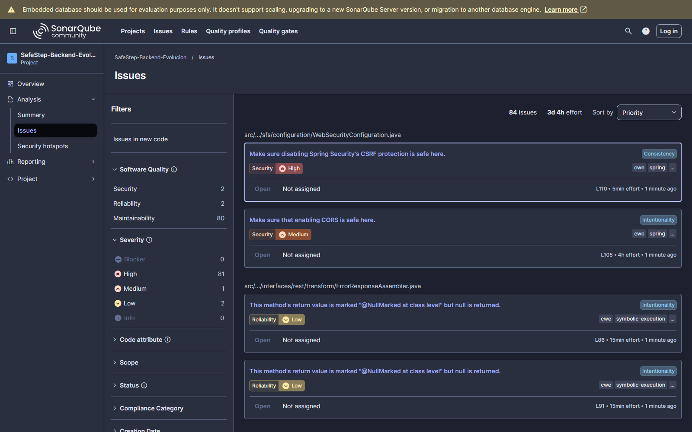
  
<i><b>Figura 6.2.7.</b> Incidencias abiertas en SonarQube en la etapa 00: Código base heredado. <b>Fuente</b>: Elaboración propia</i>

#### Etapa 01. Canje de cupones (estado previo al TB1)

**Qué se implementó o corrigió.** Se incorpora la funcionalidad de canje de cupones con SafeCoins: 19 archivos Java nuevos (369 en total) y 13 pruebas más (54 en total). Es el estado del repositorio justo antes de comenzar el trabajo de calidad del TB1.

**Código analizado.** Commit `f77dfef` (17 de septiembre de 2026).

**Hallazgos.** Aparecen 7 incidencias nuevas, asociadas al código agregado: `java:S2184` (un bug de aritmética en `StripeCheckoutClientImpl`), `java:S3776` y `java:S1192` en `CommerceCommandServiceImpl`, `java:S1192` en `UserCommandServiceImpl` y tres `java:S1452` en controladores; además se cierra una `java:S1192` anterior. Los bugs pasan de 2 a 3.

**Quality Gate.** **Failed.** El código nuevo incumple tres condiciones: cobertura de 52.5 % (mínimo 80 %), duplicación de 6.1 % (máximo 3 %) y 7 incidencias nuevas (máximo 0). Es un ejemplo de código funcional agregado sin pruebas suficientes.

| Líneas de código | Pruebas | Cobertura | Seguridad | Fiabilidad | Mantenibilidad | Duplicación |
|------------------|---------|-----------|-----------|------------|----------------|-------------|
| 9754 | 54 | 47.3 % | 2 | 3 | 85 | 1.0 % |

  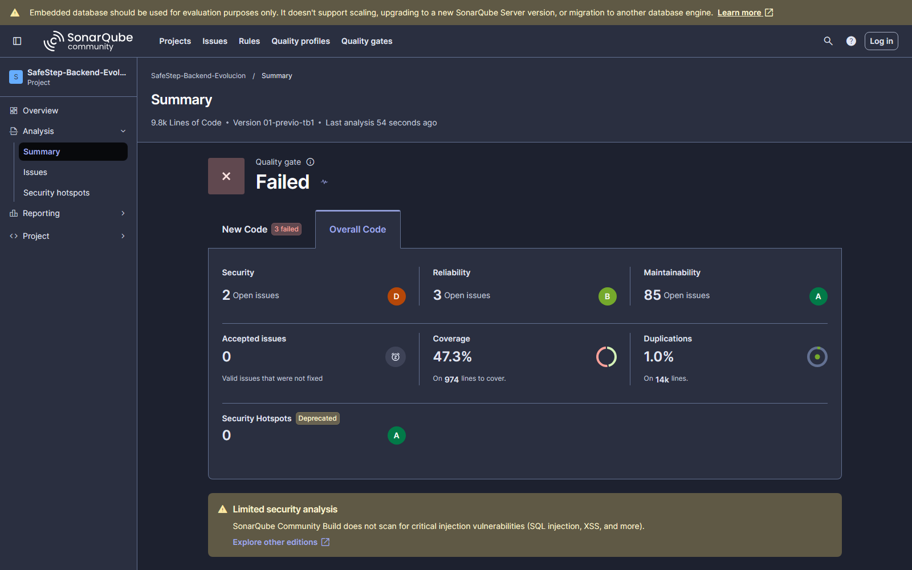
  
<i><b>Figura 6.2.8.</b> Resumen (Summary, código completo) de SonarQube en la etapa 01: Canje de cupones (estado previo al TB1). <b>Fuente</b>: Elaboración propia</i>

  
  
<i><b>Figura 6.2.9.</b> Incidencias abiertas en SonarQube en la etapa 01: Canje de cupones (estado previo al TB1). <b>Fuente</b>: Elaboración propia</i>

#### Etapa 02. Herramientas de calidad: JaCoCo, Checkstyle y SonarQube

**Qué se implementó o corrigió.** Se incorporan al `pom.xml` JaCoCo (medición de cobertura y verificación del mínimo de 80 %), Checkstyle con las reglas de Google en modo reporte y el plugin de análisis de SonarQube. No cambia el código funcional: se habilita la medición continua. Las líneas adicionales corresponden a la configuración del `pom.xml`.

**Código analizado.** Commit `13728a1` (7 de octubre de 2026).

**Hallazgos.** No aparecen ni se cierran incidencias. La cobertura se mantiene en 47.3 %.

**Quality Gate.** **Passed.** No hay código nuevo con incidencias.

| Líneas de código | Pruebas | Cobertura | Seguridad | Fiabilidad | Mantenibilidad | Duplicación |
|------------------|---------|-----------|-----------|------------|----------------|-------------|
| 9830 | 54 | 47.3 % | 2 | 3 | 85 | 1.0 % |

  
  
<i><b>Figura 6.2.10.</b> Resumen (Summary, código completo) de SonarQube en la etapa 02: Herramientas de calidad: JaCoCo, Checkstyle y SonarQube. <b>Fuente</b>: Elaboración propia</i>

  
  
<i><b>Figura 6.2.11.</b> Incidencias abiertas en SonarQube en la etapa 02: Herramientas de calidad: JaCoCo, Checkstyle y SonarQube. <b>Fuente</b>: Elaboración propia</i>

#### Etapa 03. Pruebas unitarias de commerce e iam

**Qué se implementó o corrigió.** Se agregan 72 pruebas unitarias (de 54 a 126): en `commerce`, reglas de carrito y órdenes, sesión de pago con Stripe, catálogo y canje de cupones; en `iam`, gestión de roles, semilla del administrador y fachada ACL.

**Código analizado.** Commits `d0e6e94` y `78aaf5d` (7 de octubre de 2026).

**Hallazgos.** Las pruebas no introducen incidencias. La cobertura sube de 47.3 % a 67.8 %.

**Quality Gate.** **Passed.**

| Líneas de código | Pruebas | Cobertura | Seguridad | Fiabilidad | Mantenibilidad | Duplicación |
|------------------|---------|-----------|-----------|------------|----------------|-------------|
| 9830 | 126 | 67.8 % | 2 | 3 | 85 | 1.0 % |

  
  
<i><b>Figura 6.2.12.</b> Resumen (Summary, código completo) de SonarQube en la etapa 03: Pruebas unitarias de commerce e iam. <b>Fuente</b>: Elaboración propia</i>

  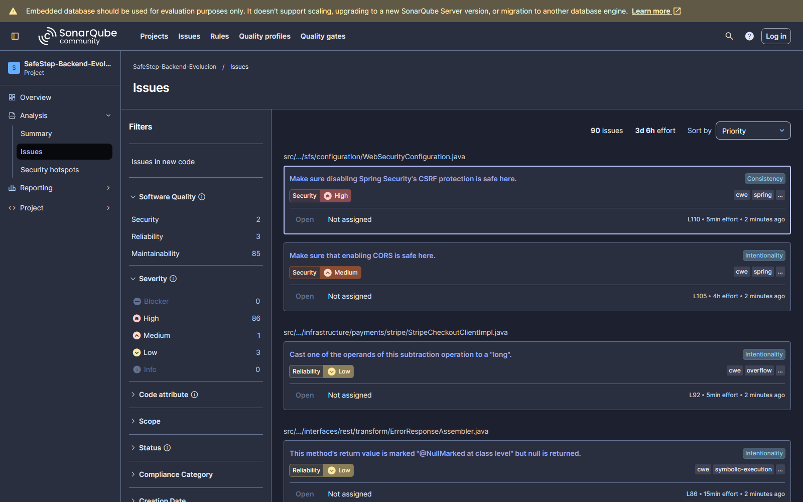
  
<i><b>Figura 6.2.13.</b> Incidencias abiertas en SonarQube en la etapa 03: Pruebas unitarias de commerce e iam. <b>Fuente</b>: Elaboración propia</i>

#### Etapa 04. Pruebas unitarias de gamification y simulation

**Qué se implementó o corrigió.** Se agregan 46 pruebas unitarias (de 126 a 172): reglas de misiones e insignias, gasto de SafeCoins y manejador del evento de intento completado en `gamification`; registro de intentos, CRUD de simulaciones y eventos de dominio en `simulation`.

**Código analizado.** Commits `c60f963` y `1c9d1ed` (7 de octubre de 2026).

**Hallazgos.** Sin incidencias nuevas. La cobertura sube de 67.8 % a 80.8 %, por encima del mínimo de 80 % que exige el Quality Gate para el código nuevo.

**Quality Gate.** **Passed.**

| Líneas de código | Pruebas | Cobertura | Seguridad | Fiabilidad | Mantenibilidad | Duplicación |
|------------------|---------|-----------|-----------|------------|----------------|-------------|
| 9830 | 172 | 80.8 % | 2 | 3 | 85 | 1.0 % |

  
  
<i><b>Figura 6.2.14.</b> Resumen (Summary, código completo) de SonarQube en la etapa 04: Pruebas unitarias de gamification y simulation. <b>Fuente</b>: Elaboración propia</i>

  
  
<i><b>Figura 6.2.15.</b> Incidencias abiertas en SonarQube en la etapa 04: Pruebas unitarias de gamification y simulation. <b>Fuente</b>: Elaboración propia</i>

#### Etapa 05. Pruebas unitarias de analytics, profiles y shared

**Qué se implementó o corrigió.** Se agregan 29 pruebas unitarias (de 172 a 201): resumen, progreso y emisión de certificados en `analytics`; comandos, consultas y fachada ACL en `profiles`; y el tipo `Result` y el manejador global de excepciones en `shared`.

**Código analizado.** Commits `1aa5aaf`, `2e17510` y `15f374c` (7 de octubre de 2026).

**Hallazgos.** La cobertura sube de 80.8 % a 90.9 %. Aparece una incidencia nueva: `java:S1186` (método vacío) en `GlobalExceptionHandlerTest`, código de las propias pruebas.

**Quality Gate.** **Failed.** Una incidencia nueva (máximo 0), a pesar de que la cobertura del código nuevo cumple.

| Líneas de código | Pruebas | Cobertura | Seguridad | Fiabilidad | Mantenibilidad | Duplicación |
|------------------|---------|-----------|-----------|------------|----------------|-------------|
| 9830 | 201 | 90.9 % | 2 | 3 | 86 | 1.0 % |

  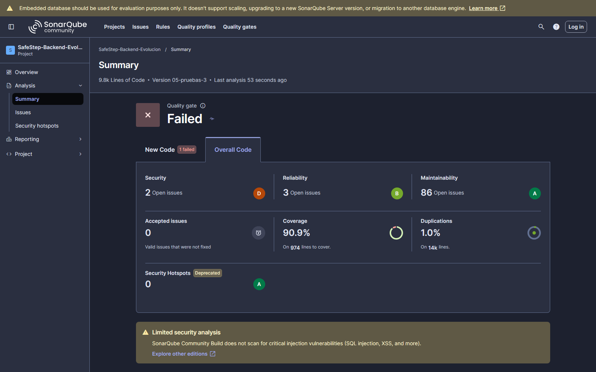
  
<i><b>Figura 6.2.16.</b> Resumen (Summary, código completo) de SonarQube en la etapa 05: Pruebas unitarias de analytics, profiles y shared. <b>Fuente</b>: Elaboración propia</i>

  
  
<i><b>Figura 6.2.17.</b> Incidencias abiertas en SonarQube en la etapa 05: Pruebas unitarias de analytics, profiles y shared. <b>Fuente</b>: Elaboración propia</i>

#### Etapa 06. BDD con Cucumber, pruebas de API con Karate e integración continua

**Qué se implementó o corrigió.** Se agregan 33 escenarios de Cucumber (cinco archivos `.feature` con criterios de aceptación en Gherkin, etiquetados con sus historias de usuario) que levantan la aplicación completa sobre una base H2 aislada: 234 pruebas en total. El mismo estado incluye la suite de integración de la API con Karate (36 escenarios, que SonarQube no mide) y el pipeline de Jenkins con SonarQube descrito en 7.1.

**Código analizado.** Commit `ffc7a6c` (8 de octubre de 2026), que integra los cambios de BDD, Karate y del pipeline.

**Hallazgos.** La cobertura sube de 90.9 % a 91.7 %. No hay incidencias nuevas. Este es el estado previo a las correcciones: sus hallazgos (2 vulnerabilidades y 3 bugs) coinciden con el primer análisis del pipeline que se describe en 7.1.2 y son los que se corrigen en las etapas siguientes.

**Quality Gate.** **Passed.**

| Líneas de código | Pruebas | Cobertura | Seguridad | Fiabilidad | Mantenibilidad | Duplicación |
|------------------|---------|-----------|-----------|------------|----------------|-------------|
| 9854 | 234 | 91.7 % | 2 | 3 | 86 | 1.0 % |

  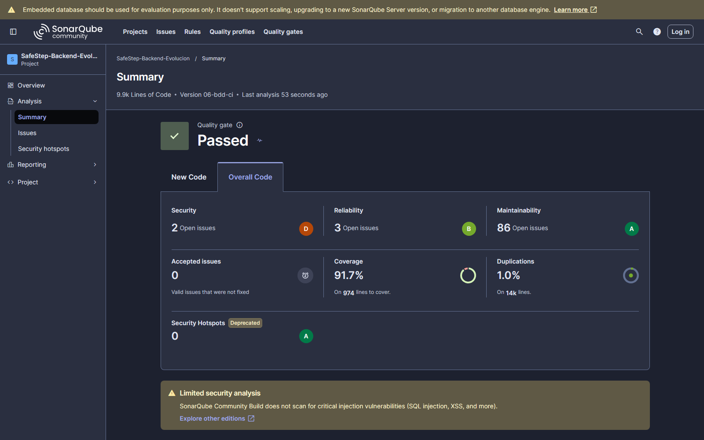
  
<i><b>Figura 6.2.18.</b> Resumen (Summary, código completo) de SonarQube en la etapa 06: BDD con Cucumber, pruebas de API con Karate e integración continua. <b>Fuente</b>: Elaboración propia</i>

  
  
<i><b>Figura 6.2.19.</b> Incidencias abiertas en SonarQube en la etapa 06: BDD con Cucumber, pruebas de API con Karate e integración continua. <b>Fuente</b>: Elaboración propia</i>

#### Etapa 07. Corrección de la política CORS (java:S5122)

**Qué se implementó o corrigió.** `WebSecurityConfiguration` deja de aceptar cualquier origen (`*`) y lee los orígenes permitidos de la propiedad `safestep.cors.allowed-origins` (variable de entorno `SAFESTEP_CORS_ALLOWED_ORIGINS`), con el frontend local y los frontends publicados por defecto. La configuración de pruebas declara la misma propiedad.

**Código analizado.** Cambios de los commits `5dfcbdb` y `c95ca77` (8 de octubre de 2026) correspondientes a CORS.

**Hallazgos.** Se cierra `java:S5122`: las incidencias de seguridad pasan de 2 a 1. Queda abierta únicamente `java:S4502` (CSRF deshabilitado), que se mantiene a propósito porque la API es *stateless* y autentica con JWT, como se explica en 7.1.2.

**Quality Gate.** **Passed.**

| Líneas de código | Pruebas | Cobertura | Seguridad | Fiabilidad | Mantenibilidad | Duplicación |
|------------------|---------|-----------|-----------|------------|----------------|-------------|
| 9858 | 234 | 91.7 % | 1 | 3 | 86 | 1.0 % |

  
  
<i><b>Figura 6.2.20.</b> Resumen (Summary, código completo) de SonarQube en la etapa 07: Corrección de la política CORS (java:S5122). <b>Fuente</b>: Elaboración propia</i>

  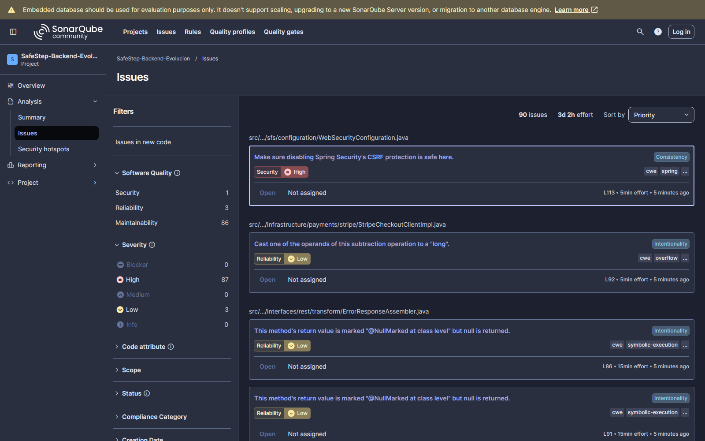
  
<i><b>Figura 6.2.21.</b> Incidencias abiertas en SonarQube en la etapa 07: Corrección de la política CORS (java:S5122). <b>Fuente</b>: Elaboración propia</i>

#### Etapa 08. Corrección de dos bugs (java:S2184 y java:S2637)

**Qué se implementó o corrigió.** En `StripeCheckoutClientImpl` el cálculo del descuento usa aritmética `long` (`100L - discountPercentage`) para evitar un posible desbordamiento (`java:S2184`). En `ErrorResponseAssembler` los métodos que pueden devolver `null` se anotan como `@Nullable` (`java:S2637`, dos incidencias).

**Código analizado.** Cambios del commit `5dfcbdb` (8 de octubre de 2026) en `StripeCheckoutClientImpl` y `ErrorResponseAssembler`.

**Hallazgos.** Se cierran `java:S2184` y las dos `java:S2637`: las incidencias de fiabilidad pasan de 3 a 0.

**Quality Gate.** **Passed.**

| Líneas de código | Pruebas | Cobertura | Seguridad | Fiabilidad | Mantenibilidad | Duplicación |
|------------------|---------|-----------|-----------|------------|----------------|-------------|
| 9859 | 234 | 91.7 % | 1 | 0 | 86 | 1.0 % |

  
  
<i><b>Figura 6.2.22.</b> Resumen (Summary, código completo) de SonarQube en la etapa 08: Corrección de dos bugs (java:S2184 y java:S2637). <b>Fuente</b>: Elaboración propia</i>

  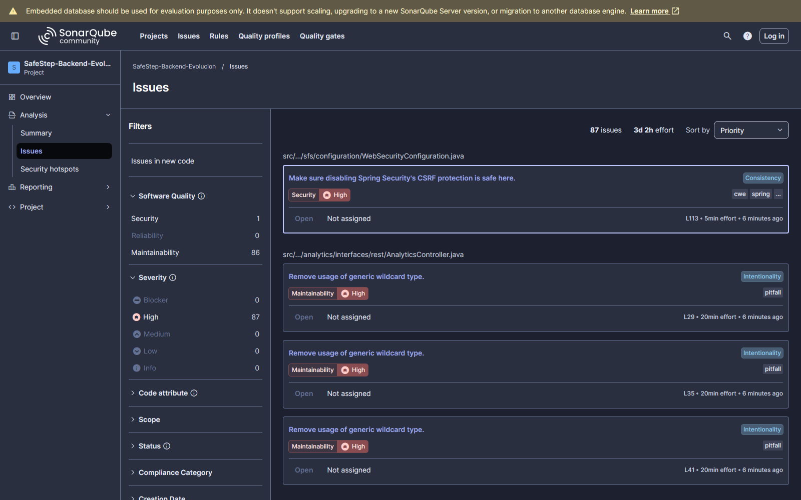
  
<i><b>Figura 6.2.23.</b> Incidencias abiertas en SonarQube en la etapa 08: Corrección de dos bugs (java:S2184 y java:S2637). <b>Fuente</b>: Elaboración propia</i>

#### Etapa 09. Respuesta 400 ante un JSON mal formado

**Qué se implementó o corrigió.** Al desarrollar las pruebas de integración se detectó que la API respondía HTTP 500 ante un cuerpo JSON mal formado. Se agrega en `GlobalExceptionHandler` un manejador para `HttpMessageNotReadableException` que responde 400 con un error de validación sin exponer el mensaje interno del analizador, se registran los errores inesperados y se agregan los mensajes en español e inglés. Se suman 4 pruebas (238 en total): tres de integración por HTTP (JSON mal formado, origen CORS permitido y origen ajeno) y una unitaria.

**Código analizado.** Cambios de los commits `5dfcbdb` y `c95ca77` (8 de octubre de 2026) en el manejador global de excepciones.

**Hallazgos.** Aparece una incidencia nueva, `java:S1452`, en el manejador recién agregado (devolvía `ResponseEntity<?>`).

**Quality Gate.** **Failed.** Una incidencia nueva (máximo 0). Es el caso en que el Quality Gate detiene el pipeline por código nuevo con una incidencia, tal como ocurrió en la ejecución #6 de Jenkins (7.1.2).

| Líneas de código | Pruebas | Cobertura | Seguridad | Fiabilidad | Mantenibilidad | Duplicación |
|------------------|---------|-----------|-----------|------------|----------------|-------------|
| 9871 | 238 | 91.7 % | 1 | 0 | 87 | 1.0 % |

  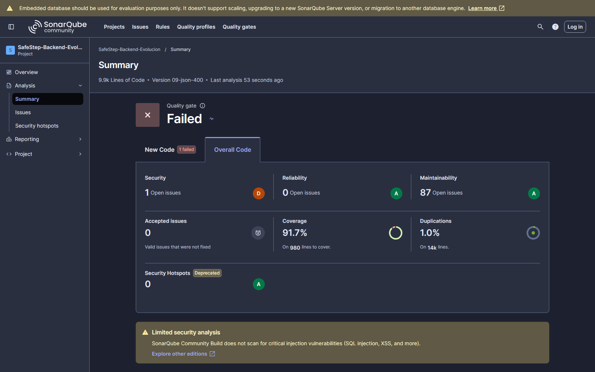
  
<i><b>Figura 6.2.24.</b> Resumen (Summary, código completo) de SonarQube en la etapa 09: Respuesta 400 ante un JSON mal formado. <b>Fuente</b>: Elaboración propia</i>

  
  
<i><b>Figura 6.2.25.</b> Incidencias abiertas en SonarQube en la etapa 09: Respuesta 400 ante un JSON mal formado. <b>Fuente</b>: Elaboración propia</i>

#### Etapa 10. Corrección de java:S1452 en el manejador nuevo

**Qué se implementó o corrigió.** El método `handleHttpMessageNotReadable` pasa de devolver `ResponseEntity<?>` a devolver `ResponseEntity<ErrorResource>`, con lo que el tipo de retorno queda explícito.

**Código analizado.** Cambio del commit `d5faeed` (8 de octubre de 2026).

**Hallazgos.** Se cierra la `java:S1452` del manejador. Las incidencias de mantenibilidad vuelven de 87 a 86.

**Quality Gate.** **Passed.**

| Líneas de código | Pruebas | Cobertura | Seguridad | Fiabilidad | Mantenibilidad | Duplicación |
|------------------|---------|-----------|-----------|------------|----------------|-------------|
| 9872 | 238 | 91.7 % | 1 | 0 | 86 | 1.0 % |

  
  
<i><b>Figura 6.2.26.</b> Resumen (Summary, código completo) de SonarQube en la etapa 10: Corrección de java:S1452 en el manejador nuevo. <b>Fuente</b>: Elaboración propia</i>

  
  
<i><b>Figura 6.2.27.</b> Incidencias abiertas en SonarQube en la etapa 10: Corrección de java:S1452 en el manejador nuevo. <b>Fuente</b>: Elaboración propia</i>

#### Etapa 11. Estado final del backend

**Qué se implementó o corrigió.** Se documentan con OpenAPI las respuestas exitosas de la API (se anotaron 49 operaciones cuya respuesta no tenía esquema) y se agregan 4 pruebas de contrato que verifican el documento publicado, hasta llegar a 242 pruebas. El estado incluye además el README actualizado y los archivos de contenerización y de integración continua (Dockerfile, Docker Compose, imagen de PostgreSQL y Jenkinsfile), que SonarQube no mide.

**Código analizado.** Commit `793e367` (28 de octubre de 2026), estado actual de la rama `main`.

**Hallazgos.** Sin incidencias nuevas. Quedan 87 incidencias abiertas (1 de seguridad y 86 de mantenibilidad), que se describen en la sección de hallazgos abiertos.

**Quality Gate.** **Passed.**

| Líneas de código | Pruebas | Cobertura | Seguridad | Fiabilidad | Mantenibilidad | Duplicación |
|------------------|---------|-----------|-----------|------------|----------------|-------------|
| 9964 | 242 | 91.7 % | 1 | 0 | 86 | 1.0 % |

  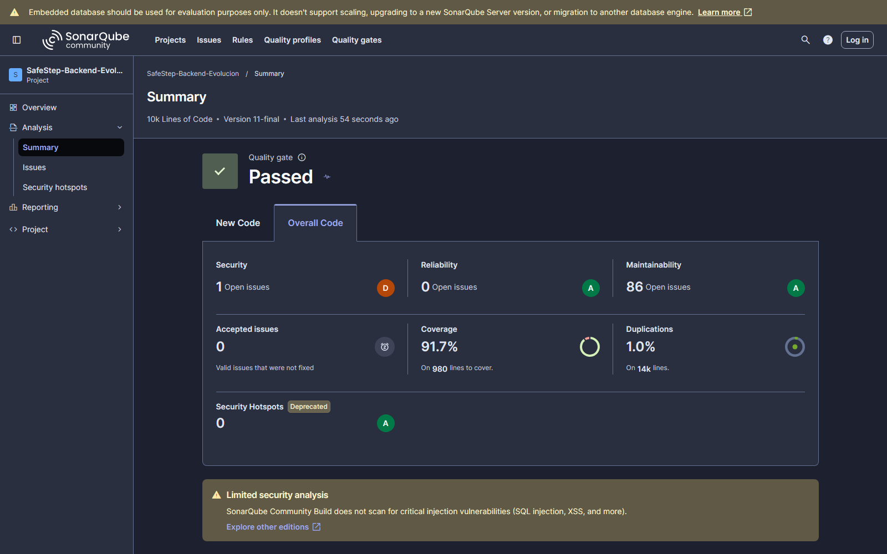
  
<i><b>Figura 6.2.28.</b> Resumen (Summary, código completo) de SonarQube en la etapa 11: Estado final del backend. <b>Fuente</b>: Elaboración propia</i>

  
  
<i><b>Figura 6.2.29.</b> Incidencias abiertas en SonarQube en la etapa 11: Estado final del backend. <b>Fuente</b>: Elaboración propia</i>

**Backend: hallazgos abiertos y deuda técnica**

Al cierre del análisis quedan 87 incidencias abiertas en el backend. Ninguna impide el Quality Gate, que evalúa solo el código nuevo, pero constituyen deuda técnica identificada:

| Regla | Cantidad | Descripción | Situación |
|-------|----------|-------------|-----------|
| `java:S1452` | 65 | Los comodines genéricos no deben usarse en tipos de retorno (`ResponseEntity<?>`) | Código anterior en controladores; pendiente de corregir |
| `java:S1192` | 16 | Los literales de texto no deben duplicarse | Pendiente de corregir |
| `java:S3776` | 2 | La complejidad cognitiva de los métodos no debe ser demasiado alta | Pendiente de corregir |
| `java:S1186` | 2 | Los métodos no deben estar vacíos | Pendiente de corregir |
| `java:S2696` | 1 | Los métodos de instancia no deben escribir en campos estáticos | Pendiente de corregir |
| `java:S4502` | 1 | Las protecciones CSRF no deben deshabilitarse | **Se mantiene a propósito**: la API es *stateless*, autentica con JWT en el encabezado `Authorization` y no usa cookies de sesión (7.1.2) |

**Frontend: análisis en 3 etapas**

El frontend (Angular 21) se analizó con el mismo procedimiento. Un detalle de la medición: por defecto, el ejecutor de pruebas de Angular solo mide los archivos que importan las pruebas, por lo que informaba 100 % sobre 2 líneas; para obtener un valor real se configuró la medición sobre todo `src/**/*.ts`. El frontend solo cuenta con una prueba de arranque (`app.spec.ts`, 2 pruebas), de modo que su cobertura es prácticamente nula.

| Etapa | Qué se implementó | Líneas | Cobertura | Seguridad | Fiabilidad | Mantenibilidad | Quality Gate |
|-------|-------------------|--------|-----------|-----------|------------|----------------|--------------|
| F0 | Código base heredado | 11939 | 0.4 % | 0 | 12 | 3 | Passed |
| F1 | Panel de administración y canje de cupones | 12891 | 0.4 % | 0 | 11 | 1 | Failed |
| F2 | Estado final del frontend | 13147 | 0.4 % | 0 | 11 | 1 | Passed |

  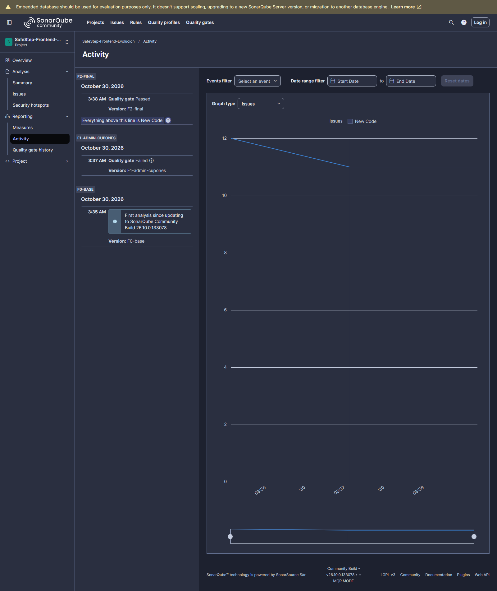
  
<i><b>Figura 6.2.30.</b> Actividad del proyecto del frontend en SonarQube: evolución de las incidencias en las 3 etapas. <b>Fuente</b>: Elaboración propia</i>

  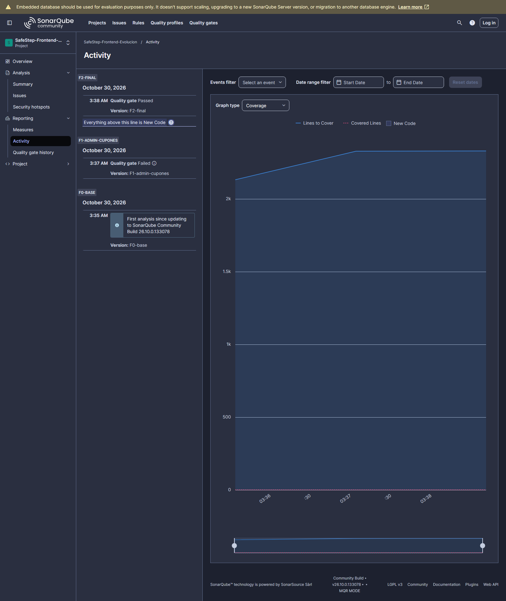
  
<i><b>Figura 6.2.31.</b> Actividad del proyecto del frontend en SonarQube: evolución de las líneas a cubrir y las líneas cubiertas. <b>Fuente</b>: Elaboración propia</i>

  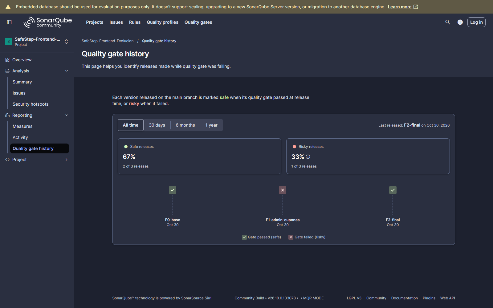
  
<i><b>Figura 6.2.32.</b> Historial del Quality Gate del frontend: la etapa F1 falló por código nuevo sin pruebas. <b>Fuente</b>: Elaboración propia</i>

#### Etapa F0. Código base heredado

**Qué se implementó o corrigió.** Es el punto de partida del frontend: el código base heredado del curso anterior, con 140 archivos TypeScript y una sola prueba de arranque.

**Código analizado.** Commit `b86d1bc` (5 de septiembre de 2026).

**Hallazgos.** Se detectan 12 incidencias abiertas: 8 de `typescript:S9383` (promesas que no se esperan ni se manejan), 2 de `typescript:S7773` (usar las funciones estáticas de `Number` en lugar de las globales), 1 de `typescript:S7723` (llamar a los constructores nativos de forma consistente con o sin `new`) y 1 de `typescript:S8786` (expresión regular con retroceso no lineal). La cobertura es de 0.4 %.

**Quality Gate.** **Passed.** Es el primer análisis del proyecto y no hay una versión anterior con la cual comparar.

| Líneas de código | Cobertura | Seguridad | Fiabilidad | Mantenibilidad | Duplicación |
|------------------|-----------|-----------|------------|----------------|-------------|
| 11939 | 0.4 % | 0 | 12 | 3 | 0.0 % |

  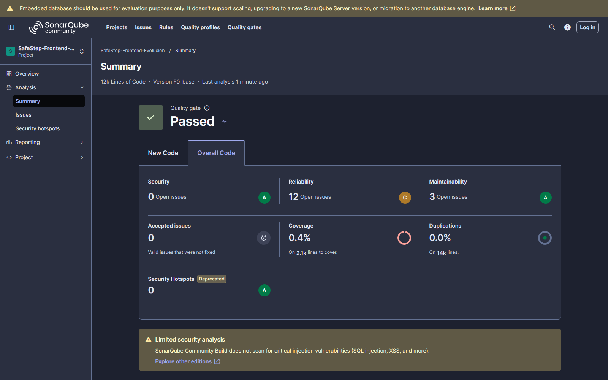
  
<i><b>Figura 6.2.33.</b> Resumen (Summary, código completo) de SonarQube en la etapa F0: Código base heredado. <b>Fuente</b>: Elaboración propia</i>

  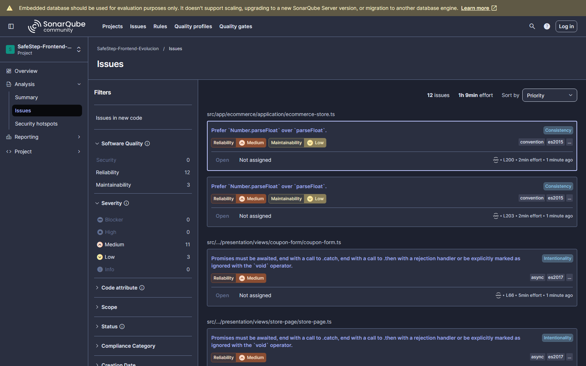
  
<i><b>Figura 6.2.34.</b> Incidencias abiertas en SonarQube en la etapa F0: Código base heredado. <b>Fuente</b>: Elaboración propia</i>

#### Etapa F1. Panel de administración y canje de cupones

**Qué se implementó o corrigió.** Se agregan el panel de administración, la gestión de roles, el rediseño de cupones, la página de canje de cupones, el selector de cupón en el checkout y la vista de los cupones canjeados del jugador.

**Código analizado.** Commit `be56a72` (17 de septiembre de 2026): 56 archivos modificados.

**Hallazgos.** Se cierran dos incidencias `typescript:S7773` en `ecommerce-store.ts` y aparece una `typescript:S9383` nueva en `user-roles-form.ts`: las abiertas pasan de 12 a 11.

**Quality Gate.** **Failed.** El código nuevo no tiene cobertura (0 %, mínimo 80 %) y agrega 1 incidencia nueva: se incorporó funcionalidad sin pruebas.

| Líneas de código | Cobertura | Seguridad | Fiabilidad | Mantenibilidad | Duplicación |
|------------------|-----------|-----------|------------|----------------|-------------|
| 12891 | 0.4 % | 0 | 11 | 1 | 0.0 % |

  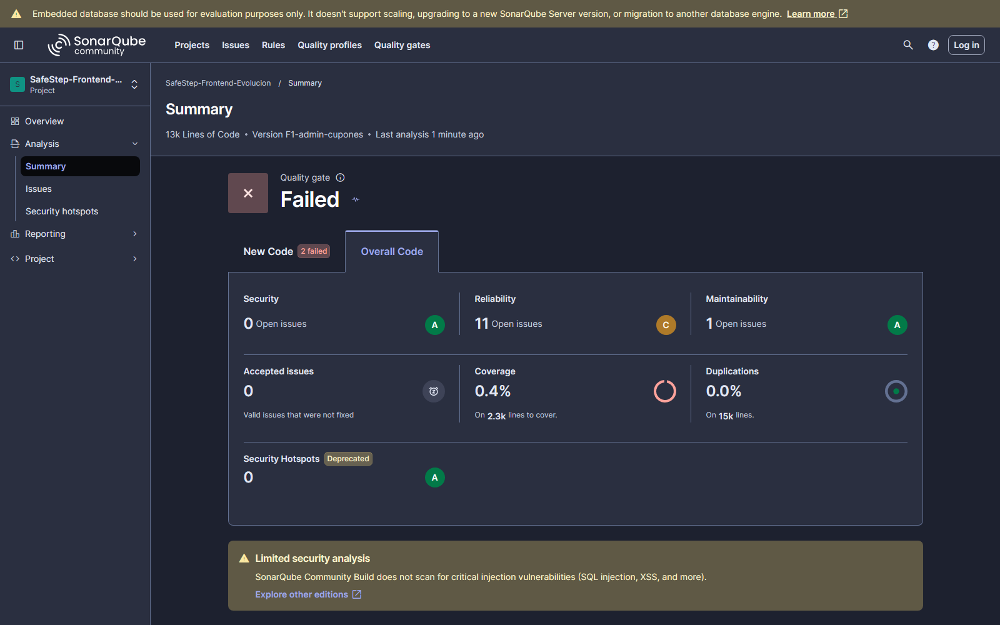
  
<i><b>Figura 6.2.35.</b> Resumen (Summary, código completo) de SonarQube en la etapa F1: Panel de administración y canje de cupones. <b>Fuente</b>: Elaboración propia</i>

  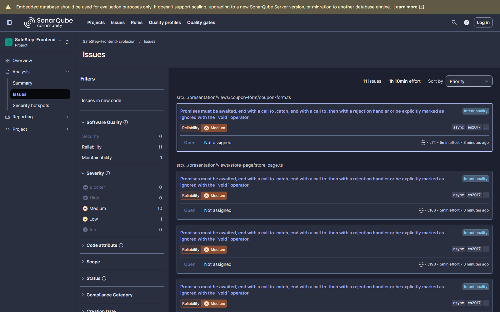
  
<i><b>Figura 6.2.36.</b> Incidencias abiertas en SonarQube en la etapa F1: Panel de administración y canje de cupones. <b>Fuente</b>: Elaboración propia</i>

#### Etapa F2. Estado final del frontend

**Qué se implementó o corrigió.** Se agrega la página pública de Términos y Condiciones (`/terms`), enlazada desde el registro, y se apunta el entorno de producción al backend desplegado en Render. Las pruebas de sistema con Selenium se agregaron y se retiraron sin efecto neto sobre el código.

**Código analizado.** Commit `960947d` (9 de octubre de 2026), estado actual de la rama `main`.

**Hallazgos.** Sin incidencias nuevas ni cerradas: quedan 11 abiertas (9 `typescript:S9383`, 1 `typescript:S7723` y 1 `typescript:S8786`).

**Quality Gate.** **Passed.**

| Líneas de código | Cobertura | Seguridad | Fiabilidad | Mantenibilidad | Duplicación |
|------------------|-----------|-----------|------------|----------------|-------------|
| 13147 | 0.4 % | 0 | 11 | 1 | 0.0 % |

  
  
<i><b>Figura 6.2.37.</b> Resumen (Summary, código completo) de SonarQube en la etapa F2: Estado final del frontend. <b>Fuente</b>: Elaboración propia</i>

  
  
<i><b>Figura 6.2.38.</b> Incidencias abiertas en SonarQube en la etapa F2: Estado final del frontend. <b>Fuente</b>: Elaboración propia</i>

**Frontend: hallazgos abiertos y deuda técnica**

| Regla | Cantidad | Descripción | Situación |
|-------|----------|-------------|-----------|
| `typescript:S9383` | 9 | Las promesas no deben quedar sin manejar | Pendiente de corregir |
| `typescript:S7723` | 1 | Los constructores nativos deben llamarse de forma consistente con o sin `new` | Pendiente de corregir |
| `typescript:S8786` | 1 | Las expresiones regulares no deben provocar retroceso no lineal | Pendiente de corregir |

La **cobertura de pruebas del frontend es de 0.4 %**: solo existe la prueba de arranque del componente raíz. Es la principal limitación de calidad del frontend y la prioridad de mejora, junto con el manejo de las promesas.

**Conclusiones**

- En el backend, la cobertura pasó de 43.2 % a 91.7 % entre la base y el estado final gracias a las pruebas unitarias por contexto (etapas 03 a 05) y a las pruebas BDD (etapa 06); las pruebas de las etapas 03 a 06 no introducen incidencias, salvo un método vacío en una prueba.
- Las vulnerabilidades pasaron de 2 a 1 (CORS corregido en la etapa 07) y los bugs de 3 a 0 (etapa 08). La incidencia de seguridad que permanece (`java:S4502`) es una decisión de diseño documentada.
- El Quality Gate cumplió su función: detuvo el código nuevo sin pruebas (etapa 01 y F1) y el código nuevo con una incidencia (etapas 05 y 09), y aprobó las etapas siguientes una vez corregido.
- Queda como deuda técnica del backend un conjunto de 86 incidencias de mantenibilidad, la mayoría `java:S1452` y `java:S1192`; y en el frontend, la cobertura de pruebas y las promesas sin manejar.

## 6.2.2. Reviews

Pendiente.
