# 7.1. Continuous Integration

La integración continua de SafeStep se implementa con **Jenkins**, siguiendo la arquitectura del material del curso: Jenkins y SonarQube se ejecutan como contenedores Docker en una red compartida y el pipeline se define como código en un `Jenkinsfile` versionado junto al backend. Cada ejecución del pipeline parte del código de una rama del repositorio del backend (`develop` en las ejecuciones #1 a #8 que se documentan abajo y `main` en el entorno actual, ver 7.2), lo compila, valida su estilo (y se detiene si encuentra una sola infracción), ejecuta las pruebas unitarias y de comportamiento (BDD), verifica la cobertura, lo analiza con SonarQube y genera el artefacto. La construcción y publicación de la imagen Docker se documentan en 7.2.

## 7.1.1. Tools and Practices

**Herramientas**

| Herramienta | Versión | Rol en la integración continua |
|-------------|---------|--------------------------------|
| Jenkins | LTS sobre JDK 25 (imagen `safestep-jenkins:1.0`) | Orquesta el pipeline declarativo; plugins: Pipeline, Git, Pipeline Stage View, SonarQube Scanner, Job DSL y Configuration as Code |
| Docker y Docker Compose | 29.6 | Ejecutan Jenkins y SonarQube como contenedores en la red compartida `spring-postgres-net` |
| Maven | 3.9.11 | Compilación, pruebas, cobertura y análisis |
| JDK Eclipse Temurin | 26 | Compila y prueba el backend (se instala en la imagen de Jenkins y se selecciona con `JAVA_HOME_26`) |
| Checkstyle | 14.3.0 (reglas de Google) | Compuerta de estilo: `checkstyle:check` falla el pipeline ante cualquier infracción |
| JUnit Jupiter, Mockito, Cucumber | ver 6.1 | Suites de prueba que ejecuta el pipeline |
| JaCoCo | 0.8.15 | Cobertura y umbral de 80 % |
| SonarQube Community Build | 26.10 | Análisis de calidad y seguridad con Quality Gate |

**Prácticas**

- **Pipeline como código.** El `Jenkinsfile` está en la raíz de `safeStept-backend`; los cambios al pipeline se revisan y versionan como cualquier otro cambio.
- **Infraestructura como código.** La carpeta `ci/` contiene el `Dockerfile` de Jenkins, `plugins.txt`, el `docker-compose.yml` y `casc.yaml`, que configura Jenkins con *Configuration as Code*: usuario administrador, servidor SonarQube (`MiSonarServer`), credencial del token (`sonarqube-token-id`) y el job `safestep-backend`, que se crea solo al iniciar. El script `ci/start-ci.sh` levanta ambos servicios, genera el token de análisis, registra el webhook y arranca Jenkins; las claves generadas se guardan en `ci/.env`, que Git ignora.
- **Fallar rápido.** Las etapas están ordenadas de la más barata a la más costosa y una etapa fallida detiene las siguientes.
- **Estilo como compuerta.** El código debe cumplir las reglas de Google sin ninguna infracción antes de ejecutar las pruebas; la validación tarda segundos y evita gastar el resto del pipeline en código que no cumple el estándar (6.2.1.1).
- **Un único origen de verdad para las reglas de calidad.** Las exclusiones de cobertura de JaCoCo y de SonarQube son las mismas.
- **Pruebas aisladas.** Las pruebas BDD usan H2 en memoria, de modo que nunca tocan datos de desarrollo ni producción.
- **Evidencia conservada.** Cada etapa archiva sus reportes (resultados JUnit, Checkstyle, JaCoCo, Cucumber y el JAR) como artefactos de la ejecución.
- **Secretos fuera del repositorio.** Las credenciales de Jenkins y SonarQube se generan en cada instalación, y la clave de Stripe se lee de la variable `STRIPE_SECRET_KEY`.
- **Flujo de ramas.** El job de Jenkins construye la rama que declara `casc.yaml` (`develop` en las ejecuciones #1 a #8 y `main` en el entorno actual); los cambios llegan con Conventional Commits, tal como se describe en 5.1.2.

## 7.1.2. Build & Test Suite Pipeline Components

El pipeline completo tiene las etapas siguientes. Los tiempos corresponden a la ejecución #6 del entorno actual (3 min 58 s de principio a fin, resultado **SUCCESS**, rama `main`).

| # | Etapa | Comando | Qué verifica o produce | Si falla | Tiempo |
|---|-------|---------|------------------------|----------|--------|
| 1 | Checkout SCM | Git | Descarga el `Jenkinsfile` y el código de `main` | Se detiene | 1 s |
| 2 | Compile Project | `mvn clean compile` | El proyecto compila con JDK 26 | Se detiene | 24 s |
| 3 | Validate Checkstyle | `mvn checkstyle:check` | El código cumple las reglas de Google sin ninguna infracción; archiva `checkstyle-result.xml` | Se detiene (ver abajo y 6.2.1.1) | 13 s |
| 4 | Unit and BDD Tests | `mvn test` | 209 pruebas unitarias y de integración más 33 escenarios Cucumber; resultados JUnit y reporte Cucumber | Se detiene | 56 s |
| 5 | Validate Test Coverage | `mvn jacoco:check` | Cobertura de instrucciones ≥ 80 % sobre las clases medidas (resultado: 93.8 %) | Se detiene | 3 s |
| 6 | SonarQube Analysis | `mvn sonar:sonar` + `waitForQualityGate()` | Envía el análisis y espera el webhook de SonarQube con el resultado del Quality Gate | Se detiene si el gate no es `OK` | 36 s |
| 7 | Package Project | `mvn package -DskipTests` | Genera `safestep-platform-1.0.0.jar`, que se archiva con huella digital | Se detiene | 5 s |
| 8 | Build Docker Image | `docker build` | Construye la imagen del backend (entrega continua, 7.2.2) | Se detiene | 1 min 21 s |
| 9 | Publish Docker Image | `docker push` | Publica la imagen en Docker Hub (entrega continua, 7.2.2) | Se detiene | 15 s |

Jenkins muestra además las entradas *Declarative: Checkout SCM* y *Declarative: Post Actions*, que no son etapas del `Jenkinsfile`; con ellas la vista de etapas tiene diez columnas.

<div align="center">
  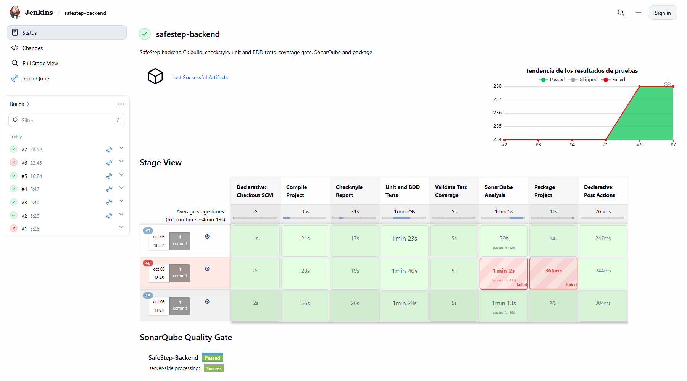
  <p><i><b>Figura 7.1.1.</b> Vista de etapas del job <code>safestep-backend</code> en Jenkins del entorno anterior (ejecuciones #5 a #8, con siete etapas). <b>Fuente</b>: Elaboración propia</i></p>
</div>

**Historial de ejecuciones.** La ejecución #1 falló porque Jenkins bloquea por seguridad los checkouts de repositorios locales; se habilitó explícitamente (`hudson.plugins.git.GitSCM.ALLOW_LOCAL_CHECKOUT`) porque el job lee el repositorio montado desde el anfitrión. Las ejecuciones #2 a #4 terminaron en SUCCESS e incluían además etapas de construcción de imagen y pruebas de API en contenedor; esas etapas se retiraron en esa entrega porque la entrega y el despliegue continuos quedaron fuera de su alcance; se reincorporaron después y se documentan en 7.2. La ejecución #5 fue la primera del pipeline de integración continua actual. Después de corregir los hallazgos de SonarQube (ver abajo), la ejecución #6 **falló a propósito del Quality Gate**: el código nuevo tenía una incidencia de estilo (`java:S1452`, un tipo genérico `ResponseEntity<?>` en el manejador nuevo) y el pipeline se detuvo en la etapa de SonarQube sin generar el JAR. Se corrigió el tipo de retorno y la ejecución #7 terminó en SUCCESS. La ejecución #8, con la documentación OpenAPI corregida y las pruebas que la protegen, también terminó en SUCCESS, ahora con 242 pruebas.

**Integración con SonarQube.** La primera instalación usó la imagen `sonarqube:lts-community` (9.9) del material del curso. Su analizador de Java no puede leer la sintaxis moderna que usa el backend (`switch` con patrones y variables sin nombre `_`) y registró errores de análisis en tres archivos, por lo que el equipo cambió a la imagen vigente `sonarqube:community`, con la que el análisis termina sin errores de lectura. SonarQube notifica a Jenkins mediante el webhook `http://jenkins-master:9089/sonarqube-webhook/`, y `waitForQualityGate()` retoma el pipeline cuando llega el resultado.

**El webhook y las direcciones privadas.** Al levantar de nuevo el entorno de CI con SonarQube 26.10, la primera ejecución del job (#1 del entorno actual) se abortó en la etapa de SonarQube. El análisis terminó correctamente (`ANALYSIS SUCCESSFUL`) y SonarQube lo procesó, pero Jenkins esperó 10 minutos —el `timeout` del paso `waitForQualityGate()`— sin recibir el resultado. El registro de SonarQube explicaba la causa: `Invalid URL: loopback, wildcard, link-local, site-local, multicast, cloud metadata addresses ... are not allowed for webhooks`. Con su validación de webhooks activa (`sonar.validateWebhooks=true`, el valor por defecto), SonarQube rechaza las direcciones privadas, y el nombre `jenkins-master` se resuelve a una dirección privada de la red de Docker (`172.18.0.2`). Se descartó un problema de red: ambos contenedores comparten `spring-postgres-net` y el puerto 9089 de Jenkins respondía desde el contenedor de SonarQube. La solución fue desactivar esa validación únicamente en el SonarQube local, con la variable `SONAR_VALIDATEWEBHOOKS: "false"` en el servicio `sonarqube-server` de `ci/docker-compose.yml`; en la ejecución siguiente el aviso llegó y la espera del Quality Gate fue de 4 segundos. En la interfaz de SonarQube, la entrega fallida se muestra solo como «Server Unreachable»; el mensaje completo del error consta en el registro del servidor.

<div align="center">
  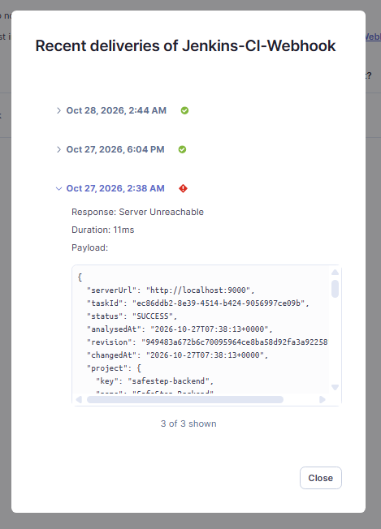
  <p><i><b>Figura 7.1.2.</b> Registro de entregas del webhook <code>Jenkins-CI-Webhook</code> en SonarQube (hora local): la primera entrega falló (<i>Server Unreachable</i>, 11 ms) y las siguientes tuvieron éxito. <b>Fuente</b>: Elaboración propia</i></p>
</div>

<div align="center">
  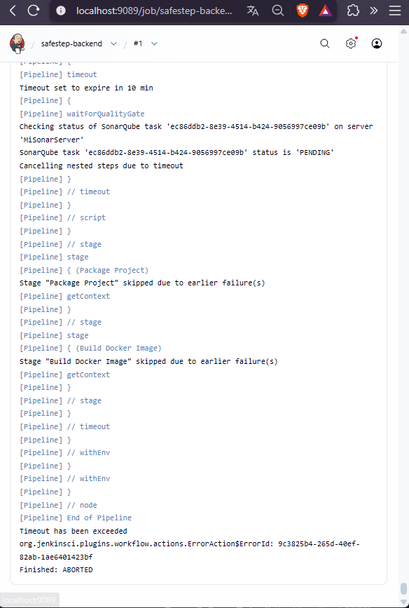
  <p><i><b>Figura 7.1.3.</b> Registro de la ejecución #1 del entorno actual: <code>waitForQualityGate</code> espera el resultado de SonarQube, vence el tiempo de espera de 10 minutos, las etapas siguientes se omiten y la ejecución termina en <code>ABORTED</code>. <b>Fuente</b>: Elaboración propia</i></p>
</div>

<div align="center">
  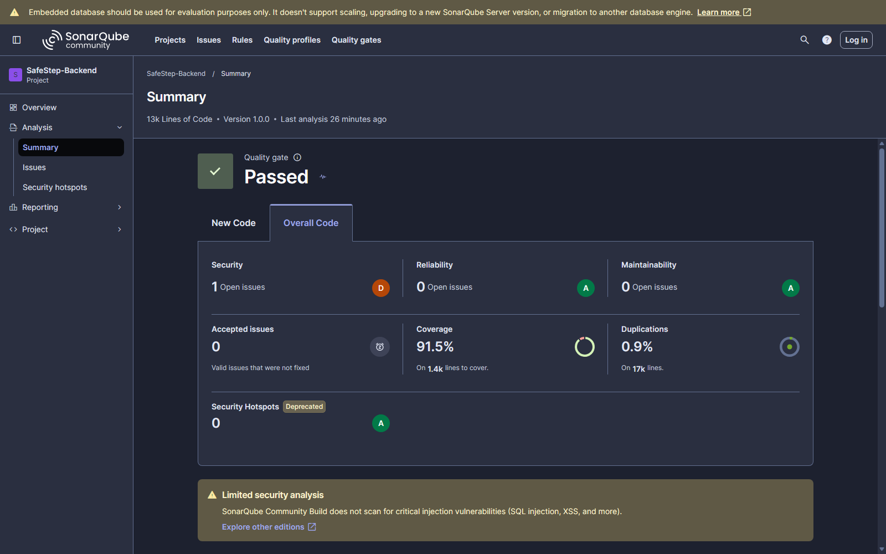
  <p><i><b>Figura 7.1.4.</b> Panel de SonarQube del backend SafeStep (código completo) tras la ejecución #6 de Jenkins, con el perfil <i>Sonar way extended</i>. <b>Fuente</b>: Elaboración propia</i></p>
</div>

| Métrica de SonarQube | Valor |
|----------------------|-------|
| Perfil de calidad de Java | *Sonar way extended* (337 reglas) |
| Líneas de código | 12,885 (17,376 líneas en total) en 371 archivos |
| Quality Gate (Sonar way) | **Aprobado** |
| Cobertura | 91.6 % sobre 1,400 líneas medibles |
| Duplicación | 0.9 % |
| Vulnerabilidades | 1 (calificación de seguridad D; es el CSRF deshabilitado a propósito) |
| Bugs | 0 (calificación de fiabilidad A) |
| Code smells | 0 (calificación de mantenibilidad A) |
| Hotspots de seguridad | 0 |

Estas cifras corresponden a la ejecución #7 del entorno actual (versión `1.0.0` en SonarQube, 9 de noviembre de 2026) y reemplazan a las de la ejecución #8 del entorno anterior (9,964 líneas, 91.7 % de cobertura y 207 *code smells*), que se tomaron con otra versión del código y del servidor. Las líneas de código aumentaron porque la limpieza de Checkstyle (6.2.1.1) partió líneas largas con *google-java-format*, y los *code smells* bajaron a cero porque se corrigieron las 86 incidencias que aparecieron al cambiar al perfil *extended* (6.2.1.2).

El Quality Gate «Sonar way» evalúa únicamente el **código nuevo**. En el primer análisis del proyecto no existía código nuevo que evaluar y el gate aprobó, por lo que las incidencias existentes se trataron como deuda técnica y se listaron en lugar de ocultarse. En los análisis posteriores el gate evalúa el código nuevo con tres condiciones: cobertura de al menos 80 %, duplicación menor a 3 % y ninguna incidencia nueva. En la ejecución #6 el commit analizado es el mismo que ya había analizado SonarQube en la tercera tanda de correcciones (6.2.1.2), de modo que no hay código nuevo: el gate evalúa solo la condición de incidencias nuevas (0) y aprueba.

**Hallazgos de seguridad y fiabilidad (6.2.1.2).** El primer análisis reportó 2 vulnerabilidades y 3 bugs. El equipo corrigió los hallazgos que eran reales y dejó, documentada, la que es una decisión de diseño:

| Tipo | Gravedad | Regla | Archivo | Descripción | Estado |
|------|----------|-------|---------|-------------|--------|
| Vulnerabilidad | Crítica | `java:S4502` | `WebSecurityConfiguration` | La protección CSRF de Spring Security está deshabilitada | **Se mantiene.** Es aceptable en esta API: es *stateless*, autentica con JWT en el encabezado `Authorization` y no usa cookies de sesión |
| Vulnerabilidad | Mayor | `java:S5122` | `WebSecurityConfiguration` | CORS permitía cualquier origen (`*`) | **Corregido.** Los orígenes permitidos salen de la propiedad `safestep.cors.allowed-origins` (variable `SAFESTEP_CORS_ALLOWED_ORIGINS`), con el frontend local y los frontends publicados por defecto |
| Bug | Menor | `java:S2184` | `StripeCheckoutClientImpl` | Posible desbordamiento en una resta de enteros que se convierte a `long` | **Corregido.** La resta usa aritmética `long` |
| Bug | Menor | `java:S2637` | `ErrorResponseAssembler` (2) | Se devolvía `null` desde métodos marcados como no nulos (`@NullMarked`) | **Corregido.** El retorno se anotó como `@Nullable` |

<div align="center">
  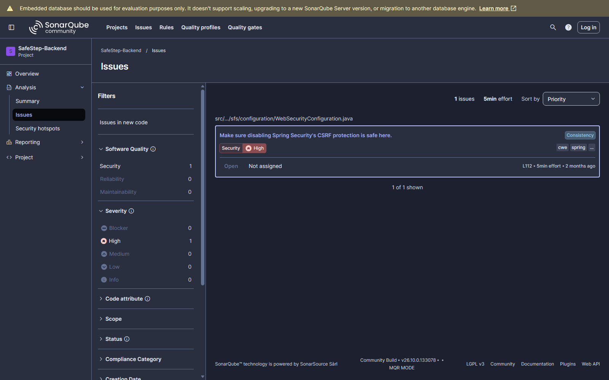
  <p><i><b>Figura 7.1.5.</b> Única incidencia que SonarQube mantiene abierta en el backend tras las correcciones: el CSRF deshabilitado a propósito. <b>Fuente</b>: Elaboración propia</i></p>
</div>

La corrección se verificó de tres formas: pruebas nuevas (una unitaria y tres de integración por HTTP sobre el cuerpo ilegible y las reglas de CORS), la ejecución completa de Jenkins con las 238 pruebas de entonces (ejecución #7) y una consulta real al backend levantado, que respondió 400 al JSON mal formado, aceptó la petición previa (*preflight*) del frontend publicado y rechazó con 403 la de un origen desconocido.

**Reportes y artefactos de cada ejecución.**

<div align="center">
  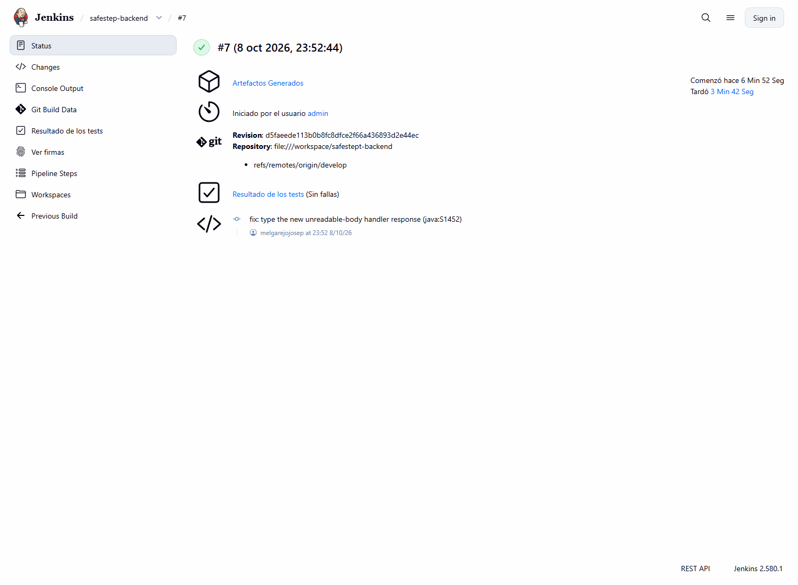
  <p><i><b>Figura 7.1.6.</b> Página de la ejecución #8 con sus artefactos archivados (JAR, Checkstyle, JaCoCo, Cucumber). <b>Fuente</b>: Elaboración propia</i></p>
</div>

**Compuerta de estilo (Checkstyle).** Desde el 8 de noviembre de 2026 la etapa 3 es una validación y no un reporte. Para comprobar que de verdad detiene el pipeline se creó, solo en el repositorio local, un commit temporal con una única infracción deliberada (una importación fuera de orden en `PaymentMethod.java`) y se ejecutó el job. La ejecución #4 falló en `Validate Checkstyle` con `You have 1 Checkstyle violation` y la consola indica que `Unit and BDD Tests` y las etapas siguientes se omitieron por el fallo anterior. Ese commit se descartó antes de publicar el repositorio, por lo que no consta en su historial. La ejecución #5, sobre el commit `1103ccf` con el backend sin infracciones (6.2.1.1), pasó todas las etapas, incluida `Validate Checkstyle`, con `You have 0 Checkstyle violations`.

<div align="center">
  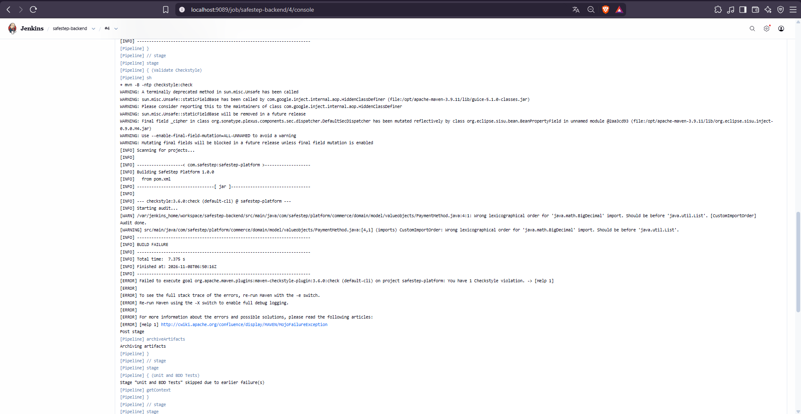
  <p><i><b>Figura 7.1.7.</b> Consola de la ejecución #4: <code>mvn checkstyle:check</code> detecta la importación fuera de orden (<code>CustomImportOrder</code>) y falla con <code>BUILD FAILURE</code>; la etapa <code>Unit and BDD Tests</code> se omite. <b>Fuente</b>: Elaboración propia</i></p>
</div>

<div align="center">
  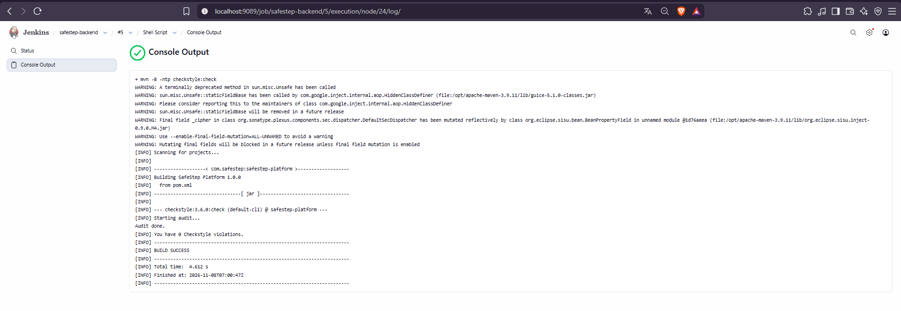
  <p><i><b>Figura 7.1.8.</b> Consola de la etapa <code>Validate Checkstyle</code> de la ejecución #5: <code>You have 0 Checkstyle violations</code> y <code>BUILD SUCCESS</code>. <b>Fuente</b>: Elaboración propia</i></p>
</div>

<div align="center">
  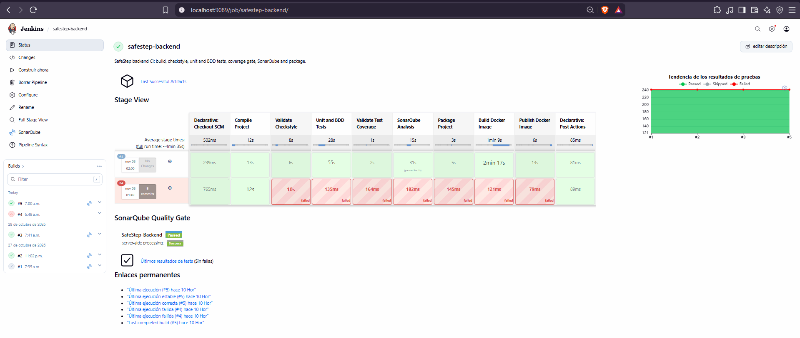
  <p><i><b>Figura 7.1.9.</b> Vista de etapas del job <code>safestep-backend</code>: la ejecución #5 (arriba) pasa las diez etapas y la ejecución #4 (abajo) aparece en rojo por la compuerta de estilo. <b>Fuente</b>: Elaboración propia</i></p>
</div>

**Ejecución con el perfil *Sonar way extended*.** El 8 de noviembre de 2026 se cambió el proyecto `safestep-backend` al perfil *Sonar way extended* y se corrigieron las incidencias que aparecieron (6.2.1.2). La ejecución #6, sobre `main` con las tres confirmaciones de esas correcciones (`7daa9dd`, `f105e82` y `d6afc1a`), pasó las diez entradas de la vista de etapas: 242 pruebas aprobadas sin fallos ni omisiones, cobertura de JaCoCo de 93.8 %, Quality Gate **Passed** y la imagen publicada en Docker Hub. Dura 3 min 58 s, y la etapa de SonarQube, que ahora no encuentra incidencias de mantenibilidad, tarda 36 s.

<div align="center">
  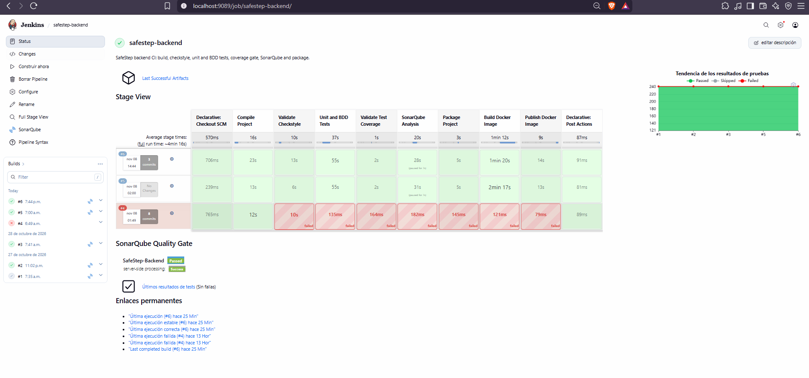
  <p><i><b>Figura 7.1.10.</b> Vista de etapas del job <code>safestep-backend</code>: la ejecución #6 (arriba) pasa todas las etapas con el perfil <i>Sonar way extended</i>, con el Quality Gate <i>Passed</i> y las pruebas sin fallos; la #5 es la ejecución verde de la compuerta de estilo y la #4 la ejecución roja. <b>Fuente</b>: Elaboración propia</i></p>
</div>

**Ejecución tras la política de recompensas.** El 9 de noviembre de 2026 el backend incorporó en el servidor el umbral de aprobación de 70 % y la reducción a la mitad por cada repetición aprobada (`c79a1be`) y la reparación de los datos semilla (`b6707df`). La ejecución #7, sobre `main` con esas dos confirmaciones, pasó las diez etapas: 260 pruebas aprobadas (18 más que en la #6) sin fallos ni omisiones, cobertura de JaCoCo de 93.9 %, Quality Gate **Passed**, 0 *code smells* y la imagen publicada de nuevo en Docker Hub. Dura 5 min 8 s, más que la #6 porque hay más pruebas y la etapa de construcción de la imagen tardó 1 min 37 s.

<div align="center">
  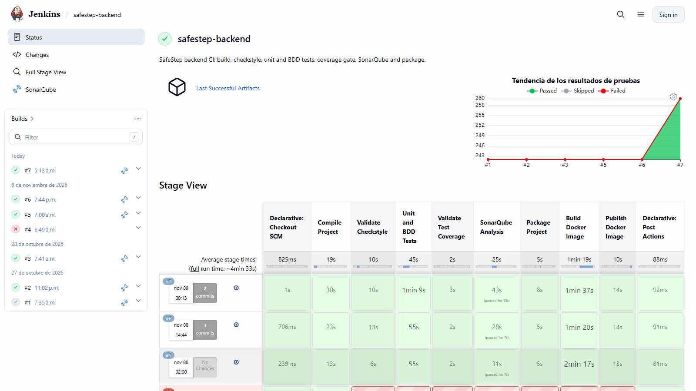
  <p><i><b>Figura 7.1.11.</b> Página del job <code>safestep-backend</code> tras la ejecución #7: tendencia de pruebas (de 242 a 260 aprobadas) y vista de etapas con todas las etapas en verde. <b>Fuente</b>: Elaboración propia</i></p>
</div>

**Cómo reproducir el entorno de CI:**

```bash
cd safeStept-backend/ci
bash start-ci.sh          # SonarQube :9000, Jenkins :9089 (usuario admin, clave en ci/.env)
```

Jenkins ejecuta el job `safestep-backend` sobre la rama que declara `ci/jenkins/casc.yaml` (`main` en el entorno actual); también puede iniciarse manualmente desde la interfaz con *Build Now*.
