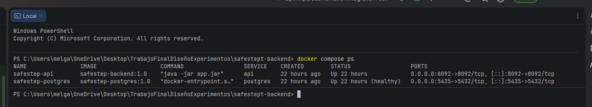
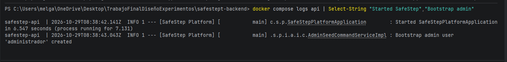
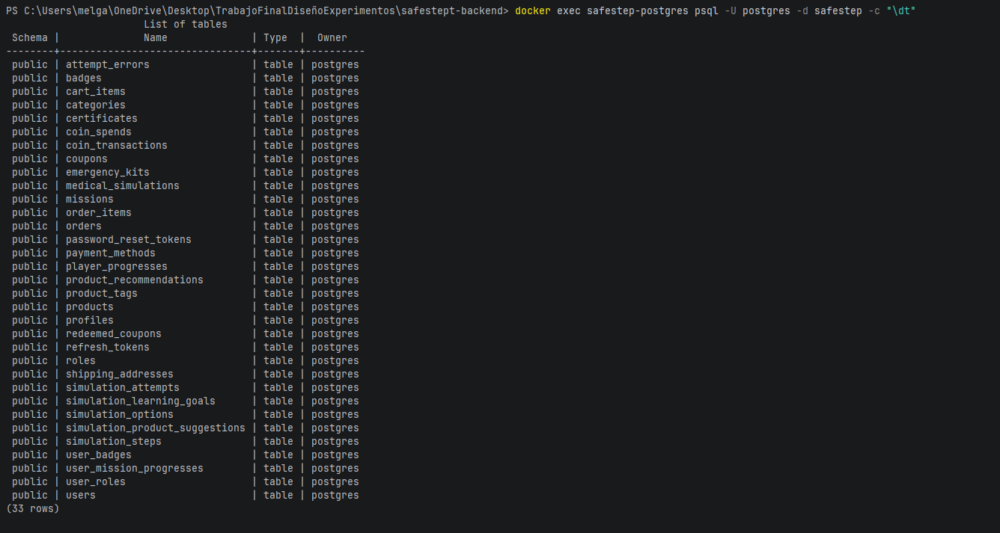
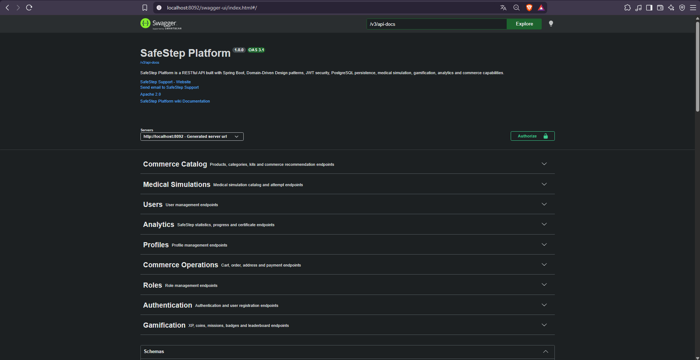
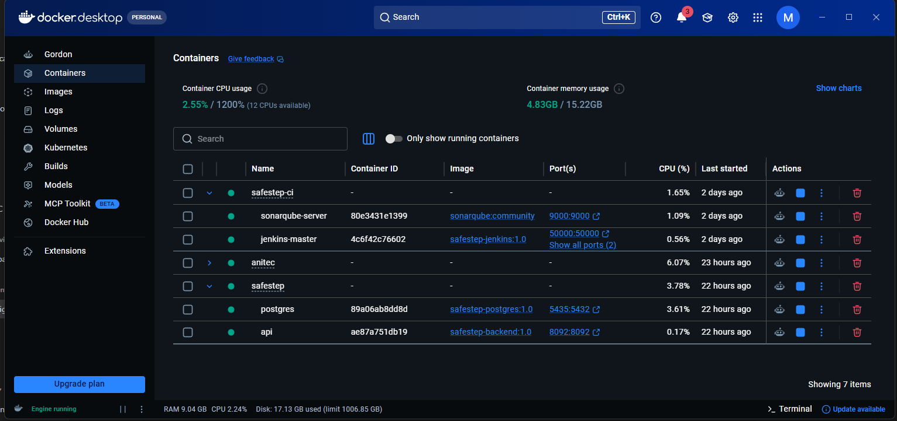

# 7.2. Continuous Delivery

La entrega continua extiende el pipeline de integración continua (7.1) con tres pasos: construir una **imagen Docker** de la aplicación, **versionarla** con el número de la ejecución que la produjo y **publicarla** en un registro. El resultado de cada ejecución exitosa deja de ser solo un archivo JAR y pasa a ser un artefacto autocontenido que cualquier equipo con Docker puede descargar y ejecutar sin instalar Java, Maven ni configurar el entorno.

La misma entrega incluye un **entorno local contenedorizado** de la aplicación: el backend y su base de datos PostgreSQL se levantan juntos con un único comando, de modo que cualquier integrante puede reproducir el sistema completo en su equipo. Las imágenes se construyen desde el mismo `Dockerfile` que utiliza Render para desplegar el backend (5.2.1.5.8).

El entorno de CI se reconstruyó con el script `ci/start-ci.sh`, por lo que el historial de ejecuciones de Jenkins que se cita en esta sección parte de la ejecución #1 y es independiente del historial citado en 7.1.

## 7.2.1. Tools and Practices

**Herramientas**

| Herramienta | Versión | Rol en la entrega continua |
|-------------|---------|----------------------------|
| Docker Desktop (motor Docker) | 4.96.0 (motor 29.9.1) | Construye y ejecuta las imágenes y los contenedores del equipo |
| Docker CLI y Buildx dentro de Jenkins | 29.9.2 y Buildx 0.38.1 | Permiten que el pipeline construya y publique imágenes usando el motor del anfitrión |
| Docker Compose | integrado en Docker Desktop | Define y levanta la aplicación (API y base de datos) y el entorno de CI |
| Jenkins | 2.580.1 (imagen `safestep-jenkins:1.0`) | Ejecuta las etapas de construcción y publicación |
| Jenkins Configuration as Code (JCasC) | plugin de la imagen de Jenkins | Declara la credencial de Docker Hub como código |
| Docker Hub | servicio en línea | Registro público donde se publica `melga135/safestep-backend` |
| Imagen `postgres:18-alpine` | PostgreSQL 18.6 | Base de datos del entorno local, con un script de inicialización propio |
| Imágenes `eclipse-temurin:26-jdk` y `26-jre` | Temurin 26 | Etapa de compilación y etapa de ejecución del `Dockerfile` del backend |

**Prácticas**

- **Un artefacto inmutable y versionado.** Cada ejecución publica la imagen con dos etiquetas: el número de la ejecución de Jenkins (por ejemplo `3`), que identifica de forma única qué código la produjo, y `latest`, que apunta a la más reciente.
- **Imagen construida en dos etapas.** La etapa de compilación usa el JDK 26 con Maven 3.9.11; la etapa de ejecución parte del JRE 26 y solo copia el JAR. La imagen final no contiene el código fuente, Maven ni el JDK.
- **Contexto de construcción mínimo.** El archivo `.dockerignore` excluye `target/`, `ci/`, `api-tests/`, `docker/`, `.git`, los archivos `.env` y el propio `Jenkinsfile`, de modo que Jenkins no envía carpetas pesadas ni secretos al motor de Docker.
- **Configuración por variables de entorno.** La imagen no contiene contraseñas ni claves: la conexión a la base de datos, el secreto de los tokens JWT y las claves de Stripe se inyectan al ejecutar el contenedor, tal como se hace en Render (5.2.1.5.8).
- **Secretos fuera del repositorio.** Las claves del entorno local viven en archivos `.env` que Git ignora; el repositorio solo incluye plantillas sin valores (`.env.example`). El token de Docker Hub nunca aparece en el `Jenkinsfile`: Jenkins lo entrega al paso de publicación como credencial y los registros de la ejecución lo ocultan.
- **Mínimo privilegio.** El token de Docker Hub tiene el permiso *Repo Read & Write*: puede subir imágenes, pero no borrarlas ni administrar la cuenta.
- **Cierre de sesión tras publicar.** La etapa de publicación ejecuta `docker logout` aunque falle, para no dejar la sesión guardada en el directorio de Jenkins.
- **Entorno reproducible como código.** El `docker-compose.yml` de la aplicación y el de CI, el `Dockerfile` de cada imagen y `casc.yaml` están versionados; reconstruir el entorno en otro equipo requiere solo completar el archivo `.env` de ese equipo.
- **Arranque ordenado.** La API espera a que PostgreSQL pase su verificación de salud antes de iniciarse, lo que evita errores de conexión durante el arranque.
- **Redes separadas.** La aplicación usa su propia red (`safestep_default`) y las herramientas de CI usan `spring-postgres-net`. Jenkins no necesita comunicarse con la API ni con la base de datos, porque las pruebas del pipeline usan una base en memoria y la construcción de imágenes se hace a través del socket de Docker.

**Entorno local contenedorizado de la aplicación**

El archivo `docker-compose.yml`, en la raíz de `safeStept-backend`, define dos servicios:

| Servicio | Imagen | Contenedor | Puerto en el equipo | Descripción |
|----------|--------|------------|---------------------|-------------|
| `postgres` | `safestep-postgres:1.0` (desde `docker/postgres/Dockerfile`) | `safestep-postgres` | `5435` | PostgreSQL 18 sobre Alpine. El script `init-scripts/01-create-database.sql` crea la base `safestep` la primera vez que arranca; las tablas las genera la aplicación (`ddl-auto=update`) |
| `api` | `safestep-backend:1.0` (desde el `Dockerfile` del backend) | `safestep-api` | `8092` | API REST de SafeStep con el perfil `prod` |

El puerto `5435` evita el conflicto con un PostgreSQL instalado directamente en el equipo (puerto `5432`). Los datos de la base se conservan en el volumen `safestep_pgdata`. Fragmento esencial del archivo:

```yaml
services:
  postgres:
    build: ./docker/postgres
    image: safestep-postgres:1.0
    container_name: safestep-postgres
    environment:
      POSTGRES_PASSWORD: "${POSTGRES_PASSWORD:?copy .env.example to .env and set POSTGRES_PASSWORD}"
    ports:
      - "5435:5432"
    volumes:
      - pgdata:/var/lib/postgresql
    healthcheck:
      test: ["CMD-SHELL", "pg_isready -U postgres -d safestep"]
      interval: 5s
      timeout: 3s
      retries: 10

  api:
    build: .
    image: safestep-backend:1.0
    container_name: safestep-api
    depends_on:
      postgres:
        condition: service_healthy
    environment:
      SPRING_PROFILES_ACTIVE: prod
      DATABASE_URL: postgres          # el nombre del servicio se resuelve dentro de la red de Compose
      DATABASE_NAME: safestep
      JWT_SECRET: "${JWT_SECRET:?copy .env.example to .env and set JWT_SECRET}"
    ports:
      - "8092:8092"
```

Las claves se leen del archivo `.env`. Si falta alguna obligatoria, Compose se detiene con un mensaje que indica qué completar.

| Variable (`.env`) | Uso | Secreto |
|-------------------|-----|---------|
| `POSTGRES_PASSWORD` | Contraseña del usuario `postgres`; la API la recibe como `DATABASE_PASSWORD` | Sí |
| `JWT_SECRET` | Clave de firma de los tokens, de al menos 40 caracteres | Sí |
| `SAFESTEP_ADMIN_USERNAME` y `SAFESTEP_ADMIN_PASSWORD` | Primer administrador, que se crea solo si ambas variables tienen valor (opcionales) | Sí |
| `STRIPE_SECRET_KEY` y `STRIPE_WEBHOOK_SECRET` | Claves de prueba de Stripe para el pago con tarjeta (opcionales) | Sí |

**Cómo levantarlo:**

```bash
cd safeStept-backend
copy .env.example .env            # en Linux o macOS: cp .env.example .env ; luego completar los valores
docker compose up -d --build
```

**Verificación realizada.** Con el entorno levantado desde cero (contenedores y volumen nuevos):

| Comprobación | Resultado |
|--------------|-----------|
| Base de datos | El servicio `postgres` pasó a `healthy` en unos 6 segundos |
| Arranque de la API | `Started SafeStepPlatformApplication in 10.947 seconds` |
| Esquema | 33 tablas creadas automáticamente en la base `safestep` |
| Administrador inicial | `Bootstrap admin user 'admin' created` (la variable de administrador estaba definida) |
| Documentación de la API | `http://localhost:8092/swagger-ui/index.html` responde HTTP 200 |
| Contrato OpenAPI | 73 operaciones publicadas en `/v3/api-docs` |
| Reconstrucción de imágenes con caché | 2.6 s |

<div align="center">
  
  <p><i><b>Figura 7.2.1.</b> Servicios de la aplicación en ejecución: <code>postgres</code> en estado <code>healthy</code> y <code>api</code> activo. <b>Fuente</b>: Elaboración propia</i></p>
</div>

<div align="center">
  
  <p><i><b>Figura 7.2.2.</b> Registro de arranque de la API (líneas filtradas del registro): la aplicación inicia y crea el administrador inicial. <b>Fuente</b>: Elaboración propia</i></p>
</div>

<div align="center">
  
  <p><i><b>Figura 7.2.3.</b> Tablas creadas por la aplicación en la base <code>safestep</code> del contenedor. <b>Fuente</b>: Elaboración propia</i></p>
</div>

<div align="center">
  
  <p><i><b>Figura 7.2.4.</b> Documentación Swagger servida por la API que corre en el contenedor. <b>Fuente</b>: Elaboración propia</i></p>
</div>

<div align="center">
  
  <p><i><b>Figura 7.2.5.</b> Contenedores del equipo en Docker Desktop: la aplicación (<code>safestep</code>) y las herramientas de CI (<code>safestep-ci</code>). <b>Fuente</b>: Elaboración propia</i></p>
</div>

**Docker dentro de Jenkins**

Para que el pipeline construya imágenes, el contenedor de Jenkins necesita dos cosas, ambas versionadas en `ci/`:

1. **El cliente de Docker.** El `Dockerfile` de Jenkins instala `docker-ce-cli` y `docker-buildx-plugin` desde el repositorio oficial de Docker para Debian. Se instala solo el cliente, no un motor adicional.
2. **El socket del motor del anfitrión.** El `docker-compose.yml` de `ci/` monta `/var/run/docker.sock` dentro de `jenkins-master`. Así, los comandos `docker` que ejecuta el pipeline los atiende el motor de Docker Desktop y las imágenes construidas quedan disponibles en el equipo.

**Riesgo asumido.** Montar el socket otorga al contenedor control casi total del motor de Docker del equipo. Se acepta en este entorno porque es local, de uso exclusivo del equipo, y porque es el procedimiento que describe el material del curso; no debe replicarse en un servidor compartido.

**Verificación.** Desde el contenedor, `docker version` muestra el cliente 29.9.2 de Jenkins y el servidor de Docker Desktop (motor 29.9.1), `docker buildx version` responde con la versión 0.38.1 y `docker ps` lista los contenedores del equipo, incluidos `safestep-api`, `safestep-postgres` y el propio Jenkins. Reconstruir la imagen de Jenkins tardó 33.6 s, porque Maven y el JDK 26 quedaron en caché.

> **[CAPTURA PENDIENTE · C-708]** **Archivo:** `markdown/assets/images/chapter-7/jenkins-docker-version.png` · **Pie:** *Figura 7.2.6.* Cliente de Docker dentro de Jenkins conectado al motor del anfitrión a través del socket. · **Qué capturar:** la salida de `docker exec jenkins-master docker version` con los bloques *Client* y *Server*. · **Cómo:** ejecuta el comando en CMD (con `safestep-ci` encendido) y captura la salida completa.

**Credencial de Docker Hub como código**

La credencial `DOCKER_HUB_CREDENTIALS` (tipo *Username with password*) se declara en `ci/jenkins/casc.yaml` y toma sus valores de las variables `DOCKER_HUB_USER` y `DOCKER_HUB_TOKEN` del archivo `ci/.env`, que Git ignora:

```yaml
credentials:
  system:
    domainCredentials:
      - credentials:
          - usernamePassword:
              scope: GLOBAL
              id: "DOCKER_HUB_CREDENTIALS"
              description: "Docker Hub access token"
              username: "${DOCKER_HUB_USER:-}"
              password: "${DOCKER_HUB_TOKEN:-}"
```

El token se generó en Docker Hub (*Account Settings → Personal access tokens*) con la descripción `jenkins-token` y el permiso *Repo Read & Write*. Se eligió declarar la credencial en `casc.yaml` en lugar de crearla a mano en la interfaz de Jenkins para que se aplique en cada arranque y pueda reproducirse en otro equipo completando solo su `.env`. Se asume, sin haberlo comprobado, que una credencial creada manualmente podría perderse al reconstruir Jenkins, porque JCasC reaplica su configuración. La verificación se hizo en dos niveles: dentro del contenedor, `DOCKER_HUB_USER` vale `melga135` y el token tiene los 36 caracteres propios de un token de Docker Hub; y en Jenkins, la credencial aparece junto con `sonarqube-token-id`.

> **[CAPTURA PENDIENTE · C-709]** **Archivo:** `markdown/assets/images/chapter-7/jenkins-credencial-dockerhub.png` · **Pie:** *Figura 7.2.7.* Credenciales globales de Jenkins: el token de SonarQube y el de Docker Hub (sin mostrar sus valores). · **Qué capturar:** la lista de credenciales con los identificadores `sonarqube-token-id` y `DOCKER_HUB_CREDENTIALS` y su tipo. · **Cómo:** en Jenkins, *Manage Jenkins → Credentials → System → Global credentials*. No abras ni edites la credencial, y no captures el archivo `.env`.

## 7.2.2. Stages Deployment Pipeline Components

A las siete etapas de integración continua (7.1.2) se suman dos etapas de entrega. El flujo completo, desde el repositorio hasta el registro, es el siguiente:

```text
Repositorio (main)
   └─► Jenkins ─► [1-7: compilar, estilo, pruebas, cobertura, SonarQube, empaquetar]
                  └─► 8. Build Docker Image ─► imagen safestep-backend:<n> y :latest (en el motor local)
                       └─► 9. Publish Docker Image ─► Docker Hub: melga135/safestep-backend:<n> y :latest
```

| # | Etapa | Comando | Qué verifica o produce | Si falla | Tiempo (ejecución #3) |
|---|-------|---------|------------------------|----------|-----------------------|
| 8 | Build Docker Image | `docker buildx build --platform linux/amd64 -t safestep-backend:<n> -t safestep-backend:latest --load .` | Construye la imagen con el `Dockerfile` del repositorio (compila y empaqueta el proyecto en su propia etapa de construcción) y la deja en el motor de Docker local | Se detiene; no se publica nada | 2 min 21 s |
| 9 | Publish Docker Image | `docker login`, `docker tag` y `docker push` | Inicia sesión con la credencial `DOCKER_HUB_CREDENTIALS`, etiqueta la imagen como `melga135/safestep-backend:<n>` y `:latest` y las sube a Docker Hub | Se detiene; la imagen queda solo en el equipo | 15 s |

Las etapas se definen en el `Jenkinsfile` del backend. La variable `REGISTRY_USER` identifica la cuenta de Docker Hub, y el secreto se entrega como variable de entorno al shell, sin pasar por la interpolación de Groovy:

```groovy
environment {
  IMAGE_NAME    = 'safestep-backend'
  TAG           = "${env.BUILD_NUMBER}"
  REGISTRY_USER = 'melga135'
}

stage('Build Docker Image') {
  steps {
    sh 'docker version --format "Docker engine: {{.Server.Version}}"'
    sh "docker buildx build --platform linux/amd64 -t ${IMAGE_NAME}:${TAG} -t ${IMAGE_NAME}:latest --load ."
    sh "docker image ls ${IMAGE_NAME}"
  }
}

stage('Publish Docker Image') {
  steps {
    withCredentials([usernamePassword(credentialsId: 'DOCKER_HUB_CREDENTIALS',
                                      usernameVariable: 'DOCKER_USER', passwordVariable: 'DOCKER_PASS')]) {
      sh '''
        echo "$DOCKER_PASS" | docker login -u "$DOCKER_USER" --password-stdin
        docker tag "$IMAGE_NAME:$TAG" "$REGISTRY_USER/$IMAGE_NAME:$TAG"
        docker tag "$IMAGE_NAME:latest" "$REGISTRY_USER/$IMAGE_NAME:latest"
        docker push "$REGISTRY_USER/$IMAGE_NAME:$TAG"
        docker push "$REGISTRY_USER/$IMAGE_NAME:latest"
      '''
    }
  }
  post {
    always {
      sh 'docker logout || true'
    }
  }
}
```

El `Jenkinsfile` se validó con el verificador declarativo de Jenkins antes de cada cambio. Como el job lee la versión **confirmada** (commit) de la rama `main`, cada cambio al pipeline se confirmó antes de probarlo.

**Resultado de la ejecución #3 (SUCCESS, 5 min 4 s).** Las diez entradas de la vista de etapas terminaron en verde, incluidas las dos etapas nuevas:

| Etapa | Duración |
|-------|----------|
| Declarative: Checkout SCM | 427 ms |
| Compile Project | 38 s |
| Checkstyle Report | 16 s |
| Unit and BDD Tests | 42 s |
| Validate Test Coverage | 2 s |
| SonarQube Analysis | 26 s (5 s de espera del Quality Gate) |
| Package Project | 8 s |
| **Build Docker Image** | **2 min 21 s** |
| **Publish Docker Image** | **15 s** |
| Declarative: Post Actions | 58 ms |

El Quality Gate de `SafeStep-Backend` quedó en `Passed` y las 242 pruebas del backend se aprobaron, sin fallos ni omisiones.

> **[CAPTURA PENDIENTE · C-710]** **Archivo:** `markdown/assets/images/chapter-7/jenkins-ejecucion-3-etapas.png` · **Pie:** *Figura 7.2.8.* Vista de etapas del job `safestep-backend` (ejecución #3) con las etapas de construcción y publicación de la imagen. · **Qué capturar:** la *Stage View* con la fila de la ejecución #3 y las 10 columnas en verde, más el recuadro del Quality Gate (`Passed`) y el resultado de pruebas. · **Cómo:** en Jenkins, abre el job `safestep-backend` y, si solo aparece una fila, usa *Full Stage View*. Captura de modo que se lean los nombres de las etapas.

> **[CAPTURA PENDIENTE · C-711]** **Archivo:** `markdown/assets/images/chapter-7/jenkins-build-docker-image-consola.png` · **Pie:** *Figura 7.2.9.* Registro de la etapa *Build Docker Image*: construcción de la imagen con Buildx. · **Qué capturar:** el tramo del *Console Output* de la ejecución #3 que muestra la etapa `Build Docker Image`, donde se lea el `docker buildx build` y las líneas finales `naming to docker.io/library/safestep-backend:3`. · **Cómo:** ejecución #3 → *Console Output*; busca `Build Docker Image` (Ctrl+F) y captura ese tramo.

> **[CAPTURA PENDIENTE · C-712]** **Archivo:** `markdown/assets/images/chapter-7/jenkins-publish-docker-image-consola.png` · **Pie:** *Figura 7.2.10.* Registro de la etapa *Publish Docker Image*: inicio de sesión y subida de las etiquetas a Docker Hub. · **Qué capturar:** el tramo del *Console Output* con `docker login`, `Login Succeeded`, los `docker push` y los *digest* de las etiquetas `3` y `latest`. · **Cómo:** en la misma página, busca `Publish Docker Image` y captura ese tramo. Jenkins oculta el token con `****`; verifica que no aparezca en claro antes de usar la imagen.

**Evidencia de la publicación.** El repositorio `melga135/safestep-backend` se creó de forma manual en Docker Hub **antes** de la primera subida, con visibilidad **pública**: si se sube una imagen a un repositorio inexistente, Docker Hub lo crea público por defecto, por lo que se prefirió elegir la visibilidad de forma explícita. Después de la ejecución #3, la pestaña *Tags* muestra las etiquetas `3` y `latest` (imágenes para Linux, subidas minutos antes) y el repositorio ocupa 187.1 MB. Localmente, `docker image ls` muestra la imagen con un tamaño de contenido de 196 MB (645 MB de espacio en disco), mientras que Docker Hub informa 187.1 MB para el repositorio.

| Imagen local | Origen |
|--------------|--------|
| `safestep-backend:1.0` | Construida con Docker Compose para el entorno local |
| `safestep-backend:2` | Construida por Jenkins en la ejecución #2 con `--load`; no se publicó |
| `safestep-backend:3` y `safestep-backend:latest` | Construidas por Jenkins en la ejecución #3 (la etiqueta `latest` pasa a apuntar a la imagen más reciente) |
| `melga135/safestep-backend:3` y `melga135/safestep-backend:latest` | La misma imagen de la ejecución #3 con el nombre del repositorio de Docker Hub; es lo que se publica |

> **[CAPTURA PENDIENTE · C-713]** **Archivo:** `markdown/assets/images/chapter-7/dockerhub-tags.png` · **Pie:** *Figura 7.2.11.* Etiquetas publicadas en Docker Hub por el pipeline (`3` y `latest`). · **Qué capturar:** la pestaña *Tags* del repositorio `melga135/safestep-backend`, con las dos etiquetas, el sistema operativo y la fecha de subida. · **Cómo:** hub.docker.com → *Repositories* → `safestep-backend` → *Tags*. Si ya ejecutaste más builds, aparecerán etiquetas adicionales; está bien.

> **[CAPTURA PENDIENTE · C-714]** **Archivo:** `markdown/assets/images/chapter-7/dockerhub-repositorio.png` · **Pie:** *Figura 7.2.12.* Repositorio público `melga135/safestep-backend` en Docker Hub. · **Qué capturar:** la página *General* del repositorio, donde se vean el nombre, el candado/estado público, la descripción, el tamaño y la fecha de la última subida. · **Cómo:** hub.docker.com → `melga135/safestep-backend`. No incluyas la configuración de tokens ni datos de facturación.

> **[CAPTURA PENDIENTE · C-715]** **Archivo:** `markdown/assets/images/chapter-7/docker-image-ls.png` · **Pie:** *Figura 7.2.13.* Imágenes del backend en el equipo: la del entorno local y las construidas por Jenkins. · **Qué capturar:** la salida de `docker image ls` filtrada por `safestep-backend` y por `melga135/safestep-backend`, con etiquetas, identificadores y tamaños. · **Cómo:** en CMD, ejecuta `docker image ls safestep-backend` y `docker image ls melga135/safestep-backend`, y captura ambas salidas juntas.

**Consumo de la imagen publicada.** Cualquier persona puede descargar la imagen sin iniciar sesión, porque el repositorio es público:

```bash
docker pull melga135/safestep-backend:latest
```

Para ejecutarla necesita una base PostgreSQL y las mismas variables de entorno del perfil `prod` que usa el entorno local (`DATABASE_URL`, `DATABASE_PORT`, `DATABASE_NAME`, `DATABASE_USER`, `DATABASE_PASSWORD` y `JWT_SECRET`). Una prueba equivalente se realizó con la imagen construida localmente, conectada a un contenedor de PostgreSQL en la misma red.

> **[CAPTURA PENDIENTE · C-716]** **Archivo:** `markdown/assets/images/chapter-7/docker-pull-imagen-publicada.png` · **Pie:** *Figura 7.2.14.* Descarga de la imagen publicada desde Docker Hub. · **Qué capturar:** la salida de `docker pull melga135/safestep-backend:latest` mostrando la descarga de capas (no el mensaje «Image is up to date»). · **Cómo:** primero borra las copias locales con `docker rmi melga135/safestep-backend:latest melga135/safestep-backend:3` y luego ejecuta el `docker pull`. Así se ve la descarga real desde internet.

**Historial de ejecuciones del entorno reconstruido:**

| Ejecución | Resultado | Qué ocurrió |
|-----------|-----------|-------------|
| #1 | ABORTED | Las etapas de compilación, estilo, pruebas y cobertura terminaron en verde. En la etapa de SonarQube, el análisis terminó bien, pero Jenkins esperó 10 minutos el resultado del Quality Gate porque SonarQube no pudo entregar el aviso (*webhook*): rechaza por defecto direcciones privadas y `jenkins-master` resuelve a una dirección privada de la red de Docker. Se resolvió con `SONAR_VALIDATEWEBHOOKS: "false"` en el servicio de SonarQube del `docker-compose.yml` de `ci/` (7.1.2) |
| #2 | SUCCESS | Nueve entradas en la vista de etapas, incluida *Build Docker Image* con `--load`. Quality Gate aprobado |
| #3 | SUCCESS | Diez entradas en la vista de etapas: se agrega *Publish Docker Image*. Imagen publicada en Docker Hub |

**Limitaciones y mejoras identificadas.**

- **La imagen vuelve a compilar y a probar el código.** El `Dockerfile` ejecuta `mvn clean package` en su etapa de construcción, de modo que las pruebas corren una segunda vez dentro de la imagen y la etapa tarda 2 min 21 s. Una mejora sería reutilizar el JAR que ya generó la etapa *Package Project*.
- **Se publica en cada ejecución exitosa,** sin una aprobación manual intermedia. Es coherente con una entrega continua, pero para un entorno productivo convendría publicar solo desde ramas o etiquetas de liberación.
- **El token de Docker Hub no tiene fecha de vencimiento.** Se mitiga con el permiso mínimo y con la posibilidad de revocarlo en cualquier momento desde Docker Hub.
- **Sin análisis de vulnerabilidades de la imagen.** Docker Scout está inactivo en el repositorio; activarlo sería el siguiente paso de seguridad.
- **Una sola plataforma (`linux/amd64`).** Equipos con procesadores ARM ejecutarían la imagen mediante emulación.
- **La publicación no despliega.** El backend en producción se construye en Render a partir del repositorio y su `Dockerfile` (5.2.1.5.8); la imagen de Docker Hub no alimenta ese despliegue. El despliegue continuo se trata en 7.3.
- **El frontend y la landing page no están contenedorizados.** El frontend se publica como sitio estático en Render y la landing page en GitHub Pages.
