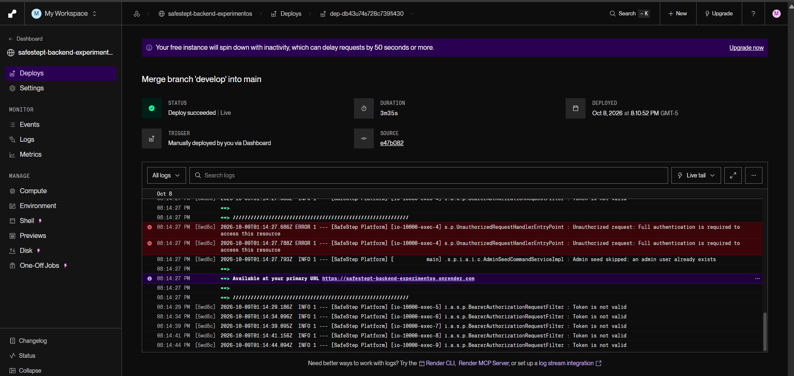
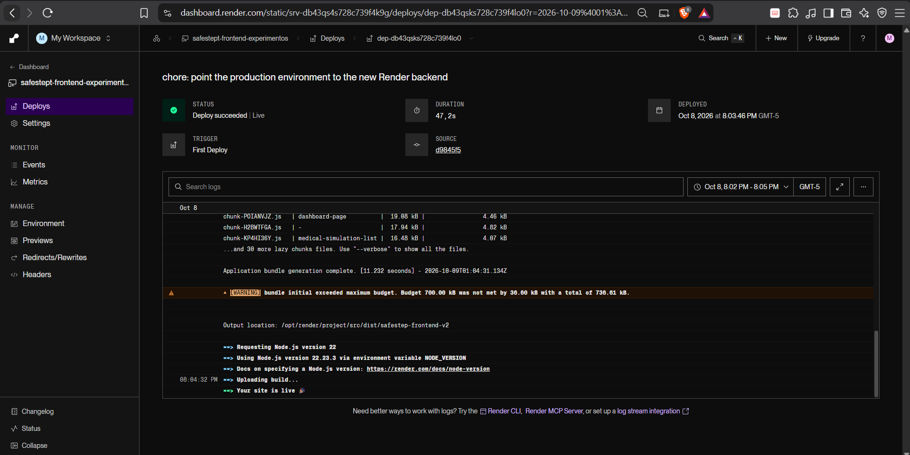
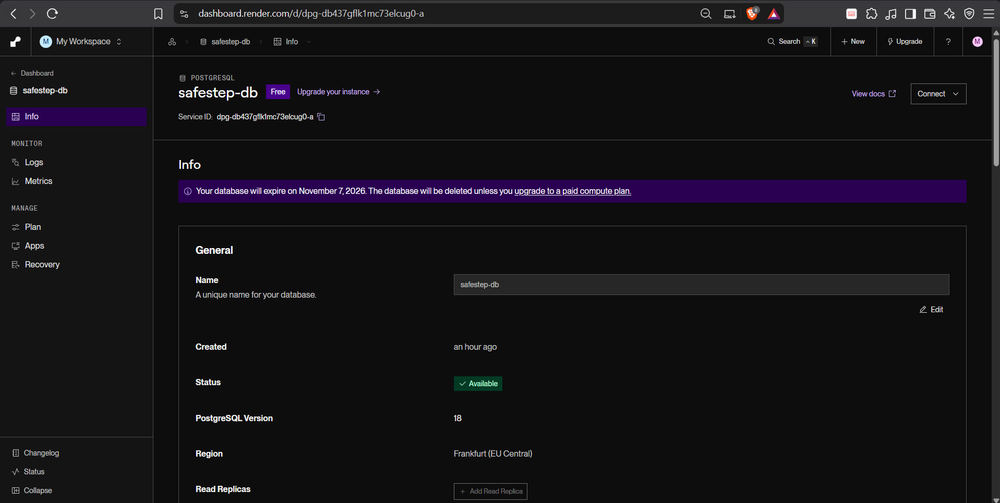
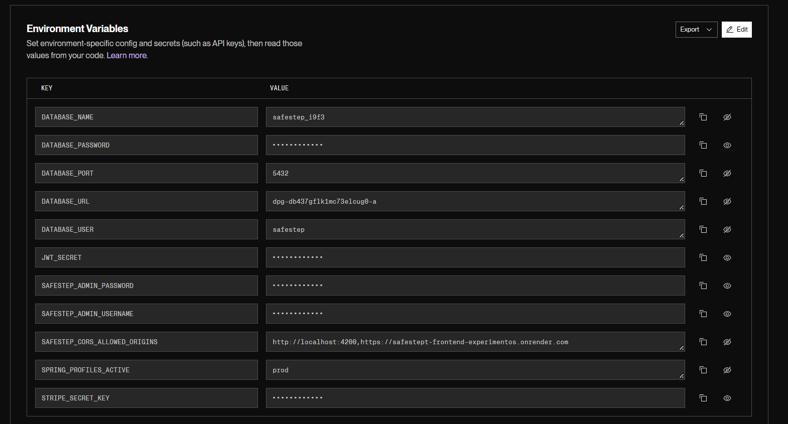
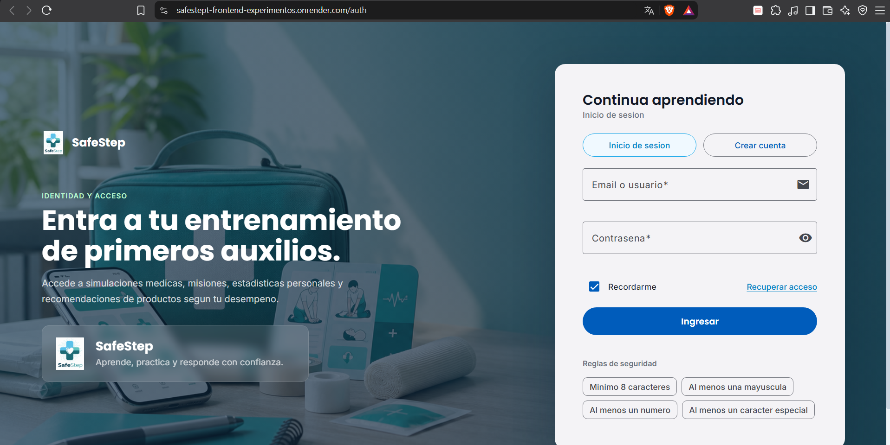

# 7.3. Continuous deployment

El despliegue continuo lleva a producción, de forma automática, cada cambio que llega a la rama principal. En SafeStep el entorno de producción vive en **Render**, en la región de Frankfurt, y publica los tres componentes del producto: la base de datos PostgreSQL, el backend (API REST) y el frontend (aplicación Angular). La Landing Page se publica por separado en GitHub Pages. El detalle de la puesta en marcha inicial, con los comandos y capturas del Sprint 5, está en 5.2.1.5.8; esta sección describe las herramientas, las prácticas y los componentes del flujo de despliegue.

## 7.3.1. Tools and Practices

**Herramientas**

| Herramienta | Uso en el despliegue |
|-------------|----------------------|
| Render | Plataforma de alojamiento: ejecuta el backend, sirve el frontend y gestiona la base de datos |
| GitHub | Repositorios `safestept-backend` y `safestept-frontend`; la rama `main` es la fuente de cada despliegue |
| Docker | El backend se construye en Render a partir del `Dockerfile` del repositorio (el mismo que usa el pipeline de integración continua, 7.1) |
| Maven | Compila el backend y ejecuta sus pruebas dentro de la construcción de la imagen |
| npm y Angular CLI | Compilan el frontend (`npm ci && npm run build`) |
| PostgreSQL 18 | Base de datos gestionada por Render (`safestep-db`) |
| Swagger UI / OpenAPI | Se usa como verificación posterior al despliegue de que la API quedó publicada |

**Prácticas**

1. **La rama `main` es la de producción.** Solo se integra a `main` el código que ya pasó por `develop` (estrategia de ramas de 5.1.2). Render observa `main` en los dos repositorios.
2. **Despliegue automático al recibir un commit** (*Auto-Deploy: On Commit*) en el backend y en el frontend. No se copian archivos a mano ni se sube un paquete: el único gesto de publicación es integrar en `main`.
3. **Las pruebas se ejecutan antes de publicar.** El `Dockerfile` del backend compila con `mvn clean package`, que ejecuta toda la batería de pruebas. Si una prueba falla, la imagen no se construye y **Render conserva la versión anterior en línea**, de modo que un cambio roto no reemplaza al que funciona. En el despliegue del Sprint 5 se ejecutaron 238 pruebas sin fallos; la batería actual tiene 242 (6.1).
4. **La configuración sale del repositorio.** Las contraseñas, el secreto de firma de los tokens (`JWT_SECRET`), el usuario administrador inicial y la clave secreta de Stripe se definen como variables de entorno en Render y nunca se guardan en el código. El perfil de Spring `prod` activa la configuración de producción.
5. **CORS restringido por entorno.** El backend solo acepta peticiones de los orígenes listados en `SAFESTEP_CORS_ALLOWED_ORIGINS` (`http://localhost:4200` y la URL del frontend desplegado), práctica introducida al corregir la regla `java:S5122` de SonarQube (6.2.1.2).
6. **Verificación posterior al despliegue.** Después de cada despliegue grande se ejecutan pruebas de humo contra las URL públicas: carga del frontend y de sus rutas internas, publicación de Swagger y `/v3/api-docs`, respuesta 401 sin token, 400 ante JSON mal formado y comportamiento de CORS con un origen permitido y uno desconocido.
7. **Un solo origen de verdad para la imagen.** La misma definición (`Dockerfile`) produce la imagen que se construye en el pipeline de Jenkins, la que se publica en Docker Hub (`melga135/safestep-backend`) y la que construye Render, lo que reduce las diferencias entre los entornos.

## 7.3.2. Production Deployment Pipeline Components

El flujo de producción está formado por las siguientes etapas; Jenkins y SonarQube (7.1) verifican la calidad del código en el equipo del desarrollador, mientras que Render ejecuta el despliegue.

| # | Etapa | Dónde ocurre | Qué hace |
|---|-------|--------------|----------|
| 1 | Integración en `main` | GitHub | Se fusiona `develop` en `main` y se envía la rama al repositorio remoto |
| 2 | Detección del cambio | Render | El webhook de GitHub avisa a Render, que inicia un despliegue por cada servicio cuyo repositorio cambió |
| 3 | Construcción del backend | Render (runtime Docker) | Construye la imagen en dos fases: compila con Maven, **ejecuta las pruebas** y empaqueta el JAR; luego copia el JAR a una imagen mínima con JRE |
| 4 | Construcción del frontend | Render (Static Site) | Con Node.js 22 ejecuta `npm ci && npm run build` y genera `dist/safestep-frontend-v2/browser` |
| 5 | Publicación | Render | Arranca el backend con la configuración del entorno y publica los archivos estáticos del frontend; el estado pasa a *Deploy succeeded, Live* |
| 6 | Conexión con la base de datos | Render (red interna) | El backend se conecta a `safestep-db` mediante el hostname interno, accesible solo desde la misma región |
| 7 | Verificación | Equipo | Pruebas de humo contra las URL públicas (tabla de 5.2.1.5.8) |

**Recursos del entorno de producción**

| Componente | Recurso en Render | Tipo | Plan |
|------------|-------------------|------|------|
| Base de datos | `safestep-db` | PostgreSQL 18 (1 GB) | Free |
| Backend | `safestept-backend-experimentos` | Web Service, runtime Docker | Free |
| Frontend | `safestept-frontend-experimentos` | Static Site | Free |

**Reglas del frontend en producción.** El Static Site aplica una regla de reescritura de `/*` hacia `/index.html`; sin ella, las rutas internas de Angular (por ejemplo `/app/dashboard`) devolverían 404 al recargar la página. La compilación usa `NODE_VERSION=22`.

**Resultado de los primeros despliegues** (8 de octubre de 2026)

| Servicio | Commit | Disparador | Duración | Estado |
|----------|--------|------------|----------|--------|
| Frontend | `d9845f5` | Primer despliegue | 47 s | Deploy succeeded, Live |
| Backend | `e47b082` | Manual desde el panel | 3 min 35 s | Deploy succeeded, Live |

  
  
<i><b>Figura 7.3.1.</b> Despliegue del backend en Render: estado Deploy succeeded, Live. <b>Fuente</b>: Elaboración propia</i>

  
  
<i><b>Figura 7.3.2.</b> Despliegue del frontend en Render: estado Deploy succeeded, Live. <b>Fuente</b>: Elaboración propia</i>

  
  
<i><b>Figura 7.3.3.</b> Panel de la base de datos <code>safestep-db</code> en Render. <b>Fuente</b>: Elaboración propia</i>

  
  
<i><b>Figura 7.3.4.</b> Variables de entorno del backend en Render; los valores secretos aparecen ocultos. <b>Fuente</b>: Elaboración propia</i>

  
  
<i><b>Figura 7.3.5.</b> Frontend de SafeStep publicado en Render. <b>Fuente</b>: Elaboración propia</i>

**Limitaciones del entorno actual**

- **Jenkins no dispara el despliegue.** El pipeline de Jenkins (7.1) corre en el equipo del desarrollador y verifica el código, pero Render despliega por su propio webhook de GitHub. Por eso la publicación no espera el resultado del Quality Gate de SonarQube; la única compuerta previa a producción son las pruebas que ejecuta la construcción de la imagen.
- **Plan gratuito.** El backend se suspende tras unos 15 minutos sin tráfico y la primera petición posterior tarda al menos 50 segundos mientras Spring Boot arranca. La base de datos gratuita **caduca el 7 de noviembre de 2026** y debe migrarse o recrearse antes de esa fecha si el producto sigue en uso.
- **Presupuesto del paquete del frontend.** La compilación advierte que el paquete inicial (736.61 kB) supera en 36.6 kB el presupuesto de 700 kB.
- **Verificación manual.** Las pruebas de humo posteriores al despliegue se ejecutaron a mano; no forman parte de ninguna automatización.

**Mejoras previstas:** que el despliegue de Render se dispare solo cuando el pipeline de Jenkins apruebe el Quality Gate (por ejemplo, desactivando el despliegue automático y llamando al *deploy hook* de Render desde una etapa final del `Jenkinsfile`); automatizar las pruebas de humo con una etapa que consulte las URL públicas; y desplegar en Render la imagen ya publicada en Docker Hub en lugar de reconstruirla.
